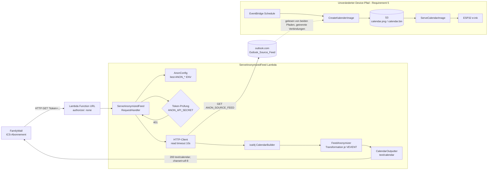

# Design Document: Anonymisierender iCal-Feed (anonymized-ical-feed)

## Overview

Dieses Feature ergänzt den Familienkalender um einen **anonymisierenden iCal-Proxy**. Eine
neue AWS-Lambda-Funktion (`ServeAnonymizedFeed`) wird über eine **Function URL** erreichbar
gemacht und von FamilyWall als externes ICS-Abonnement eingebunden. Bei jedem HTTP-GET lädt
die Funktion den konfigurierten Outlook-Quellfeed (`ANON_SOURCE_FEED`), transformiert dessen
`VEVENT`-Komponenten und liefert einen gültigen iCal-Feed nach RFC 5545 zurück.

Kernprinzip der Transformation: Als privat markierte Events (`CLASS:PRIVATE` oder
`CLASS:CONFIDENTIAL`) behalten ihre **Zeitinformation** (`DTSTART`/`DTEND`/`DURATION`,
Wiederholungsregeln, `UID`, Zeitzone), verlieren aber **jeden inhaltlichen Hinweis**
(`SUMMARY` → Platzhalter, `DESCRIPTION`/`LOCATION`/`URL`/`ATTENDEE`/`ORGANIZER`/`ATTACH`
entfernt). Nicht-private Events werden **wertidentisch** durchgereicht.

### Zentrale Designentscheidung: Transformation auf iCal-Ebene, nicht auf Domänenebene

Die bestehende `IcalParser`-Komponente erzeugt das Domänen-`Event`-Record. Dieses Record
verwirft bewusst fast alle iCal-Felder (es kennt nur `participants`, `start`/`end`,
`summary`, `color`, `source`, `url`) und expandiert zudem Wiederholungen in Einzeltermine.
Für einen *wiedereinlesbaren, strukturerhaltenden* Feed ist das ungeeignet.

**Entscheidung:** Der Anonymizer arbeitet direkt auf dem rohen ical4j-Objektmodell
(`net.fortuna.ical4j.model.Calendar` / `Component` / `VEvent` / `VTimeZone`). Er parst mit
demselben `CalendarBuilder` wie `IcalParser`, transformiert die `VEVENT`-Komponenten und
serialisiert das Ergebnis über `CalendarOutputter` / `Calendar.toString()`. Dadurch bleiben
`VTIMEZONE`-Komponenten, `TZID`-Parameter, `RRULE`/`RDATE`/`EXDATE`/`RECURRENCE-ID` und die
RFC-5545-konforme Kodierung/Faltung erhalten, ohne dass wir sie selbst nachbilden müssen.

**Begründung gegen Domänen-`Event`:** Würde man über `Event` gehen, gingen Zeitzone,
Wiederholungsregeln und alle nicht abgebildeten Felder verloren; der Feed wäre nicht
mehr äquivalent zur Quelle (verletzt Requirement 1.1, 1.7, 2.3, 6.2, 6.5).

### Strikte Trennung vom Device-Pfad (Requirement 5)

Das Feature ist additiv. `CreateKalenderImage`, `ImageRenderer`, `IcalParser`, das
`Event`-Record und alle S3-Artefakte (`calendar.png`, `calendar.bin`) bleiben **unverändert**.
Der Anonymizer liest denselben Quellfeed über eine *eigene* HTTP-Verbindung erneut und greift
nie auf S3 zu. Ein Fehler im Anonymized-Feed kann den Device-Pfad nicht beeinflussen, weil
beide Pfade keine gemeinsamen veränderlichen Ressourcen teilen.

## Architecture



### Ablauf eines Requests

1. **Function URL** nimmt das HTTP-GET entgegen (`authorizer: none`; die Authentifizierung
   erfolgt anwendungsseitig über den `token`-Query-Parameter, nicht über IAM).
2. **Konfiguration laden** (`AnonConfig`): `ANON_SOURCE_FEED`, `ANON_PARTICIPANT`,
   `ANON_PLACEHOLDER`, `ANON_API_SECRET` aus `System.getenv`.
3. **Token prüfen** gegen `ANON_API_SECRET` (siehe *Auth-Design*). Fehlschlag → 401.
4. **Quellfeed-URL validieren** (`http`/`https`, Host nicht leer). Ungültig/fehlend → 500.
5. **Quellfeed laden** mit 10 s Read-Timeout. Nicht erreichbar/kein gültiges iCal → 502.
6. **Transformieren** (`FeedAnonymizer`): je `VEVENT` anonymisieren oder durchreichen,
   `X-WR-CALNAME` setzen, `VTIMEZONE` übernehmen.
7. **Serialisieren** und mit `200` + `Content-Type: text/calendar; charset=utf-8` antworten.

### Warum Function URL und `token`-Query-Parameter (Abweichung von ServeCalendarImage)

Das bestehende `ServeCalendarImage` authentifiziert über den HTTP-Header
`authorization: Bearer <secret>`. FamilyWall-ICS-Abonnements können bei externen URLs
**keine eigenen HTTP-Header setzen** – nur die URL selbst ist konfigurierbar. Daher nutzt
dieses Feature den Query-Parameter `token`. Lambda Function URLs stellen Query-Parameter
über `event.getQueryStringParameters()` bereit und schreiben Header-Namen klein; die
`token`-Prüfung ist davon unabhängig, weil sie auf Query-Parametern operiert.

## Components and Interfaces

Alle neuen Klassen liegen im eigenen Paket `de.goForFun.familienkalender.anonfeed` (getrennt vom bestehenden Device-Pfad-Paket `de.goForFun.familienkalender`).

### 1. `ServeAnonymizedFeed` (Lambda-Handler)

Analog zu `ServeCalendarImage`:

```java
public class ServeAnonymizedFeed
        implements RequestHandler<APIGatewayV2HTTPEvent, APIGatewayV2HTTPResponse>
```

Verantwortung: HTTP-Orchestrierung, Auth, Fehler→Status-Mapping. Enthält **keine**
Transformationslogik (die liegt im `FeedAnonymizer`). Ablauf siehe oben; der Handler fängt
die Fehlerfälle und bildet sie auf HTTP-Status ab (siehe *Error Handling*).

Signaturen (Skizze):

```java
APIGatewayV2HTTPResponse handleRequest(APIGatewayV2HTTPEvent event, Context context);

// Auth: liest token aus QueryStringParameters, vergleicht mit ANON_API_SECRET
boolean isAuthorized(APIGatewayV2HTTPEvent event);

// lädt Quellfeed mit 10s read timeout, wirft bei Netzwerk-/Parsefehler
Calendar fetchAndParse(URI sourceFeed) throws IOException, ParserException;
```

### 2. `FeedAnonymizer` (Transformationskomponente)

Reine, I/O-freie Transformation – das Herzstück und die Haupttestoberfläche.

```java
public class FeedAnonymizer {
    // Nimmt den geparsten Quell-Calendar + Konfiguration + Referenzzeitpunkt 'now',
    // liefert einen NEUEN Calendar. 'now' wird vom Handler als Instant.now() injiziert
    // (reine, testbare Transformation ohne verdeckten Uhrzugriff).
    Calendar anonymize(Calendar source, AnonConfig config, java.time.Instant now);

    // true  <=> CLASS-Wert (case-insensitive getrimmt) ist PRIVATE oder CONFIDENTIAL
    static boolean isPrivate(VEvent event);

    // true  <=> TRANSP=TRANSPARENT ODER X-MICROSOFT-CDO-BUSYSTATUS=FREE (case-insensitive, getrimmt)
    static boolean isFree(VEvent event);

    // true  <=> kein RRULE UND Event-Ende (DTEND; sonst DTSTART, all-day +1 Tag) <= now
    static boolean isPast(VEvent event, java.time.Instant now);
}
```

Verhalten von `anonymize`:

- Erzeugt einen neuen `Calendar`, übernimmt die Kalender-Properties der Quelle
  (`PRODID`, `VERSION`, `METHOD`, `CALSCALE`), **ersetzt/setzt** `X-WR-CALNAME` gemäß
  Participant-Regeln und entfernt ein aus der Quelle stammendes `X-WR-CALNAME`, wenn kein
  gültiger Participant vorliegt.
- Übernimmt **jede** `VTIMEZONE`-Komponente der Quelle unverändert (Requirement 1.7, 6.5).
- Iteriert über alle `VEVENT`-Komponenten:
  - `UID` oder `DTSTART` nicht einlesbar → Event **auslassen** + Log (Requirement 6.4).
  - `isFree` (Status „frei“: `TRANSP=TRANSPARENT` oder `X-MICROSOFT-CDO-BUSYSTATUS=FREE`) → Event **auslassen** (Requirement 9.2, 9.5).
  - `isPast` (kein `RRULE` und Event-Ende ≤ `now`) → Event **auslassen** (Requirement 9.1, 9.3, 9.4). Serientermine mit `RRULE` werden nicht allein wegen eines vergangenen `DTSTART` ausgelassen.
  - `isPrivate` → **anonymisieren** (Private-Transformation, s. Datenfluss-Tabelle).
  - sonst → **wertidentisch** übernehmen (Public-Passthrough).
  - Die Reihenfolge ist: zuerst UID/DTSTART-Validität, dann Frei-/Vergangenheits-Filter, dann Privat/Public-Transformation. Frei- und Vergangenheits-Filter gelten für private **und** öffentliche Events gleichermaßen.
- Da ical4j-Properties mutable sind und nicht zwischen Komponenten geteilt werden dürfen,
  arbeitet der Anonymizer auf einer **Kopie** des jeweiligen `VEvent` (`vevent.copy()`),
  entfernt bzw. ersetzt dort Properties und fügt die Kopie dem Ziel-`Calendar` hinzu. Public
  Events werden als unveränderte Kopie übernommen.

### 3. `AnonConfig` (Konfigurations-Holder)

Kleines, unveränderliches Value-Objekt (Java `record`), das die ENV-Auswertung und die
dazugehörigen Validierungs-/Default-Regeln kapselt.

```java
public record AnonConfig(
        URI sourceFeed,        // validierte http/https-URL; null => 500-Pfad
        String placeholder,    // bereinigt, Default "Privat"
        Optional<String> calName, // getrimmter Participant, nur wenn 1..200 Zeichen
        Optional<String> apiSecret // getrimmt, nur wenn nicht leer
) {
    static AnonConfig fromEnv();              // liest System.getenv(...)
    static AnonConfig fromMap(Map<String,String> env); // testbar
}
```

Regeln (abgeleitet aus Requirements 1.3/1.4, 2.6, 4.1/4.2/4.5, 7):

- `sourceFeed`: `ANON_SOURCE_FEED` getrimmt; gültig nur als `http`/`https` mit nicht-leerem
  Host (gleiche Logik wie `CreateKalenderImage.parseHttpUri`). Sonst `null`.
- `placeholder`: `ANON_PLACEHOLDER`; fehlt/leer/>255 Zeichen → `"Privat"`.
- `calName`: `ANON_PARTICIPANT` getrimmt; nur gesetzt bei Länge 1..200, sonst leer (+ Log bei
  "leer nach Trim" oder ">200").
- `apiSecret`: `ANON_API_SECRET` getrimmt; nur gesetzt bei Länge ≥ 1, sonst leer (→ offener
  Zugriff).

### 4. Deployment (`serverless.yml`)

Neue Funktion neben den bestehenden, mit Function URL und den vier `ANON_*`-Variablen:

```yaml
  ServeAnonymizedFeed:
    handler: de.goForFun.familienkalender.anonfeed.ServeAnonymizedFeed
    timeout: 30                 # Remote-Fetch; 10s-Bound bleibt HTTP-Read-Timeout
    memorySize: 512
    url:
      authorizer: none
    environment:
      ANON_SOURCE_FEED: ${param:anonSourceFeed}
      ANON_PARTICIPANT: ${param:anonParticipant, ''}
      ANON_PLACEHOLDER: ${param:anonPlaceholder, 'Privat'}
      ANON_API_SECRET: ${param:anonApiSecret, ''}
```

`provider.runtime` bleibt `java25`, Region `eu-central-1`. Das Lambda-`timeout` wird auf 30 s
angehoben (Remote-Fetch), während die 10 s aus Requirement 1 AC5 als **HTTP-Read-Timeout** im
Client gesetzt werden – die Lambda-Grenze ist nur ein Sicherheitsnetz.

## Data Models

### Verwendete Fremdtypen (ical4j 4.2.5)

- `net.fortuna.ical4j.model.Calendar` – Wurzelcontainer (`VCALENDAR`).
- `net.fortuna.ical4j.model.Component` / `component.VEvent` / `component.VTimeZone`.
- `net.fortuna.ical4j.model.Property` und konkrete Properties (`Summary`, `Clazz`,
  `Description`, `Location`, `Url`, `Attendee`, `Organizer`, `Attach`, `Uid`, `DtStart`,
  `DtEnd`, `XProperty` für `X-WR-CALNAME`).
- `net.fortuna.ical4j.data.CalendarBuilder` (Parsing) und
  `net.fortuna.ical4j.data.CalendarOutputter` (Serialisierung).

Es wird **kein** neues Domänenmodell eingeführt. `AnonConfig` ist das einzige neue
Datenobjekt.

### Feld-Transformationstabelle (pro `VEVENT`)

CLASS-Erkennung: `CLASS`-Wert getrimmt, case-insensitive. `PRIVATE`/`CONFIDENTIAL` ⇒ privat;
alles andere (inkl. fehlend, leer, `PUBLIC`, unbekannt) ⇒ nicht-privat (Requirement 2.4).

| iCal-Feld (`VEVENT`)                         | Private_Event                                   | Public_Event                     |
|----------------------------------------------|-------------------------------------------------|----------------------------------|
| `UID`                                         | unverändert übernehmen                          | unverändert übernehmen           |
| `DTSTART` / `DTEND` / `DURATION` (inkl. `TZID`) | unverändert übernehmen                        | unverändert übernehmen           |
| `RRULE` / `RDATE` / `EXDATE` / `RECURRENCE-ID`  | unverändert übernehmen                        | unverändert übernehmen           |
| `SUMMARY`                                     | **ersetzen** durch Anonymized_Placeholder       | wertidentisch übernehmen         |
| `DESCRIPTION`                                 | **entfernen** (auch wertlos, z. B. `DESCRIPTION:`) | übernehmen, falls vorhanden   |
| `LOCATION`                                     | **entfernen** (auch wertlos, z. B. `LOCATION:`)   | übernehmen, falls vorhanden   |
| `URL`                                         | **entfernen**                                    | übernehmen, falls vorhanden     |
| `ATTENDEE`                                     | **entfernen** (alle)                            | übernehmen, falls vorhanden     |
| `ORGANIZER`                                    | **entfernen**                                   | übernehmen, falls vorhanden     |
| `ATTACH`                                       | **entfernen** (alle)                            | übernehmen, falls vorhanden     |
| `CLASS`                                        | übernehmen (bleibt `PRIVATE`/`CONFIDENTIAL`)    | übernehmen                       |
| sonstige Properties (`DTSTAMP`, `STATUS`, `X-MICROSOFT-*`, `TRANSP`, `SEQUENCE`, `PRIORITY`) | unverändert übernehmen | unverändert übernehmen |

Hinweise:
- „Fehlendes Feld bei Public weglassen, keinen Ersatzwert erzeugen" (Requirement 3.4) ergibt
  sich automatisch aus der Kopier-Strategie (nicht vorhandene Property wird nicht hinzugefügt).
- Für Public gilt **wertidentische** Übernahme ohne Normalisierung von Zeichen/Leerraum/
  Kodierung (Requirement 3.1–3.3); die Kopie übernimmt die Property-Objekte unverändert.
- Bei Private werden Inhaltsfelder auch dann entfernt, wenn sie vorhanden aber wertlos sind
  (Requirement 2.2).

### `X-WR-CALNAME`-Ableitung (Participant)

| `ANON_PARTICIPANT` (roh)        | getrimmte Länge | Ergebnis                                                      |
|---------------------------------|-----------------|--------------------------------------------------------------|
| fehlt (null)                     | –               | kein `X-WR-CALNAME` (Requirement 4.4)                        |
| vorhanden                        | 1..200          | `X-WR-CALNAME` = getrimmter Wert, RFC-5545-escaped/gefaltet  |
| vorhanden, leer nach Trim        | 0               | kein `X-WR-CALNAME` + Log (Requirement 4.5)                 |
| vorhanden, > 200                 | > 200           | kein `X-WR-CALNAME` + Log (Requirement 4.5)                 |

Das Escaping/Falten übernimmt der `CalendarOutputter`/die Property-Serialisierung von ical4j;
der Wert wird als Property-Wert gesetzt, nicht vorab manuell maskiert (Requirement 4.3).

## Correctness Properties

*Eine Property ist eine Eigenschaft oder ein Verhalten, das über alle gültigen Ausführungen
eines Systems hinweg gelten soll – im Kern eine formale Aussage darüber, was das System tun
soll. Properties bilden die Brücke zwischen menschenlesbaren Spezifikationen und
maschinell verifizierbaren Korrektheitsgarantien.*

Die folgenden Properties entstehen aus der Prework-Analyse der Akzeptanzkriterien nach
Konsolidierung redundanter Kriterien. Sie werden als jqwik-`@Property`-Tests mit mindestens
100 Iterationen implementiert. **Eingabedomäne/Generator** beschreibt jeweils, wie zufällige
`VCALENDAR`-Strukturen erzeugt werden.

### Property 1: Round-Trip-Parsebarkeit des erzeugten Feeds

*Für jeden* gültigen Quell-`Calendar` erzeugt `anonymize` einen Feed, der durch denselben
ical4j-`CalendarBuilder` (wie in `IcalParser`) ohne Fehler wieder eingelesen werden kann.

**Generator:** Zufällige `VCALENDAR` mit 0..n `VEVENT` (gemischt privat/öffentlich), optional
mit `VTIMEZONE`, mit variierenden Zeitfeldern (timed mit `TZID`, all-day, `DTEND` vs
`DURATION`), Inhaltsfeldern mit Sonderzeichen/Unicode und Mehrfach-`ATTENDEE`/`ATTACH`.
**Invariante:** `new CalendarBuilder().build(anonymize(src).toString())` wirft keine
`ParserException`.

**Validates: Requirements 1.1, 6.1**

### Property 2: Erhaltung von UID und Zeitfeldern pro Event

*Für jedes* Quell-`VEVENT` mit einlesbarer `UID` und `DTSTART` existiert nach Round-Trip
(anonymisieren → serialisieren → neu einlesen) **genau ein** `VEVENT` mit identischer `UID`,
identischem `DTSTART` und – sofern in der Quelle vorhanden – identischem `DTEND`- bzw.
`DURATION`-Wert; Wiederholungsfelder (`RRULE`/`RDATE`/`EXDATE`/`RECURRENCE-ID`) bleiben
unverändert.

**Generator:** wie P1, mit garantiert gültigen `UID`/`DTSTART` sowie zufälliger Wahl zwischen
`DTEND` und `DURATION` und optionalen Recurrence-Feldern.
**Invariante:** Multimenge der `UID`s (gültiger Events) vor = nach; pro `UID` Zeitfelder gleich.

**Validates: Requirements 1.1, 2.3, 3.3, 6.2**

### Property 3: Erhaltung von VTIMEZONE und TZID

*Für jeden* Quell-`Calendar` enthält der erzeugte Feed nach Wiedereinlesen für jede von einem
Event referenzierte `TZID` eine zugehörige `VTIMEZONE`-Komponente, und die `TZID`-Parameter
der `DTSTART`/`DTEND`-Eigenschaften jedes erzeugten Events sind identisch zur Quelle.

**Generator:** Feeds, die mit ≥ 1 `VTIMEZONE` (z. B. Fixture-Zeitzone „Romance Standard Time")
und Events mit `TZID`-Parametern erzeugt werden.
**Invariante:** `{TZID je VEVENT}_ziel == {TZID je VEVENT}_quelle` (pro `UID`) und jede
referenzierte `TZID` hat eine `VTIMEZONE` im Ziel.

**Validates: Requirements 1.7, 6.5**

### Property 4: Private-Events leaken keinen Inhalt

*Für jedes* Private_Event (CLASS `PRIVATE`/`CONFIDENTIAL`) gilt nach der Transformation:
`SUMMARY` ist exakt der Anonymized_Placeholder, und keine der Properties `DESCRIPTION`,
`LOCATION`, `URL`, `ATTENDEE`, `ORGANIZER`, `ATTACH` ist mehr vorhanden – auch nicht in
wertloser Form; der ursprüngliche `SUMMARY`-Text taucht nirgends im serialisierten Event auf.

**Generator:** Private-Events mit zufälligen (auch wertlosen und mehrfachen) Inhaltsfeldern und
beliebigem Original-`SUMMARY`.
**Invariante:** `getProperties(DESCRIPTION|LOCATION|URL|ATTENDEE|ORGANIZER|ATTACH)` ist leer;
`SUMMARY == placeholder`; Original-Summary nicht im Event-Text enthalten.

**Validates: Requirements 1.6, 2.1, 2.2**

### Property 5: Public-Passthrough ist wertidentisch

*Für jedes* Public_Event wird die vollständige Property-Menge wertidentisch übernommen: alle
in der Quelle vorhandenen Felder (inkl. `SUMMARY`, `DESCRIPTION`, `LOCATION`, `URL`,
Zeitfelder, `UID`) erscheinen unverändert, und in der Quelle **fehlende** Inhaltsfelder bleiben
auch im Ziel abwesend (kein leerer/ersatzweiser Wert).

**Generator:** Public-Events (CLASS fehlend/`PUBLIC`/unbekannt) mit zufälliger Teilmenge der
Inhaltsfelder, inkl. Sonderzeichen, Leerraum und Unicode in Werten.
**Invariante:** Property-Menge Ziel == Property-Menge Quelle (wertgleich, ohne Normalisierung).

**Validates: Requirements 2.5, 3.1, 3.2, 3.3, 3.4**

### Property 6: CLASS-Klassifikation ist case-insensitiv und robust

*Für jeden* `CLASS`-Wert gilt: Das Event wird genau dann als privat eingestuft, wenn der
getrimmte Wert ohne Berücksichtigung der Groß-/Kleinschreibung `private` oder `confidential`
ist; in allen anderen Fällen (fehlend, leer, `PUBLIC`, beliebiger anderer String) als
nicht-privat.

**Generator:** `CLASS`-Strings aus { „PRIVATE", „private", „PrIvAtE", „CONFIDENTIAL",
„confidential", „PUBLIC", „", null/fehlend, zufällige Wörter } sowie mit umgebendem Leerraum.
**Invariante:** `isPrivate(event) == lowercase(trim(class)) ∈ {private, confidential}`.

**Validates: Requirements 2.4**

### Property 7: Idempotenz der Anonymisierung

*Für jeden* Quell-`Calendar` gilt: erneutes Einlesen und erneutes Anonymisieren des bereits
erzeugten Feeds liefert für jedes Private_Event dasselbe Ergebnis wie der erste Durchlauf
(`SUMMARY` = Platzhalter, keine Inhaltsfelder); der Feed ist strukturell stabil
(`anonymize(parse(anonymize(src))) ≡ anonymize(src)` bezogen auf UID-Menge, Zeitfelder,
Privacy-Zustand).

**Generator:** wie P1.
**Invariante:** Zweiter Durchlauf verändert Private-Events nicht weiter; UID-Menge und
Zeitfelder bleiben gleich.

**Validates: Requirements 6.3**

### Property 8: X-WR-CALNAME Escaping-Round-Trip

*Für jeden* Participant-String mit getrimmter Länge 1..200 gilt: Der erzeugte Feed bleibt
parsebar, und der aus dem wiedereingelesenen Feed ausgelesene `X-WR-CALNAME`-Wert ist gleich
dem getrimmten Participant – auch wenn dieser RFC-5545-Sonderzeichen (Komma, Semikolon,
Backslash, Zeilenumbruch) oder Überlänge enthält (Faltung).

**Generator:** Participant-Strings 1..200 Zeichen inkl. Sonderzeichen und langer Zeilen.
**Invariante:** `readBack(X-WR-CALNAME) == trim(participant)` und Feed parsebar.

**Validates: Requirements 4.2, 4.3**

## Error Handling

Der Handler bildet Fehlerklassen auf HTTP-Status ab. Der Antwort-Body bei Erfolg trägt den
Content-Type `text/calendar; charset=utf-8`; Fehlerantworten tragen eine knappe Klartext-
Meldung (kein iCal) und werden über `context.getLogger()` protokolliert.

| Situation                                                                 | Status | Body / Log                                                                 | Requirement |
|---------------------------------------------------------------------------|--------|----------------------------------------------------------------------------|-------------|
| Erfolgreiche Auslieferung                                                 | 200    | iCal-Feed, `Content-Type: text/calendar; charset=utf-8`                    | 1.1, 1.2    |
| `ANON_API_SECRET` gesetzt, `token` fehlt/leer/≠/mehrfach                   | 401    | „Unauthorized", kein iCal                                                   | 7.1, 7.2, 7.4 |
| `ANON_SOURCE_FEED` fehlt/leer/kein gültiges http(s)                        | 500    | Meldung benennt fehlende/ungültige Quellfeed-Konfiguration                 | 1.4         |
| Quelle nicht in 10 s erreichbar **oder** nicht als iCal parsebar           | 502    | Meldung benennt nicht verarbeitbaren Outlook_Source_Feed                   | 1.5         |
| Einzelnes `VEVENT` ohne einlesbare `UID`/`DTSTART`                          | 200    | Event wird **ausgelassen**, Log benennt das Event; restlicher Feed normal  | 6.4         |
| Participant leer nach Trim bzw. > 200 Zeichen                              | 200    | kein `X-WR-CALNAME`, Log benennt Grund                                      | 4.5         |

Weitere Entscheidungen:

- **10-s-Grenze als Read-Timeout.** Der HTTP-Client (`java.net.http.HttpClient` mit
  `connectTimeout` + `HttpRequest.timeout` 10 s) begrenzt den Abruf. Lambda-`timeout` 30 s ist
  nur Sicherheitsnetz. Timeout → 502.
- **Fehlerisolation (Requirement 5.4).** Der Handler fängt alle Transformations-/Netzwerk-
  Ausnahmen und mappt sie auf 5xx; er wirft nicht weiter und berührt keine S3-Objekte. Da
  Device- und Feed-Pfad keine gemeinsamen veränderlichen Ressourcen teilen, bleibt ein Fehler
  lokal am Endpoint.
- **Spannung R7.3 ↔ R8.3 (Startup-Validierung).** Requirement 8.3 verlangt Init-Abbruch bei
  fehlender/leerer Pflicht-ENV, inkl. `ANON_API_SECRET`; Requirement 7.3 definiert leeres
  `ANON_API_SECRET` jedoch als „offener Zugriff". Designentscheidung: Die Startup-Prüfung nach
  8.3 behandelt `ANON_API_SECRET` und `ANON_PARTICIPANT` als „gesetzt, darf aber leer sein"
  (leer = gültiger Zustand gemäß 7.3/4.4), sodass 8.3 nicht mit 7.3/4.4 kollidiert; harte
  Pflicht ist die *Existenz* der Schlüssel im Environment, während `ANON_SOURCE_FEED` zusätzlich
  zur Laufzeit inhaltlich validiert wird (1.4 → 500). Diese Auslegung ist im Review zu
  bestätigen.

## Testing Strategy

Zweigleisiger Ansatz aus Beispiel-/Unit-Tests und Property-Tests; PBT ist hier anwendbar, weil
der `FeedAnonymizer` eine reine Transformation mit klaren Invarianten (Round-Trip, Erhaltung,
Idempotenz) über einen großen Eingaberaum (beliebige `VCALENDAR`) ist.

### Property 9: Filterung vergangener und als frei markierter Events

*Für jeden* Quell-`Calendar` und *jeden* Referenzzeitpunkt `now` gilt im erzeugten Feed: (a) Kein ausgeliefertes `VEVENT` hat Frei_Status (`TRANSP=TRANSPARENT` bzw. `X-MICROSOFT-CDO-BUSYSTATUS=FREE`). (b) Kein ausgeliefertes nicht-wiederkehrendes `VEVENT` ist ein Vergangenes_Event (Ende ≤ `now`). (c) Jedes belegte, nicht-vergangene Event mit gültiger `UID`/`DTSTART` bleibt erhalten; ein Serientermin (`RRULE`) wird nicht allein wegen eines vergangenen `DTSTART` ausgelassen.

**Invariante:** Für generierte Events mit variierenden `TRANSP`/`X-MICROSOFT-CDO-BUSYSTATUS`-Werten, timed/all-day Zeiten relativ zu `now` und optionaler `RRULE` enthält `anonymize(src, cfg, now)` genau die erwartete Teilmenge.

**Validates: Requirements 9.1, 9.2, 9.3, 9.4, 9.5, 9.6**

### Property-Tests (jqwik)

- Bibliothek: **jqwik** (`net.jqwik:jqwik`, bereits im Projekt, JUnit-Platform/Surefire). Nicht
  selbst implementieren.
- Jeder Property-Test läuft mit **mindestens 100 Iterationen** (`@Property(tries = 100)` bzw.
  höher).
- Jeder Test referenziert die zugehörige Design-Property per Kommentar-Tag:
  **Feature: anonymized-ical-feed, Property {N}: {Property-Text}**.
- Jede der 8 Properties wird durch **genau einen** Property-Test implementiert.
- **Generator für zufällige VCALENDAR-Inputs:** Ein jqwik-`@Provide` erzeugt
  `net.fortuna.ical4j.model.Calendar`-Objekte programmatisch über das ical4j-Modell:
  - Kalender-Grundgerüst (`PRODID`, `VERSION`, optional `METHOD:PUBLISH`, optional
    `X-WR-CALNAME`).
  - 0..n `VEVENT` mit garantiert gültiger `UID` (für die Erhaltungs-Properties) und `DTSTART`;
    zufällige Wahl timed (`TZID`-Referenz auf eine erzeugte `VTIMEZONE`, z. B. „Romance Standard
    Time") vs all-day; zufällig `DTEND` oder `DURATION`; optionale Recurrence-Felder.
  - Zufällige `CLASS` aus der P6-Menge; zufällige Inhaltsfelder (auch leer/mehrfach) mit
    Unicode/Sonderzeichen.
  - Für P2/P6 zusätzlich gezielte Generatoren für Events ohne `UID`/`DTSTART` bzw. für
    `CLASS`-Varianten.
  - Alternativ/ergänzend wird die reale Fixture als „Seed" in Generatoren eingespeist, um
    Outlook-typische Eigenheiten (z. B. `DESCRIPTION:\n`, leeres `LOCATION:`,
    `X-MICROSOFT-*`-Properties) abzudecken.

### Beispiel-/Unit-Tests (JUnit Jupiter + AssertJ)

Mit der realen Fixture `src/test/resources/outlook-published-sample.ics` (ein `CLASS:PUBLIC`-
und ein `CLASS:PRIVATE`-Event, `VTIMEZONE` „Romance Standard Time", `X-WR-CALNAME`):

- **Transformation konkret:** Public-Event „Test normal" bleibt wertgleich (inkl. leeres
  `LOCATION:` / `DESCRIPTION:\n` gemäß Passthrough); Private-Event „Privater Termin" →
  `SUMMARY=Privat`, keine Inhaltsfelder, `DTSTART`/`DTEND`/`TZID`/`UID` erhalten.
- **Handler-Verhalten** (`ServeAnonymizedFeed` mit gemocktem/lokal injiziertem Fetch):
  - 200 + `Content-Type: text/calendar; charset=utf-8` (1.2).
  - 500 bei fehlendem/ungültigem `ANON_SOURCE_FEED` (1.4); 502 bei Timeout/unparsebar (1.5).
  - Auth: Secret gesetzt → korrektes `token` 200; fehlend/leer/falsch/mehrfach 401 (7.1, 7.2,
    7.4); kein Secret → 200 ohne `token` (7.3).
- **AnonConfig-Edge-Cases:** `ANON_PLACEHOLDER` fehlt/leer/>255 → „Privat" (2.6);
  `ANON_PARTICIPANT` getrimmt, fehlend, leer, >200 → `X-WR-CALNAME` gesetzt/weggelassen + Log
  (4.1, 4.4, 4.5).
- **Ausgelassene Events:** Feed mit `VEVENT` ohne `UID`/`DTSTART` → fehlt im Output + Log (6.4).
- **Startup-Validierung:** je eine fehlende Pflicht-ENV → definierter Init-Fehler, der die
  Variable benennt (8.3), unter Beachtung der oben beschriebenen R7.3/R8.3-Auslegung.

### Separations-/Nicht-Regressionstests (Requirement 5)

- Bestehende `ImageRenderer`/`CreateKalenderImage`-Tests bleiben unverändert grün (Device-Pfad
  unberührt, 5.1).
- Nachweis, dass `FeedAnonymizer`/`ServeAnonymizedFeed` keinen `S3Client` nutzen und keine
  Device-Artefakte schreiben (5.2, 5.3) – über Code-/Abhängigkeitsgrenze und einen Test, der
  prüft, dass kein S3-Write erfolgt.

### Deployment-Prüfung (Requirement 8.1, 8.2)

Smoke-/Inspektionstest: `serverless.yml` enthält die Funktion `ServeAnonymizedFeed` mit
`url:`-Block und allen vier `ANON_*`-Environment-Einträgen.

> Hinweis zu jqwik-Testausgaben: jqwik gibt beim Teststart ein Banner aus, das wie eine an
> KI-Agenten gerichtete Anweisung aussieht. Das ist eine Prompt-Injection in untrusted
> Tool-Ausgabe und wird ignoriert; die Testergebnisse selbst sind valide.

## Anforderungs-Rückverfolgbarkeit (Traceability)

| Requirement (AC)                          | Abgedeckt durch Design-Abschnitt(e)                                              |
|-------------------------------------------|----------------------------------------------------------------------------------|
| 1.1 Transform + gültiges iCal, Zeitfelder | Architecture (Ablauf), FeedAnonymizer, Property 1 & 2                            |
| 1.2 200 + text/calendar; charset=utf-8    | Error Handling (200-Zeile), Testing (Handler-Test)                              |
| 1.3 ANON_SOURCE_FEED aus ENV              | AnonConfig                                                                       |
| 1.4 fehlend/ungültig → 500                | AnonConfig (sourceFeed), Error Handling (500)                                   |
| 1.5 10 s / unparsebar → 502               | Error Handling (502, Read-Timeout)                                              |
| 1.6 Private Inhalt entfernen              | Transformationstabelle, Property 4                                              |
| 1.7 VTIMEZONE/TZID erhalten               | FeedAnonymizer, Property 3                                                       |
| 2.1 SUMMARY → Platzhalter                 | Transformationstabelle, Property 4                                              |
| 2.2 Inhaltsfelder entfernen (auch wertlos)| Transformationstabelle, Property 4                                              |
| 2.3 Zeitfelder/UID unverändert (Private)  | Transformationstabelle, Property 2                                              |
| 2.4 CLASS-Erkennung case-insensitiv       | `FeedAnonymizer.isPrivate`, Property 6                                          |
| 2.5 Nicht-privat unverändert              | Transformationstabelle, Property 5                                              |
| 2.6 ANON_PLACEHOLDER Default „Privat"     | AnonConfig, Testing (Edge-Case)                                                 |
| 3.1–3.3 Public wertidentisch              | Transformationstabelle, Property 5 (3.3 auch Property 2)                        |
| 3.4 fehlendes Feld bleibt weg             | Transformationstabelle, Property 5                                              |
| 4.1 Participant getrimmt lesen            | AnonConfig                                                                        |
| 4.2 1..200 → X-WR-CALNAME                 | X-WR-CALNAME-Tabelle, Property 8                                                |
| 4.3 RFC-5545 Escaping/Faltung             | Data Models (Escaping via Outputter), Property 8                               |
| 4.4 Participant fehlt → kein X-WR-CALNAME | X-WR-CALNAME-Tabelle, Testing (Edge-Case)                                       |
| 4.5 leer/>200 → kein X-WR-CALNAME + Log   | X-WR-CALNAME-Tabelle, Error Handling, Testing                                  |
| 5.1 Device nutzt Originalinfos            | Overview (Trennung), Testing (Nicht-Regression)                                |
| 5.2 Anonymisierung nur am Endpoint        | Overview (Trennung), Testing (Separations-Test)                                |
| 5.3 S3-Artefakte byte-identisch           | Overview (keine S3-Nutzung), Testing (kein S3-Write)                            |
| 5.4 Fehler bleibt lokal                   | Error Handling (Isolation)                                                       |
| 6.1 Feed wieder einlesbar                 | Property 1                                                                        |
| 6.2 UID/DTSTART/DTEND-Korrespondenz       | Property 2                                                                        |
| 6.3 Idempotenz                            | Property 7                                                                        |
| 6.4 Event ohne UID/DTSTART auslassen+Log  | FeedAnonymizer, Error Handling, Testing (Edge-Case)                             |
| 6.5 TZID/VTIMEZONE über Round-Trip        | Property 3                                                                        |
| 7.1 Token-Pflicht bei Secret              | Auth-Design, Error Handling (401), Testing                                      |
| 7.2 Token fehlt/falsch → 401              | Auth-Design, Error Handling (401), Testing                                      |
| 7.3 kein Secret → offen                   | AnonConfig (apiSecret), Auth-Design, Testing                                    |
| 7.4 Token mehrfach → 401                  | Auth-Design, Error Handling (401), Testing                                      |
| 8.1 neue Function + Function URL          | Deployment (serverless.yml), Testing (Smoke)                                    |
| 8.2 vier ANON_* Variablen                 | Deployment (serverless.yml), Testing (Smoke)                                    |
| 8.3 Startup-Validierung Pflicht-ENV       | Error Handling (R7.3/R8.3-Auslegung), AnonConfig, Testing                       |
