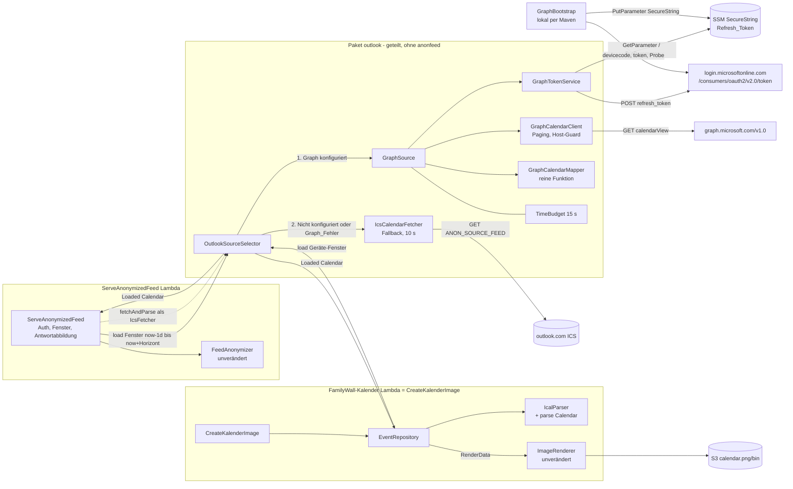
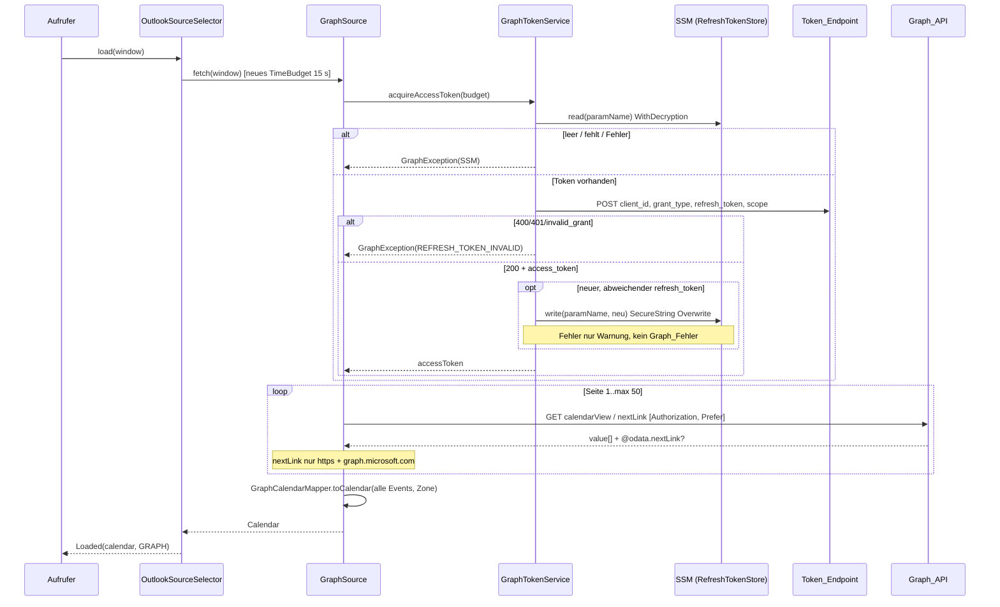

# Design Document: Outlook-Kalender über Microsoft Graph (outlook-graph-source)

## Overview

Bisher beziehen beide Funktionen, die den Outlook.com-Kalender nutzen, ihn ausschließlich über den veröffentlichten ICS-Link (`ANON_SOURCE_FEED`):

- `ServeAnonymizedFeed` (FamilyWall-Feed, anonymisiert) und
- `CreateKalenderImage` (e-ink-Device, über den Participant-Feed des `EventRepository`).

Am echten Feed wurde verifiziert: Outlook maskiert den Titel privat gekennzeichneter Termine selbst („Privater Termin") und exportiert keine `CATEGORIES`. Dieses Feature macht **Microsoft Graph (`GET /me/calendarView`)** zur primären Quelle beider Funktionen. Graph liefert `sensitivity`, `categories`, `showAs` und den echten Titel. Der ICS-Link bleibt als **Fallback** erhalten und das bisherige Verhalten gilt unverändert, solange Graph nicht konfiguriert ist.

### Zentrale Designentscheidungen

| # | Entscheidung | Begründung |
|---|---|---|
| D1 | **Graph-Events werden auf ical4j-`VEVENT`s abgebildet** (`GraphCalendarMapper`), nicht auf eine eigene Domänenstruktur. | `FeedAnonymizer` (inkl. aller Tests) und `IcalParser` bleiben unverändert gültig (Requirement 7.1, 13.5). Das Mapping ist eine reine Funktion `JsonNode → VEVENT` (Requirement 5.15). |
| D2 | **Eigenes Paket `de.goForFun.familienkalender.outlook`** mit der Graph_Source, dem Selector und den Transport-/Token-Schnittstellen. Es importiert nichts aus `anonfeed`; `anonfeed` und `EventRepository`/`CreateKalenderImage` importieren aus `outlook`. | Requirement 1.8, 10.2, 10.3, 13.19: Der Device-Pfad darf keine `anonfeed`-Komponenten nutzen; `ServeCalendarImage` und `ImageRenderer` kennen `outlook` nicht. |
| D3 | **Quellenauswahl in genau einer Klasse (`OutlookSourceSelector`)** mit Ergebnistyp `OutlookLoad` (`Loaded` / `NotConfigured` / `Unavailable`). Beide Aufrufer bilden nur dieses Ergebnis auf ihre Antwortform ab (HTTP-Status bzw. Fehlerliste). | Eine Entscheidungstabelle, eine Property (Property 1); die Regeln „kein Mischen“ (Property 2), „genau eine Warnung“ (Property 5) und „keine Ausnahme nach außen“ (Property 7) gelten dadurch für beide Aufrufer identisch (Requirement 2.10). |
| D4 | **Alle Nebenwirkungen hinter Schnittstellen**: `GraphHttp` (HTTP), `RefreshTokenStore` (SSM), `java.time.Clock` (Zeit), `OutlookLog` (Protokoll), `IcsFetcher` (Fallback-Abruf). | Unit- und Property-Tests laufen ohne AWS und ohne Netzwerk (Fakes, scripted responses, `MutableClock`). |
| D5 | **Device konsumiert den Graph-`Calendar` direkt über eine neue `IcalParser`-Überladung `parse(Calendar, LocalDate, LocalDate, EventSource)`** (reine Extraktion aus `parseForPeriod`, Verhalten bestehender Methoden unverändert). | Alternative „serialisieren und per `parse(InputStream, …)` wieder einlesen“ kostet CPU und verändert den ICS-Fallback (dessen `Calendar` kommt bereits aus `CalendarBuilder`). Mit der Überladung ist der ICS-Fallback des Devices **bitgleich** zum bisherigen Pfad (derselbe `CalendarBuilder`-Output wird durch dieselbe Logik expandiert). Das Risiko, dass ein programmatisch gebauter `Calendar` anders expandiert als ein geparster, wird durch Property 25 (Äquivalenz mit Serialisierungs-Round-Trip) abgesichert. |
| D6 | **Device wählt den Pfad pro Lauf**: ist Graph nicht konfiguriert, wird der **bestehende** `EventRepository`-Konstruktor mit `participantFeedUri` unverändert verwendet (Requirement 13.2 „exakt wie bisher“, inkl. Fehlermeldungstext des ICS-Abrufs). Nur bei konfiguriertem Graph kommt ein neuer Konstruktor mit `OutlookCalendarLoader` zum Einsatz. | Kein Regressionsrisiko im Legacy-Pfad; die 10-s-Grenze des Fallbacks (Requirement 13.11) gilt nur im neuen Pfad. |
| D7 | **Kein Zustand außer dem Refresh-Token im SSM**; Access-Token nur lokal im einzelnen `load()`-Aufruf (Requirement 3.13, 10.10). | Keine Caches in Feldern/Statics; ein Test mit zwei Läufen prüft zwei Token-Tausche. |
| D8 | **Funktionsbezogene IAM-Rollen ohne Plugin**: zwei eigene `AWS::IAM::Role`-Ressourcen in `resources:` und `functions.<name>.role`, SSM/KMS-Statements per CloudFormation-`Condition` nur bei gesetztem `GRAPH_REFRESH_TOKEN_PARAM`. | Das Projekt nutzt keine Serverless-Plugins; `serverless-iam-roles-per-function` ist seit 2021 nicht mehr gepflegt, die Kompatibilität mit Serverless Framework v4 ist nicht belegt. Native Rollen erfüllen Requirement 9.5 (kein Provider-Statement) und halten das Deployment bei leerem Parameter gültig (Requirement 11.4). |
| D9 | **Bootstrap als separate `main`-Klasse im Unterpaket `outlook.bootstrap`**, per `exec-maven-plugin` gestartet und per Shade-Filter aus dem Lambda-Uber-JAR ausgeschlossen. | Requirement 8.1, 8.17. Wiederverwendung von `JdkGraphHttp`, `SsmRefreshTokenStore` und `GraphEndpoints`. |
| D10 | **Deterministischer `DTSTAMP`** = `DTSTART` in UTC. | `DTSTAMP` ist nach RFC 5545 Pflicht und `CalendarOutputter` validiert; das Mapping darf die Systemuhr nicht lesen (Requirement 5.15). Graph liefert `lastModifiedDateTime` nicht im erlaubten `$select` (Requirement 4.9). |

### Abgrenzung

Nicht Teil dieses Designs: Schreibzugriff auf den Kalender, S3-Snapshot, mehrere Konten, Arbeits-/Schulkonten. `ServeCalendarImage`, `ImageRenderer`, `FeedAnonymizer` und `AnonConfig` bleiben unverändert.

### Recherche-Erkenntnisse und Annahmen

- **Persönliche Microsoft-Konten:** Client-Credentials werden nicht unterstützt; es braucht delegierte Anmeldung (Device Code Flow, Endpunkt `/consumers`). Ob `Calendars.Read` mit persönlichem Konto zuverlässig funktioniert, ist nicht gesichert. Vor der Implementierung gilt ein **Spike** (Abschnitt *Spike und offene Punkte*).
- **Refresh-Token-Rotation:** Der Token-Endpoint liefert bei Verwendung ggf. einen neuen `refresh_token`; der alte bleibt gültig. Parallele Läufe beider Funktionen sind daher unkritisch (last-writer-wins, Requirement 3.16).
- **Graph-Zeitzone:** Mit `Prefer: outlook.timezone="<IANA-ID>"` liefert Graph `start`/`end` als lokale `dateTime` (7 Nachkommastellen) plus `timeZone`. Ohne Prefer-Header wäre es `UTC`. Der Header wird auf jedem Request gesetzt (Requirement 6.1).
- **`@odata.nextLink`:** Graph übernimmt `$select`/`$top` und die Zeitfenster-Parameter in den `nextLink`; die Graph_Source folgt der URL **unverändert** (Requirement 4.4), prüft aber Schema und Host (Requirement 4.11).
- **Lombok/MapStruct** werden für die neuen Klassen nicht benötigt; die Klassen sind `record`s und kleine finale Klassen.
- **Abhängigkeiten:** `java.net.http` (JDK), Jackson (`jackson-databind`, aktuell transitiv über `jollyday-jackson`; wird direkt deklariert und über `jackson-bom` in der heute transitiv aufgelösten Version – lokal 2.19.1, vor dem Commit mit `./mvnw dependency:tree` zu bestätigen – in `dependencyManagement` ausgerichtet), AWS SDK `software.amazon.awssdk:ssm` ohne Versionsangabe über das bestehende BOM (2.57.7). Keine MSAL (Requirement 11.12, 11.13).

## Architecture

### Komponentenübersicht



Abhängigkeitsrichtung: `anonfeed → outlook`, `EventRepository/CreateKalenderImage → outlook`, `outlook → (ical4j, Jackson, AWS SSM, JDK)`. Das Paket `outlook` importiert weder `anonfeed` noch `software.amazon.awssdk.services.s3`. `ServeCalendarImage` und `ImageRenderer` importieren `outlook` nicht.

### Ablauf `GraphSource.fetch(window)` (ein Lauf)



### Entscheidungstabelle der Quellenauswahl

`graphState` ∈ {CONFIGURED, NOT_CONFIGURED}; `icsUrl` ∈ {gültig, fehlend/ungültig}.

| # | graphState | Graph-Ergebnis | icsUrl | ICS-Ergebnis | `OutlookLoad` | Feed-Antwort | Device-Fehlerliste |
|---|---|---|---|---|---|---|---|
| 1 | CONFIGURED | Erfolg (auch 0 Events) | egal | nicht aufgerufen | `Loaded(GRAPH)` | 200 | – |
| 2 | CONFIGURED | Graph_Fehler | gültig | Erfolg | `Loaded(ICS)` | 200 | – |
| 3 | CONFIGURED | Graph_Fehler | gültig | Fehler | `Unavailable(icsMessage)` | 502 | `Outlook-Feed: <ICS-Meldung>` |
| 4 | CONFIGURED | Graph_Fehler | fehlend/ungültig | nicht aufgerufen | `Unavailable("Graph nicht verfügbar (<Kategorie>)")` | 502 | `Outlook-Feed: Graph nicht verfügbar (<Kategorie>)` |
| 5 | NOT_CONFIGURED | nicht aufgerufen | gültig | Erfolg | `Loaded(ICS)` | 200 | – |
| 6 | NOT_CONFIGURED | nicht aufgerufen | gültig | Fehler | `Unavailable(icsMessage)` | 502 | `Outlook-Feed: <ICS-Meldung>` |
| 7 | NOT_CONFIGURED | nicht aufgerufen | fehlend/ungültig | nicht aufgerufen | `NotConfigured` | 500 (wie bisher) | still inaktiv, kein Eintrag |

Zeilen 5 bis 7 entsprechen exakt dem Verhalten vor dieser Erweiterung (Requirement 1.2, 13.2). Der Device-Pfad verwendet für Zeilen 5 bis 7 den **bestehenden** Konstruktor (D6); der Selector bildet sie dennoch ab, weil `ServeAnonymizedFeed` sie benötigt.

### Ablauf in `ServeAnonymizedFeed.handleRequest`

1. `loadConfig()` und Authentifizierung wie bisher (**vor** jedem Netzwerkzugriff, Requirement 1.6).
2. `loadGraphConfig()` (neuer Seam, liest je Anfrage `GRAPH_CLIENT_ID`, `GRAPH_REFRESH_TOKEN_PARAM`; Requirement 1.7).
3. Fenster bestimmen: `QueryWindows.feed(now(), horizonDays)`; `horizonDays` aus `HorizonDays.parse(System.getenv("GRAPH_HORIZON_DAYS"))` (Requirement 4.2, 4.3).
4. `OutlookSourceSelector.load(window)` mit `this::fetchAndParse` als `IcsFetcher` und `config.sourceFeed()` als Fallback-URL.
5. Ergebnis abbilden: `Loaded` → `FeedAnonymizer.anonymize(calendar, config, now)` → 200; `NotConfigured` → 500 (Text wie bisher); `Unavailable` → 502 mit Text „Outlook_Source_Feed konnte nicht abgerufen oder gelesen werden“.
6. Die bisherige Vorabprüfung „`sourceFeed == null` → 500“ **entfällt** an dieser Stelle und ist Teil der Tabellenzeile 7 (bei konfiguriertem Graph darf eine fehlende `ANON_SOURCE_FEED` den Graph-Erfolg nicht verhindern, Requirement 1.5).

Der Handler führt keine S3-Operation aus (Requirement 10.5) und fängt jede `RuntimeException` weiterhin lokal ab.

## Components and Interfaces

Alle neuen Typen liegen in `de.goForFun.familienkalender.outlook`, sofern nicht anders angegeben.

### 1. `GraphConfig`

```java
public record GraphConfig(String clientId, String refreshTokenParam) {
    public enum State { CONFIGURED, NOT_CONFIGURED, PARTIAL }
    public static GraphConfig fromEnv();                        // System.getenv, je Aufruf frisch
    public static GraphConfig fromMap(Map<String,String> env);  // testbar
    public State state();          // CONFIGURED nur wenn beide getrimmt nicht-leer
    public String missingVariable(); // nur bei PARTIAL: Name der fehlenden Variable
}
```

`clientId` und `refreshTokenParam` werden getrimmt gespeichert (`null` → `""`). `PARTIAL` zählt für die Quellenauswahl als nicht konfiguriert; der Selector protokolliert dann **genau eine Warnung** mit dem Variablennamen, nie mit einem Wert (Requirement 1.3, 1.9).

### 2. `OutlookLoad`, `OutlookCalendarLoader`

```java
public sealed interface OutlookLoad {
    enum Origin { GRAPH, ICS }
    record Loaded(Calendar calendar, Origin origin) implements OutlookLoad {}
    record NotConfigured() implements OutlookLoad {}              // weder Graph noch gültige ICS-URL
    record Unavailable(String detail) implements OutlookLoad {}   // detail ist sicher (Kategorie bzw. ICS-Meldung)
}

@FunctionalInterface
public interface OutlookCalendarLoader {
    OutlookLoad load(QueryWindow window);
}
```

`Unavailable.detail` ist entweder die Meldung des ICS-Abrufs oder `"Graph nicht verfügbar (" + category.displayName() + ")"`. Damit entsteht der Fehlerlisten-Eintrag des Devices durch reines Voranstellen von `"Outlook-Feed: "` (Requirement 13.13, 13.14).

### 3. `OutlookSourceSelector`

```java
public final class OutlookSourceSelector implements OutlookCalendarLoader {
    public OutlookSourceSelector(GraphConfig graphConfig,
                                 Supplier<GraphSource> graphSourceFactory, // erzeugt je load() frisch
                                 URI icsFallbackUrl,                       // null = fehlend/ungültig
                                 IcsFetcher icsFetcher,
                                 OutlookLog log);
    @Override public OutlookLoad load(QueryWindow window);
}
```

Verhalten (Tabelle oben):

- Fängt **jede** `Throwable`-Unterklasse `Exception` der Graph_Source ab und behandelt sie als Graph_Fehler der Kategorie `NETWORK` bzw. – für unbekannte Ausnahmen – `RESPONSE_UNPARSABLE` (Requirement 2.7, 13.17). Beim Fallback wird dieselbe Behandlung für `IcsFetcher` angewandt (`Unavailable` mit generischer Meldung).
- Protokolliert beim Wechsel auf die Fallback-Quelle **genau eine** WARN-Zeile mit genau einer Kategorie (Requirement 2.2, 13.12) und – bei Token-/SSM-Fehlern – zusätzlich **genau eine** ERROR-Zeile (Requirement 12.1, 12.2, 12.8).
- Das `Calendar`-Objekt des Fallbacks wird **unverändert** (Identität) durchgereicht (Requirement 2.8).
- Es werden nie Graph-Teilergebnisse übernommen: `GraphSource.fetch` liefert entweder den vollständigen `Calendar` oder wirft (Requirement 2.9, 4.14, 13.18).

### 4. `IcsFetcher`, `IcsCalendarFetcher`, `IcsFetchException`

```java
@FunctionalInterface
public interface IcsFetcher { Calendar fetch(URI url) throws IcsFetchException; }

public final class IcsFetchException extends Exception { /* message = sichere Kurzmeldung */ }

public final class IcsCalendarFetcher implements IcsFetcher {
    // java.net.http.HttpClient, connectTimeout 10 s, request timeout 10 s,
    // followRedirects(NORMAL); HTTP-Status 2xx; CalendarBuilder.build(InputStream)
}
```

- `ServeAnonymizedFeed` übergibt einen Adapter auf seine bestehende Methode `fetchAndParse(URI)` (Seam bleibt für Tests erhalten; `FeedUnavailableException` wird in `IcsFetchException` umgewandelt).
- Das Device übergibt `IcsCalendarFetcher` (der Handler-Code liegt in `anonfeed` und darf vom Device nicht genutzt werden, daher die kleine, bewusste Dopplung der ~20 Zeilen HTTP-Abruf).
- Der Fallback-Timeout (10 s) ist unabhängig vom verbrauchten Graph-Budget (Requirement 2.9, 13.16).

### 5. `GraphSource`

```java
public final class GraphSource {
    public GraphSource(GraphConfig config,
                       RefreshTokenStore tokenStore,
                       GraphHttp http,
                       Clock clock,
                       ZoneId zone,          // aufgelöste TIMEZONE
                       OutlookLog log);

    /** Vollständiger Calendar oder GraphException; nie Teilergebnisse. */
    public Calendar fetch(QueryWindow window) throws GraphException;
}
```

Ablauf: `TimeBudget budget = TimeBudget.start(clock, 15 s)` → `GraphTokenService.acquire(budget)` → `GraphCalendarClient.fetchAll(window, accessToken, budget)` → `GraphCalendarMapper.toCalendar(events, zone)`. Die Klasse hält keinen Zustand zwischen Aufrufen (Requirement 3.13). Sie liest weder die Systemuhr (nur die injizierte `Clock` für das Budget) noch `GRAPH_HORIZON_DAYS` (Requirement 4.15).

### 6. `TimeBudget`

```java
public final class TimeBudget {
    public static TimeBudget start(Clock clock, Duration total);
    public Duration remaining();                 // negativ => abgelaufen
    public void checkpoint() throws GraphException;          // BUDGET, wenn remaining <= 0
    public Duration stepTimeout(Duration cap) throws GraphException; // min(cap, remaining) nach checkpoint
}
```

Jeder Schritt (SSM lesen, Token-Tausch, SSM schreiben, jede Seite) ruft `stepTimeout(10 s)` auf. Dadurch gilt: Kein Request beginnt nach Ablauf des Budgets, jeder Request-Timeout ist ≤ min(10 s, Restbudget), die Summe überschreitet 15 s nicht (Requirement 2.6, 3.14, 4.10, 13.16).

### 7. `RefreshTokenStore` und `SsmRefreshTokenStore`

```java
public interface RefreshTokenStore {
    String read(String parameterName, Duration timeout) throws GraphException;   // Klartext, getrimmt-fähig
    void write(String parameterName, String value, Duration timeout) throws GraphException;
}

public final class SsmRefreshTokenStore implements RefreshTokenStore, AutoCloseable {
    public SsmRefreshTokenStore(SsmClient ssm);
    // read: GetParameterRequest(name, withDecryption=true) + overrideConfiguration.apiCallTimeout(timeout)
    // write: PutParameterRequest(name, value, type=SECURE_STRING, overwrite=true) + apiCallTimeout
}
```

Fehlerabbildung: `ParameterNotFoundException`, jede andere `SsmException`, `SdkClientException`, leerer Wert → `GraphErrorCategory.SSM_UNAVAILABLE`. Die Exception-Meldung enthält **nur** Kategorie und Parametername, nie Wert oder SDK-Meldungstext (Requirement 3.11). Der `SsmClient` wird je Lauf in einem try-with-resources der Factory erzeugt und geschlossen (Region aus `AWS_REGION`).

### 8. `GraphHttp`, `JdkGraphHttp`, `HttpCall`, `HttpResult`

```java
public interface GraphHttp {
    HttpResult send(HttpCall call, Duration timeout) throws GraphException; // NETWORK / TIMEOUT
}
public record HttpCall(String method, URI uri, Map<String,String> headers, String formOrNullBody) {}
public record HttpResult(int status, String body) {}

public final class JdkGraphHttp implements GraphHttp {
    // HttpClient.newBuilder().connectTimeout(10 s).followRedirects(NEVER).build()
    // HttpRequest.timeout(timeout); Body als String (UTF-8)
}
```

`followRedirects(NEVER)` verhindert, dass ein Redirect den `Authorization`-Header an einen anderen Host trägt. `HttpTimeoutException`/`HttpConnectTimeoutException` → `TIMEOUT`, `IOException` → `NETWORK`, `InterruptedException` → Interrupt-Flag setzen, `NETWORK`.

### 9. `GraphEndpoints` (Konstanten und Guard)

```java
public final class GraphEndpoints {
    public static final String TOKEN_URL  = "https://login.microsoftonline.com/consumers/oauth2/v2.0/token";
    public static final String DEVICE_URL = "https://login.microsoftonline.com/consumers/oauth2/v2.0/devicecode";
    public static final String CALENDAR_VIEW = "https://graph.microsoft.com/v1.0/me/calendarView";
    public static final String SCOPE = "Calendars.Read offline_access";
    public static boolean isGraphUri(URI u);   // https && Host == graph.microsoft.com (case-insensitiv) && userInfo == null && Port in {-1,443}
    public static boolean isLoginUri(URI u);   // https && Host == login.microsoftonline.com && userInfo == null && Port in {-1,443}
}
```

`GraphCalendarClient` und `GraphTokenService` prüfen **vor** jedem `send` mit dem passenden Guard. Ein Verstoß ist ein Graph_Fehler und führt zu keinem Request (Requirement 4.11, 9.6, 9.7). `Authorization` wird nur an `isGraphUri`, der Refresh-Token nur an `isLoginUri` gesendet.

### 10. `GraphTokenService`

```java
final class GraphTokenService {
    GraphTokenService(GraphConfig cfg, RefreshTokenStore store, GraphHttp http, OutlookLog log);
    String acquire(TimeBudget budget) throws GraphException;   // access_token

    // reine Hilfsfunktionen (testbar)
    static String tokenRequestBody(String clientId, String refreshToken);        // form-urlencoded
    static TokenOutcome classify(int status, String body);                        // siehe unten
    static boolean shouldPersist(String readToken, String returnedOrNull);        // Rotationsentscheidung
}
```

Ablauf: `budget.stepTimeout` → `store.read` (leer nach Trim → `SSM_UNAVAILABLE`, kein Token-Request) → Token-POST mit genau den Feldern `client_id`, `grant_type=refresh_token`, `refresh_token`, `scope=Calendars.Read offline_access` (kein `client_secret`) → `classify`:

| Antwort | Ergebnis |
|---|---|
| Status 200, JSON, `access_token` nicht leer | Erfolg (+ ggf. `refresh_token`) |
| Status 200, nicht parsebar oder ohne/mit leerem `access_token` | `TOKEN_EXCHANGE_FAILED` (parsebar) bzw. `RESPONSE_UNPARSABLE`; **kein** SSM-Write |
| Status 400 oder 401, oder Feld `error == "invalid_grant"` | `REFRESH_TOKEN_INVALID`; kein SSM-Write |
| anderer Status außerhalb 2xx | `TOKEN_EXCHANGE_FAILED` mit Status; kein SSM-Write |
| Netzwerkfehler / Timeout | `NETWORK` / `TIMEOUT`; kein SSM-Write |

`shouldPersist(read, returned)` ⇔ `returned != null && !returned.isBlank() && !returned.equals(read.trim())`. Wird geschrieben, geschieht das **vor** dem ersten Graph-Request (`acquire` kehrt erst nach dem Write zurück). Ein Fehler beim Write erzeugt nur eine WARN-Zeile mit Parametername und Kategorie, keinen Graph_Fehler (Requirement 3.8). Es gibt keinen Retry und pro `acquire` höchstens einen Token-Tausch (Requirement 12.5).

### 11. `GraphCalendarClient`

```java
final class GraphCalendarClient {
    GraphCalendarClient(GraphHttp http, ZoneId zone);
    List<JsonNode> fetchAll(QueryWindow window, String accessToken, TimeBudget budget) throws GraphException;

    static URI initialUri(QueryWindow window);   // startDateTime/endDateTime UTC "yyyy-MM-dd'T'HH:mm:ss'Z'", $select, $top=100
    static int MAX_PAGES = 50;
}
```

- Header pro Request: `Authorization: Bearer <token>`, `Prefer: outlook.timezone="<zone>"`, `Accept: application/json`.
- `$select=id,iCalUId,subject,start,end,isAllDay,isCancelled,sensitivity,categories,showAs,location,bodyPreview,type,originalStart`, `$top=100`.
- Seitenschleife: Antwort `2xx` → Jackson-Parse → `value` muss Array sein (sonst `RESPONSE_UNPARSABLE`) → Events anhängen → `@odata.nextLink` vorhanden? → Host-/Schema-Guard (sonst `RESPONSE_UNPARSABLE`, kein Request) → würde die 51. Seite angefordert, `PAGE_LIMIT`.
- Status außerhalb 2xx → `GRAPH_HTTP` mit Status und Graph-Fehlercode (`error.code`, nur wenn es `[A-Za-z0-9_.-]{1,64}` entspricht); kein Retry, kein Body im Fehlertext.
- Bei jedem Fehler wird nichts zurückgegeben (die Liste bleibt lokal).

### 12. `GraphCalendarMapper` (reine Funktion)

```java
public final class GraphCalendarMapper {
    public static MappingResult toCalendar(List<JsonNode> graphEvents, ZoneId appZone);

    public record MappingResult(Calendar calendar, int cancelled, int skipped) {}

    // Einzelereignis-Funktionen (package-private/public für Tests)
    static Optional<MappedEvent> map(JsonNode event, ZoneId appZone);
    static String mapClass(String sensitivityOrNull);                  // PRIVATE | CONFIDENTIAL | PUBLIC
    static ShowAs mapShowAs(String showAsOrNull);                      // record(transp, busyStatus)
    static List<String> nonEmptyCategories(JsonNode categoriesOrNull);
}
```

`toCalendar` arbeitet in zwei Pässen: (1) jedes Event einzeln mappen (`cancelled` zählen, Unmappbare zählen und ohne Inhalte protokollieren lassen), (2) UIDs über die ganze Liste eindeutig machen (Abschnitt *UID-Bildung*). Es nutzt weder Netzwerk, noch SSM, noch Systemuhr (Requirement 5.15). Es filtert **nie** nach `sensitivity`, `categories` oder `showAs` (Requirement 5.16).

Das Ergebnis ist ein neuer `Calendar` mit `PRODID:-//familienkalender//outlook-graph-source//DE`, `VERSION:2.0`, `CALSCALE:GREGORIAN`, genau einer `VTIMEZONE` je referenzierter `TZID` (aus `TimeZoneRegistryFactory.getInstance().createRegistry().getTimeZone(id).getVTimeZone()`) und den `VEVENT`s in Eingabereihenfolge.

### 13. `QueryWindow`, `QueryWindows`, `HorizonDays`

```java
public record QueryWindow(Instant start, Instant end) {}

public final class QueryWindows {
    public static QueryWindow feed(Instant now, int horizonDays);        // [now - 1 d, now + horizonDays d]
    public static QueryWindow device(LocalDate referenceDate, ZoneId z);  // [1. des Monats 00:00, Tag nach Ende Folgemonat 00:00) in z
}

public final class HorizonDays {
    public static final int DEFAULT = 365;
    public static Result parse(String raw);   // Result(int days, boolean invalidWarning)
}
```

`device(...)` ist identisch zum Datumsbereich im `EventRepository` (`rangeStart = YearMonth.from(ref).atDay(1)`, `rangeEnd = YearMonth.from(ref).plusMonths(1).atEndOfMonth()`, Ende exklusiv = `rangeEnd.plusDays(1).atStartOfDay(zone)`), damit Graph und die übrigen Feeds dasselbe Fenster haben (Requirement 13.4). `HorizonDays.parse` akzeptiert nur ganzzahlige Dezimalwerte `1..730` (Regex `[0-9]{1,3}`, danach Wertprüfung, ohne Vorzeichen/Leerraum/Dezimalpunkt); alles andere ergibt 365, und `invalidWarning` ist nur gesetzt, wenn der Wert gesetzt, aber ungültig war (Requirement 4.3).

### 14. `GraphException`, `GraphErrorCategory`, `OutlookLog`

```java
public enum GraphErrorCategory {
    REFRESH_TOKEN_INVALID("Refresh_Token ungültig, Bootstrap erneut ausführen"),
    SSM_UNAVAILABLE("SSM-Lesefehler"),
    TOKEN_EXCHANGE_FAILED("Token-Tausch fehlgeschlagen"),
    NETWORK("Netzwerkfehler"),
    TIMEOUT("Timeout"),
    GRAPH_HTTP("Graph-HTTP-Status"),
    RESPONSE_UNPARSABLE("Antwort nicht parsebar"),
    PAGE_LIMIT("Seitenobergrenze überschritten"),
    BUDGET("Graph_Zeitbudget überschritten");
    public String displayName();
}

public final class GraphException extends Exception {
    public GraphErrorCategory category();
    public OptionalInt httpStatus();
    public Optional<String> graphCode();   // bereits gegen Allowlist-Regex bereinigt
    public String safeMessage();           // nur Kategorie, Status, Code - nie Body/Token/Titel
}

public interface OutlookLog { void warn(String message); void error(String message); }
```

`GraphException` trägt **keine** `cause`-Kette mit SDK- oder HTTP-Meldungstexten in `getMessage()`; `safeMessage()` ist die einzige Quelle für Protokollzeilen. Aufrufer implementieren `OutlookLog` über `context.getLogger()` (Präfixe `WARN: ` und `ERROR: ` wie im bestehenden Code) bzw. `LambdaLogger`.

Für die ERROR-Zeilen aus Requirement 12 gilt: `REFRESH_TOKEN_INVALID` → `"ERROR: Refresh_Token ungültig, Bootstrap erneut ausführen (SSM_Parameter: <Name>)"`; `SSM_UNAVAILABLE` → `"ERROR: SSM_Parameter nicht verfügbar, Bootstrap erneut ausführen oder Parameter prüfen (SSM_Parameter: <Name>)"`. Die WARN-Zeile des Fallbacks nennt unabhängig davon `displayName()` (z. B. „SSM-Lesefehler“).

### 15. Änderungen an bestehenden Klassen

**`IcalParser`** (additiv):

```java
public List<Event> parse(Calendar calendar, LocalDate from, LocalDate to, EventSource source)
```

`parseForPeriod(InputStream, …)` wird in „Stream → `CalendarBuilder.build` → `expand(Calendar, …)`“ zerlegt; die neue Überladung ruft `expand` direkt auf. Bestehende Signaturen und ihr Verhalten bleiben unverändert (Requirement 13.5).

**`EventRepository`** (additiv, neuer Konstruktor; der bestehende 7-Argument-Konstruktor bleibt unverändert):

```java
public EventRepository(URI feedUri, URI schoolFeedUri, URI vacationFeedUri,
                       OutlookCalendarLoader outlookLoader, String participantName,
                       LocalDate referenceDate, HolidayProvider holidayProvider)
        throws IOException, ParserException
```

Nach `assignParticipantsToUnassigned(...)` (Requirement 13.10) wird `outlookLoader.load(QueryWindows.device(referenceDate, AppTimeZone.get()))` aufgerufen und das Ergebnis behandelt:

- `Loaded(calendar, origin)` → `icalParser.parse(calendar, rangeStart, rangeEnd, EventSource.CALENDAR)`; jedes Event erhält `participants = List.of(trim(name))`, wenn `trim(name)` nicht leer ist, sonst bleiben die Teilnehmer unverändert (Requirement 13.9). Es entsteht kein Fehlerlisten-Eintrag (Requirement 13.3, 13.11).
- `NotConfigured` → nichts (Requirement 10.6 der Spec `anonymized-ical-feed`).
- `Unavailable(detail)` → genau ein Eintrag `"Outlook-Feed: " + detail` (Requirement 13.13, 13.14, 13.15); keine Outlook-Events.
- Eine `RuntimeException` aus dem Loader oder dem Parsen wird zu `Unavailable`-Verhalten mit generischer Meldung; sie bricht den Lauf nicht ab (Requirement 13.17).

Die gemeinsame Teilnehmer-/Anhängelogik wird in eine private Methode `appendOutlookEvents(...)` extrahiert, die der Legacy-Konstruktor ebenfalls nutzt (kein Verhaltensunterschied).

**`CreateKalenderImage`**: ermittelt je Lauf `GraphConfig.fromEnv()`; bei `CONFIGURED` wird `new OutlookSourceSelector(cfg, () -> newGraphSource(...), parseHttpUri(ANON_SOURCE_FEED), new IcsCalendarFetcher(), log)` an den neuen Konstruktor übergeben, sonst bleibt der bisherige Aufruf mit `outlookFeedUri` erhalten. Bei `PARTIAL` wird genau eine Warnung geschrieben (Requirement 1.9).

**`ServeAnonymizedFeed`**: neue paket-sichtbare Seams für Tests:

```java
GraphConfig loadGraphConfig() { return GraphConfig.fromEnv(); }
Instant now() { return Instant.now(); }
OutlookCalendarLoader createLoader(AnonConfig cfg, GraphConfig graphCfg, OutlookLog log); // Default: OutlookSourceSelector
```

`loadConfig()` und `fetchAndParse(URI)` bleiben unverändert und werden weiter von `ServeAnonymizedFeedTest` überschrieben.

### 16. Bootstrap (`outlook.bootstrap`)

```java
public final class GraphBootstrap {
    public static void main(String[] args);      // setzt Exit-Code, ruft run(...)
    static int run(String[] args, Map<String,String> env, GraphHttp http, RefreshTokenStore store,
                   Clock clock, Sleeper sleeper, PrintStream out, PrintStream err);
}
record BootstrapConfig(String clientId, String parameterName) {
    static BootstrapConfig resolve(String[] args, Map<String,String> env) throws ConfigException;
}
final class DeviceCodeFlow { /* devicecode, Polling-Automat */ }
final class ScopeCheck { static boolean includesCalendarsRead(String scopeResponse); }
```

- `resolve`: Argument `--client-id`/`--param` hat Vorrang vor `GRAPH_CLIENT_ID`/`GRAPH_REFRESH_TOKEN_PARAM`; Werte werden getrimmt; fehlt oder ist eine Angabe leer → Meldung mit dem Namen der Angabe, Exit-Code ≠ 0, **kein** Netzwerkzugriff (Requirement 8.2, 8.3).
- Ablauf: `POST devicecode` (`client_id`, `scope=Calendars.Read offline_access`) → URL und Benutzercode auf `out` → Polling (`grant_type=urn:ietf:params:oauth:grant-type:device_code`) im Intervall `interval` (Default 5 s), `authorization_pending` → weiter, `slow_down` → Intervall + 5 s, anderer Fehlercode oder Ablauf `expires_in` → Abbruch (Requirement 8.4 bis 8.7).
- Prüfung vor dem Speichern: `refresh_token` nicht leer **und** `ScopeCheck.includesCalendarsRead(scope)` (Scope-Liste leerzeichengetrennt, Vergleich ohne Groß-/Kleinschreibung; auch `https://graph.microsoft.com/Calendars.Read` zählt) (Requirement 8.8, 8.9).
- Probe: `GET /me/calendarView` für ein 1-Tages-Fenster mit dem erhaltenen Access-Token; Status außerhalb 2xx → Abbruch mit Status und Graph-Code, **ohne** SSM-Write (Requirement 8.10, 8.11). Erst danach `store.write(...)` als SecureString; Erfolg wird mit Parametername, aber ohne Tokenwert gemeldet (Requirement 8.12, 8.13).
- Jeder HTTP-Aufruf mit Connect- und Request-Timeout 10 s, Fehler → Kategorie und Exit ≠ 0 (Requirement 8.14, 8.15). Ausgaben und Fehlermeldungen enthalten nie Token (Requirement 8.16).

Start per Maven (Abschnitt *Build und Deployment*): `./mvnw -q compile exec:java@graph-bootstrap -Dexec.args="--client-id <ID> --param /familienkalender/graph-refresh-token"`.

## Data Models

### Graph-Event (Eingabe, nur die angeforderten Felder)

```json
{
  "id": "AAMk…",
  "iCalUId": "040000008200E000…",
  "subject": "Zahnarzt",
  "start": { "dateTime": "2026-10-28T14:00:00.0000000", "timeZone": "Europe/Berlin" },
  "end":   { "dateTime": "2026-10-28T15:00:00.0000000", "timeZone": "Europe/Berlin" },
  "isAllDay": false,
  "isCancelled": false,
  "sensitivity": "private",
  "categories": ["privat", "Arzt"],
  "showAs": "busy",
  "location": { "displayName": "Praxis Dr. Muster" },
  "bodyPreview": "Bitte Versichertenkarte mitbringen",
  "type": "singleInstance",
  "originalStart": "2026-10-28T13:00:00Z"
}
```

### Feld-Mapping `Graph_Event → VEVENT`

| Graph-Feld | VEVENT | Regel | Requirement |
|---|---|---|---|
| `isCancelled == true` | – | Event wird nicht aufgenommen (zählt als `cancelled`, kein Fehler) | 4.8 |
| `subject` | `SUMMARY` | zeichenidentisch; fehlt/`null`/leer → `SUMMARY` mit leerem Wert | 5.2 |
| `sensitivity` | `CLASS` | case-insensitiv: `private` → `PRIVATE`, `confidential` → `CONFIDENTIAL`, alles andere inkl. `normal`/`personal`/fehlend → `PUBLIC` | 5.3 bis 5.6 |
| `categories[]` | `CATEGORIES` | genau eine Property mit allen nicht-leeren Einträgen in Reihenfolge, zeichenidentisch, RFC-Maskierung durch ical4j; sonst keine Property | 5.7 |
| `showAs` | `TRANSP`, `X-MICROSOFT-CDO-BUSYSTATUS` | siehe Tabelle unten | 5.8, 5.9 |
| `location.displayName` | `LOCATION` | nur wenn getrimmt nicht leer; Wert ungetrimmt übernommen | 5.10 |
| `bodyPreview` | `DESCRIPTION` | nur wenn getrimmt nicht leer; ungekürzt | 5.11 |
| `iCalUId` / `id` | `UID` | siehe *UID-Bildung* | 5.12, 5.13 |
| `start`/`end`/`isAllDay` | `DTSTART`/`DTEND` | siehe *Zeitbildung* | 6.3 bis 6.7 |
| – | `DTSTAMP` | `DTSTART` in UTC (deterministisch, D10) | 5.15 |
| – | `RRULE`/`RDATE`/`EXDATE` | werden nie erzeugt (Occurrences einzeln) | 4.7 |

`showAs` → `(TRANSP, X-MICROSOFT-CDO-BUSYSTATUS)`, case-insensitiv:

| `showAs` | `TRANSP` | `BUSYSTATUS` |
|---|---|---|
| `free` | `TRANSPARENT` | `FREE` |
| `tentative` | `OPAQUE` | `TENTATIVE` |
| `oof` | `OPAQUE` | `OOF` |
| `busy`, `workingElsewhere`, `unknown`, fehlend/`null`/leer, jeder andere Wert | `OPAQUE` | `BUSY` |

### UID-Bildung

1. `baseUid = iCalUId` (nicht leer) sonst `id`. Fehlen beide **oder** ist `start` nicht auswertbar → Event wird ausgelassen (Requirement 5.14).
2. `needsSuffix(event) = type ∈ {occurrence, exception}` (case-insensitiv) **oder** `baseUid` kommt bei mehreren der zu mappenden Events der Antwort vor.
3. Suffix: `"-" + format(yyyyMMdd'T'HHmmss'Z', originalStart ersatzweise start in UTC)`. `originalStart` wird als `OffsetDateTime`/`Instant` gelesen; ist es nicht parsebar, gilt `start` (aus `dateTime` + `timeZone`).
4. Bleibt nach dem Suffix eine Kollision (gleiche `baseUid`, gleicher Zeitpunkt), wird in Eingabereihenfolge `-2`, `-3`, … angehängt. Damit ist jede `UID` im `Calendar` eindeutig; für dasselbe Vorkommen bleibt sie über wiederholte Abrufe gleich (Eingabereihenfolge und Inhalt determinieren das Ergebnis).

### Zeitbildung

Eingaben: `start.dateTime`/`end.dateTime` als `yyyy-MM-dd'T'HH:mm:ss[.fffffff]`, `timeZone` als IANA-ID oder `UTC`.

| Fall | `DTSTART` / `DTEND` |
|---|---|
| `isAllDay == true` | `VALUE=DATE` aus dem Datumsanteil von `start.dateTime` bzw. `end.dateTime`, Uhrzeit verworfen, `DTEND` exklusiv. Liegt das End-Datum nicht nach dem Start-Datum: `DTEND = DTSTART + 1 Tag` |
| `isAllDay != true`, `timeZone` = IANA-ID ≠ `UTC` | lokale Zeit ohne `Z`, Sekundenbruchteile verworfen, `TZID=<timeZone>` (je für Start und Ende) |
| `isAllDay != true`, `timeZone == UTC` | UTC-Zeit mit `Z`, ohne `TZID` |
| `dateTime` fehlt/nicht parsebar, oder `timeZone` weder `UTC` noch gültige IANA-ID | Event wird ausgelassen, **ohne** Graph_Fehler und ohne Inhalte im Log |

„Gültige IANA-ID“ bedeutet operativ: `ZoneId.of(id)` gelingt **und** die ical4j-Registry kennt die ID (sonst ließe sich keine `VTIMEZONE` erzeugen). Windows-Zonennamen („W. Europe Standard Time“) scheitern an `ZoneId.of` und führen zum Auslassen (Requirement 6.7). Für jede im Ergebnis referenzierte `TZID` wird genau eine `VTIMEZONE` aufgenommen (Requirement 6.8).

### Konfiguration (Umgebungsvariablen)

| Variable | Funktionen | Vorgabe | Bedeutung |
|---|---|---|---|
| `GRAPH_CLIENT_ID` | `ServeAnonymizedFeed`, `FamilyWall-Kalender` | `''` | Client-ID der App-Registrierung |
| `GRAPH_REFRESH_TOKEN_PARAM` | `ServeAnonymizedFeed`, `FamilyWall-Kalender` | `''` | Name des SSM-Parameters (SecureString), mit führendem `/` |
| `GRAPH_HORIZON_DAYS` | nur `ServeAnonymizedFeed` | `365` | ganzzahlig 1..730; sonst 365 |
| `ANON_SOURCE_FEED` | beide | wie bisher | ICS-Fallback |
| `TIMEZONE` | beide | `Europe/Berlin` | `Prefer`-Header, Mapping, Gerätefenster |

Graph ist konfiguriert, wenn `GRAPH_CLIENT_ID` und `GRAPH_REFRESH_TOKEN_PARAM` nach Trimmen beide nicht leer sind. Der Refresh-Token selbst ist **nie** Konfiguration (Requirement 9.2, 11.6).

### Fehlerkategorien und Quellen

| Kategorie | Auslöser | Logzeile (zusätzlich) |
|---|---|---|
| `REFRESH_TOKEN_INVALID` | Token-Endpoint 400/401 oder `invalid_grant` | ERROR mit SSM-Parametername |
| `SSM_UNAVAILABLE` | Parameter fehlt, leer, Lesefehler, Berechtigung/Entschlüsselung | ERROR mit SSM-Parametername |
| `TOKEN_EXCHANGE_FAILED` | sonstiger Nicht-2xx-Status des Token-Endpoints, 200 ohne `access_token` | – |
| `NETWORK` | `IOException`, Nicht-HTTPS, Guard-Verstoß beim Senden | – |
| `TIMEOUT` | Connect-/Request-Timeout | – |
| `GRAPH_HTTP` | Graph-Antwort außerhalb 2xx (Status, optional Graph-Code) | – |
| `RESPONSE_UNPARSABLE` | kein JSON, `value` kein Array, unzulässiger `nextLink` | – |
| `PAGE_LIMIT` | 51. Seite würde angefordert | – |
| `BUDGET` | 15 s Gesamtbudget aufgebraucht | – |

## Correctness Properties

*Eine Property ist eine Eigenschaft oder ein Verhalten, das über alle gültigen Ausführungen eines Systems hinweg gelten soll, im Kern eine formale Aussage darüber, was das System tun soll. Properties bilden die Brücke zwischen menschenlesbaren Spezifikationen und maschinell verifizierbaren Korrektheitsgarantien.*

Die Properties entstehen aus der Prework-Analyse und sind nach der Reflexion konsolidiert (z. B. Property 18 fasst CLASS- und showAs-Mapping zusammen, Property 1 die Entscheidungstabelle für beide Aufrufer). Sie werden als jqwik-`@Property`-Tests mit mindestens 100 Durchläufen umgesetzt. IaC-Aspekte (`serverless.yml`, `pom.xml`), README und der I/O-Anteil des Bootstraps sind **nicht** PBT-geeignet und stehen in der Teststrategie als Inspektions- bzw. Beispieltests.

### Property 1: Quellenauswahl folgt der Entscheidungstabelle

*Für jede* Kombination aus Graph-Zustand (`CONFIGURED`/`NOT_CONFIGURED`/`PARTIAL`), Graph-Ergebnis (Erfolg mit beliebig vielen Events, einschließlich 0, oder Graph_Fehler beliebiger Kategorie), ICS-URL (gültig/fehlend) und ICS-Ergebnis (Erfolg/Fehler) liefert der `OutlookSourceSelector` genau das `OutlookLoad` der Entscheidungstabelle; `GraphSource` (und damit SSM und Token-Endpoint) wird genau dann aufgerufen, wenn der Zustand `CONFIGURED` ist, und der ICS-Fetcher genau dann, wenn (Zustand nicht `CONFIGURED`) oder (Graph_Fehler), und die ICS-URL gültig ist.

**Validates: Requirements 1.1, 1.2, 1.4, 2.1, 2.4, 2.5, 3.12, 4.14, 10.1, 10.7, 12.3, 12.4, 13.1, 13.2, 13.3, 13.11**

### Property 2: Quellen werden nie gemischt

*Für jede* Folge von Graph-Seiten (mit beliebig vielen erfolgreichen Seiten, gefolgt von einem Fehler auf einer beliebigen Seite) und jeden ICS-Kalender enthält ein `Loaded`-Ergebnis ausschließlich `UID`s einer einzigen Quelle (UID-Präfixe der Fakes sind disjunkt), und nach einem Graph_Fehler enthält es keine `UID` einer bereits abgerufenen Graph-Seite; ein Graph-Fehler liefert nie einen Teil-Calendar.

**Validates: Requirements 2.9, 4.5, 4.14, 13.18**

### Property 3: Graph-Zustand ergibt sich aus den getrimmten Konfigurationswerten

*Für jedes* Paar von Werten (`null`, leer, nur Leerraum, nicht-leer) für `GRAPH_CLIENT_ID` und `GRAPH_REFRESH_TOKEN_PARAM` ist der Zustand `CONFIGURED` genau dann, wenn beide nach Trimmen nicht leer sind, `PARTIAL` genau dann, wenn genau eine nicht-leer ist (dann genau eine Warnung, die den Namen der fehlenden Variable, aber keinen Variablenwert enthält), sonst `NOT_CONFIGURED`.

**Validates: Requirements 1.3, 1.7, 1.9**

### Property 4: Keine Geheimnisse und keine Termininhalte in Protokoll, Antwort und Fehlerliste

*Für jede* Ausführung der Graph-Pfade (Erfolg oder Fehler an einem beliebigen Schritt: SSM-Lesen, Token-Tausch, SSM-Schreiben, beliebige Seite, Mapping) mit Fakes, die Canary-Strings als Refresh-Token, Access-Token, Antwort-Bodys (Token-Endpoint und Graph) sowie als `subject`, `bodyPreview`, `location` und Kategorien liefern, enthält weder eine Protokollzeile, noch die HTTP-Antwort des `ServeAnonymizedFeed` (außer im Feed-Body die erlaubten Public-Inhalte), noch die `EventRepository`-Fehlerliste, noch eine `GraphException.safeMessage()` einen Canary-Token oder einen Canary-Inhalt.

**Validates: Requirements 2.3, 3.5, 3.15, 5.14, 9.2, 9.8, 9.9, 9.11, 13.15**

### Property 5: Pro Lauf genau eine Fallback-Warnung mit genau einer bekannten Kategorie

*Für jeden* Graph_Fehler, der zum Wechsel auf die Fallback-Quelle führt, schreibt der Selector genau eine WARN-Zeile, die genau eine Kategorie aus der festen Menge der neun `displayName()`-Werte nennt; bei `REFRESH_TOKEN_INVALID` und `SSM_UNAVAILABLE` zusätzlich genau eine ERROR-Zeile mit der festgelegten Kategorie und dem Parameternamen (ohne Wert); bei Graph-Erfolg gibt es keine dieser Zeilen.

**Validates: Requirements 2.2, 12.1, 12.2, 12.8, 13.12**

### Property 6: Zeitbudget und Einzel-Timeouts

*Für jede* Folge von Schrittdauern (SSM lesen, Token-Tausch, optional SSM schreiben, 1 bis 50 Seiten) und jede Startzeit gilt mit injizierter `Clock`: Kein Request beginnt, wenn das Restbudget ≤ 0 ist (stattdessen Kategorie `BUDGET`), jeder an `GraphHttp` und `RefreshTokenStore` übergebene Timeout ist ≤ min(10 s, Restbudget), und der Graph-Pfad endet mit `BUDGET` genau dann, wenn die kumulierte Dauer vor dem Start eines weiteren notwendigen Schritts 15 s erreicht; der Fallback-Abruf erhält danach unabhängig vom Verbrauch einen Timeout von 10 s.

**Validates: Requirements 2.6, 2.9, 3.14, 4.10, 13.16**

### Property 7: Ausnahmen der Graph_Source erreichen den Aufrufer nie

*Für jede* an einer beliebigen Stelle (`RefreshTokenStore`, `GraphHttp`, Parser, Mapper) injizierte `RuntimeException`- oder `GraphException`-Variante liefert `OutlookSourceSelector.load` ein `OutlookLoad` und wirft nie; ein `EventRepository`, das einen solchen Loader nutzt, wird ohne Ausnahme konstruiert, und die Ereignisse und Fehler der übrigen Feeds bleiben unverändert.

**Validates: Requirements 2.7, 13.17**

### Property 8: Token-Request enthält genau die vorgeschriebenen Formfelder

*Für jede* Client-ID und jeden Refresh-Token (beliebige Zeichen, einschließlich `&`, `=`, `+`, `%`, Leerzeichen, Unicode) enthält der Body des Token-Requests genau die Schlüssel `client_id`, `grant_type`, `refresh_token`, `scope`, nie `client_secret`; nach `URL-Decode` ergeben die Werte `client_id`, `refresh_token`, `grant_type=refresh_token` und `scope=Calendars.Read offline_access` die Eingaben (Round-Trip), und es wird kein anderer Scope gesendet.

**Validates: Requirements 3.2, 3.3, 9.1**

### Property 9: Token-Beschaffung klassifiziert alle Antworten korrekt und lässt SSM bei Fehlern unverändert

*Für jedes* SSM-Leseergebnis (Wert, leer, nur Leerraum, Ausnahme) und jede Token-Endpoint-Antwort (Status 200 mit/ohne/leerem `access_token`, nicht parsebarer Body, 400, 401, `invalid_grant` bei beliebigem Status, andere Status, Netzwerkfehler, Timeout) entspricht das Ergebnis der Klassifikationstabelle; bei SSM-Leerwert/-Fehler erfolgt kein Token-Request, bei jedem Fehler erfolgt kein SSM-Write, pro Lauf gibt es höchstens einen Token-Request, und bei Erfolg wird der Access-Token ohne weiteren Tausch für alle Seiten desselben Laufs verwendet.

**Validates: Requirements 3.4, 3.5, 3.9, 3.10, 3.11, 12.5, 12.6**

### Property 10: Rotationsentscheidung und Reihenfolge

*Für jedes* Paar aus gelesenem Token und zurückgegebenem `refresh_token` (`null`, leer, gleich, abweichend, jeweils mit Leerraumvarianten) wird in SSM genau dann geschrieben, wenn der zurückgegebene Wert nach Trimmen nicht leer ist und vom getrimmten gelesenen Wert abweicht; geschrieben wird höchstens einmal pro Lauf, als SecureString mit Overwrite und vor dem ersten calendarView-Request; ein Schreibfehler verändert das Ergebnis des Laufs (Erfolg) nicht; es gibt nie einen anderen Schreibzugriff.

**Validates: Requirements 3.6, 3.7, 3.8, 3.16, 10.6, 10.8**

### Property 11: Paging liefert alle Events in Reihenfolge und begrenzt auf 50 Seiten

*Für jede* Seitenfolge mit 1 bis 60 Seiten (Seiten dürfen leer sein, die Gesamtanzahl der Events darf 0 sein) ruft der Client genau so viele Seiten ab, wie `@odata.nextLink`-Ketten vorhanden sind, liefert bei höchstens 50 Seiten die Vereinigung aller Events in Abrufreihenfolge (bei 0 Events einen gültigen `Calendar` ohne `VEVENT`, ohne ICS-Abruf) und löst bei Bedarf einer 51. Seite `PAGE_LIMIT` ohne Teilergebnis aus; jeder Request trägt `Authorization: Bearer <Token>` und `Prefer: outlook.timezone="<aufgelöste Zone>"`; der initiale Request enthält exakt die vorgegebenen `$select`-Felder und `$top=100`.

**Validates: Requirements 4.1, 4.4, 4.5, 4.6, 4.9, 6.1**

### Property 12: Host- und Schema-Guard schützt die Token

*Für jede* URI (Schemata `https`/`http`/andere, Hosts einschließlich `graph.microsoft.com`, `GRAPH.MICROSOFT.COM`, `graph.microsoft.com.evil.example`, `evil.example`, `x@graph.microsoft.com`, `graph.microsoft.com@evil.example`, abweichende Ports) als `@odata.nextLink` bzw. Endpoint gilt: `GraphEndpoints.isGraphUri` ist genau dann wahr, wenn Schema `https`, Host (case-insensitiv) gleich `graph.microsoft.com`, keine Userinfo und Port 443 bzw. nicht gesetzt; bei `false` wird an diese URI kein Request gesendet, und `Authorization` bzw. der Refresh-Token erreichen nie einen Host außerhalb von `graph.microsoft.com` bzw. `login.microsoftonline.com`.

**Validates: Requirements 4.11, 9.6, 9.7**

### Property 13: Fehlerhafte Graph-Antworten werden als Graph_Fehler ohne Body-Leck klassifiziert

*Für jeden* HTTP-Status außerhalb 2xx und jeden Body liefert der Client genau einen Request (kein Retry) und `GRAPH_HTTP` mit Status und – nur wenn `error.code` der Allowlist `[A-Za-z0-9_.-]{1,64}` entspricht – dem Graph-Code; für jeden 2xx-Body, der kein JSON ist, kein Feld `value` hat oder dessen `value` kein Array ist, `RESPONSE_UNPARSABLE`.

**Validates: Requirements 4.12, 4.13**

### Property 14: Zeitfenster werden korrekt gebildet und formatiert

*Für jeden* Zeitpunkt `now`, jede Horizontlänge 1..730, jedes Referenzdatum und jede Zeitzone gilt: `QueryWindows.feed(now, h)` ist `[now − 1 Tag, now + h Tage]`; `QueryWindows.device(ref, zone)` beginnt am Beginn des ersten Tages des Monats von `ref` und endet (exklusiv) am Beginn des Tages nach dem letzten Tag des Folgemonats, jeweils in `zone`; die `startDateTime`/`endDateTime`-Parameter der Anfrage haben das Format `yyyy-MM-dd'T'HH:mm:ss'Z'` und ergeben beim Zurückparsen den auf Sekunden gekürzten Instant (UTC).

**Validates: Requirements 4.1, 4.2, 4.15, 13.4**

### Property 15: Konfigurationswerte werden robust aufgelöst

*Für jeden* String als `GRAPH_HORIZON_DAYS` (null, leer, Leerraum, Vorzeichen, Dezimalpunkt, Hex, 0, 1, 730, 731, sehr groß, Text) ergibt `HorizonDays.parse` genau dann den Wert, wenn es ein ganzzahliger Dezimalwert in 1..730 ist, sonst 365, mit Warnung nur wenn der Wert gesetzt, aber ungültig war; *für jeden* String als `TIMEZONE` ist die aufgelöste Zone die IANA-Zone, wenn die ID gültig ist, sonst `Europe/Berlin`.

**Validates: Requirements 4.3, 6.2**

### Property 16: Mapping erzeugt genau ein VEVENT je gültigem, nicht storniertem Event und filtert nichts weiter

*Für jede* Liste von Graph-Events (beliebige Kombination aus gültigen, stornierten, ohne `iCalUId`/`id`, ohne/mit unparsebarem `start`/`end`, mit Windows-Zeitzonennamen, beliebigen `sensitivity`/`categories`/`showAs`-Werten) enthält der `Calendar` genau die Events, die weder `isCancelled == true` sind noch nach den Auslassungsregeln entfallen, in Eingabereihenfolge, ohne `RRULE`/`RDATE`/`EXDATE`; kein Event entfällt wegen `sensitivity`, `categories` oder `showAs`; das Auslassen löst keinen Fehler aus und beeinflusst die übrigen Events nicht.

**Validates: Requirements 4.7, 4.8, 5.1, 5.14, 5.16, 6.7, 13.20**

### Property 17: Das Mapping ist deterministisch und frei von Umgebungszugriffen

*Für jede* Graph-Event-Liste und Zone liefert zweimaliges Mappen (mit dazwischen verstrichener Systemzeit) byte-identisch serialisierte `Calendar`s; das Ergebnis enthält einen `DTSTAMP`, der dem `DTSTART` in UTC entspricht.

**Validates: Requirements 5.15, 5.16**

### Property 18: CLASS-, TRANSP- und BUSYSTATUS-Mapping folgen den Tabellen

*Für jeden* `sensitivity`-Wert (alle Groß-/Kleinschreibungen von `private`, `confidential`, `normal`, `personal`, fehlend, `null`, leer, beliebige Strings) ist `CLASS` gleich `PRIVATE`, `CONFIDENTIAL` bzw. `PUBLIC` gemäß Tabelle; *für jeden* `showAs`-Wert (alle Schreibweisen von `free`, `tentative`, `oof`, `busy`, `workingElsewhere`, `unknown`, fehlend, `null`, leer, beliebig) entsprechen `TRANSP` und `X-MICROSOFT-CDO-BUSYSTATUS` der Tabelle.

**Validates: Requirements 5.3, 5.4, 5.5, 5.6, 5.8, 5.9**

### Property 19: Textfelder überstehen die Serialisierung unverändert

*Für jedes* `subject`, jede `location.displayName`, jede `bodyPreview` und jede Kategorienliste (Unicode, Komma, Semikolon, Backslash, Anführungszeichen, Zeilenumbrüche, Leerraum am Rand, leere Einträge) ergibt Serialisieren des gemappten `Calendar` und Wiedereinlesen mit `CalendarBuilder`: `SUMMARY` zeichenidentisch (leer, wenn `subject` fehlt), `LOCATION`/`DESCRIPTION` nur vorhanden, wenn der getrimmte Eingabewert nicht leer ist, und dann zeichenidentisch, und genau eine `CATEGORIES`-Property mit den nicht-leeren Einträgen in Eingabereihenfolge (keine, wenn keine nicht-leeren Einträge vorhanden sind).

**Validates: Requirements 5.2, 5.7, 5.10, 5.11**

### Property 20: UIDs sind eindeutig und stabil

*Für jede* Graph-Event-Liste (mit absichtlich doppelten `iCalUId`, fehlenden `iCalUId`, Typen `occurrence`/`exception`/`singleInstance`, gleichen `originalStart`-Zeitpunkten) sind alle `UID`s des Ergebnisses paarweise verschieden, stammen aus `iCalUId` (ersatzweise `id`), tragen bei `occurrence`/`exception` oder doppelter `iCalUId` das Suffix `-yyyyMMdd'T'HHmmss'Z'` des ursprünglichen Beginns (UTC), und wiederholtes Mappen derselben Liste liefert dieselben `UID`s.

**Validates: Requirements 5.12, 5.13**

### Property 21: Zeitangaben überstehen die Serialisierung (Round-Trip)

*Für jedes* Event (ganztägig oder nicht; Zeitzonen `UTC`, `Europe/Berlin`, `America/New_York`, `Asia/Kolkata` und weitere IANA-IDs; lokale Zeiten in DST-Lücken und -Überlappungen; Sekundenbruchteile; `end` vor, gleich oder nach `start` bei Ganztag) liefert Serialisieren und Wiedereinlesen für `UID`, `SUMMARY`, `CLASS`, `DTSTART` und `DTEND` die erwarteten Werte: bei Ganztag `DATE`-Werte des Datumsanteils mit `DTEND` > `DTSTART` (Start + 1 Tag, wenn das Ende nicht nach dem Start liegt), bei `UTC` denselben Instant mit `Z`, bei anderen Zonen denselben Instant wie `(LocalDateTime, Zone)` mit `TZID` ohne Bruchteile.

**Validates: Requirements 6.3, 6.4, 6.5, 6.6, 6.10**

### Property 22: Kalender-Grundgerüst und VTIMEZONE-Menge sind konsistent

*Für jede* (auch leere) Graph-Event-Liste enthält der `Calendar` `PRODID` (nicht leer) und `VERSION:2.0`, lässt sich fehlerfrei serialisieren und wieder einlesen, und die Menge der `TZID`-Werte der enthaltenen `VTIMEZONE`s ist gleich der Menge der in `VEVENT`-`DTSTART`/`DTEND` referenzierten `TZID`s (genau eine `VTIMEZONE` je referenzierter Zone, keine weiteren).

**Validates: Requirements 6.8, 6.9**

### Property 23: Anonymisierung von Graph-Daten folgt sensitivity und Kategorie und leakt nichts

*Für jede* Liste von Graph-Events und jeden Referenzzeitpunkt gilt nach `map → FeedAnonymizer.anonymize`: Ein Event ist genau dann anonymisiert (Titel = Platzhalter, keine `DESCRIPTION`/`LOCATION`/`ATTENDEE`/…), wenn `sensitivity` (case-insensitiv) `private` oder `confidential` ist oder eine Kategorie (getrimmt, case-insensitiv) `privat` lautet; Events mit `normal`/`personal`/fehlender Sensitivität ohne Privat-Kategorie behalten Titel, Ort und Beschreibung; vergangene und als frei markierte Events (`showAs == free`) fehlen im Ergebnis; für anonymisierte Events enthält der serialisierte Feed weder `subject` noch `bodyPreview` noch `location` noch andere Kategorien als die Privat-Kategorie.

**Validates: Requirements 7.1, 7.2, 7.3, 7.4, 7.5, 7.9**

### Property 24: Idempotenz der Anonymisierung auf Graph-abgeleiteten Kalendern

*Für jede* Liste von Graph-Events gilt: Anonymisieren, Serialisieren, erneutes Einlesen mit dem `CalendarBuilder` und erneutes Anonymisieren liefert für jedes `VEVENT` identische `UID`, `DTSTART`, `DTEND`, `SUMMARY`, `CLASS` und `TRANSP` wie das einmalige Anonymisieren.

**Validates: Requirements 7.8**

### Property 25: Der Device-Parser liest den Graph-Kalender äquivalent zur Serialisierung

*Für jede* Graph-Event-Liste und jedes Geräte-Fenster ergibt `IcalParser.parse(calendar, from, to, CALENDAR)` dieselbe Liste von `Event`s (Teilnehmer, Start, Ende, Titel, Quelle, UID) wie `IcalParser.parse(serialize(calendar), from, to, CALENDAR)`.

**Validates: Requirements 13.5**

### Property 26: Das Device zeigt genau die Graph-Events des Fensters, mit unverändertem Titel

*Für jede* Liste von Graph-Events innerhalb des Geräte-Fensters (beliebige `sensitivity`, `categories`, `showAs`, einschließlich `private`/`confidential`/`free`) sind die vom `EventRepository` aus dem Graph-Loader gelieferten Outlook-Events nach Anzahl und Titel-Multimenge gleich der Menge der Graph-Events ohne die stornierten und ohne die nach den Auslassungsregeln entfallenen; jeder Titel ist der `subject` zeichenidentisch (leer, wenn er fehlt); der `FeedAnonymizer` wird nicht aufgerufen.

**Validates: Requirements 13.5, 13.6, 13.7, 13.8, 13.20**

### Property 27: Teilnehmerzuordnung der Outlook-Events

*Für jeden* Participant-Wert (`null`, leer, Leerraum, Text mit Rand-Leerraum und Sonderzeichen) und jede Graph-Event-Liste haben alle Outlook-Events genau dann die Teilnehmerliste `[trim(name)]`, wenn `trim(name)` nicht leer ist, sonst die unveränderte Teilnehmerliste aus dem Mapping; Hauptfeed-Events ohne Teilnehmer erhalten den Participant nicht.

**Validates: Requirements 13.9, 13.10**

### Property 28: Die Device-Fehlerliste folgt der Entscheidungstabelle

*Für jedes* `OutlookLoad`-Ergebnis des Loaders enthält `EventRepository.getErrors()` höchstens einen Eintrag mit dem Präfix `Outlook-Feed:`; und zwar genau einen Eintrag `Outlook-Feed: <detail>` bei `Unavailable(detail)` (ICS-Fehler: ICS-Meldung; Graph-Fehler ohne ICS-URL: `Graph nicht verfügbar (<Kategorie>)`), keinen bei `Loaded` und `NotConfigured`; die übrigen Fehlereinträge und Events bleiben unverändert.

**Validates: Requirements 13.3, 13.11, 13.13, 13.14, 13.15**

### Property 29: Bootstrap-Konfiguration hat Argument-Vorrang und bricht ohne Netzwerkzugriff ab

*Für jede* Kombination aus Programmargument und Umgebungswert (`null`, leer, Leerraum, Text) für Client-ID und Parametername ist der aufgelöste Wert das getrimmte Argument, wenn es nicht leer ist, sonst der getrimmte Umgebungswert; ist eine der beiden Angaben danach leer, endet `run` mit Exit-Code ≠ 0, einer Meldung mit dem Namen der fehlenden Angabe und ohne einen einzigen HTTP-Aufruf.

**Validates: Requirements 8.2, 8.3**

### Property 30: Der Device-Code-Polling-Automat folgt Intervall- und Abbruchregeln

*Für jede* Folge von Token-Endpoint-Antworten (`authorization_pending` beliebig oft, `slow_down` beliebig oft, `authorization_declined`, `expired_token`, `bad_verification_code`, andere Fehlercodes, Erfolg) und jede Gültigkeitsdauer `expires_in` und jedes Start-`interval` (oder keines, Vorgabe 5 s) wartet der Bootstrap zwischen den Abfragen das aktuelle Intervall (nach jedem `slow_down` um 5 s größer), fragt bei `authorization_pending` weiter ab, bricht bei jedem anderen Fehlercode oder nach Ablauf von `expires_in` mit Exit-Code ≠ 0 und Fehlercode bzw. Ablauf in der Meldung ab, und schreibt in diesen Fällen nie in SSM.

**Validates: Requirements 8.6, 8.7**

### Property 31: Die Scope-Prüfung erkennt Calendars.Read

*Für jeden* Scope-String (leerzeichengetrennte Listen in beliebiger Reihenfolge, mit Groß-/Kleinschreibungsvarianten, mit `https://graph.microsoft.com/`-Präfix, mit ähnlichen Scopes wie `Calendars.ReadWrite`, `Calendars.Read.Shared`, leer) ist `includesCalendarsRead` genau dann wahr, wenn ein Element nach Entfernen des optionalen Graph-Präfixes case-insensitiv gleich `Calendars.Read` ist; ein fehlender/leerer `refresh_token` oder ein Scope ohne `Calendars.Read` führt zu Abbruch mit Meldung des fehlenden Bestandteils und ohne SSM-Write.

**Validates: Requirements 8.8, 8.9**

### Property 32: Der Bootstrap gibt nie Token aus

*Für jeden* Ablauf des Bootstraps (Erfolg oder Fehler an einem beliebigen Schritt) mit Canary-Strings als `access_token`, `refresh_token` und in Fehler-Bodys enthalten weder `out` noch `err` einen Canary.

**Validates: Requirements 8.16**

## Error Handling

### Graph-Pfad (beide Aufrufer)

| Fehler | Erkennung | Reaktion | Requirement |
|---|---|---|---|
| Refresh-Token ungültig/abgelaufen | Token-Endpoint 400/401/`invalid_grant` | `GraphException(REFRESH_TOKEN_INVALID)`; SSM unverändert; ERROR + WARN; Fallback | 3.9, 12.1, 12.6 |
| SSM-Parameter fehlt/leer/nicht lesbar | Store | `GraphException(SSM_UNAVAILABLE)`; kein Token-Request; ERROR + WARN; Fallback | 3.11, 12.2 |
| Token-Tausch anderweitig fehlgeschlagen | Status/Netzwerk/Timeout/200 ohne `access_token` | passende Kategorie; kein SSM-Write; WARN; Fallback | 3.5, 3.10 |
| Rotierter Token nicht schreibbar | Store.write | WARN mit Parametername und Kategorie; Lauf läuft weiter | 3.8 |
| Graph-HTTP-Fehler | Status außerhalb 2xx | `GRAPH_HTTP` mit Status/Code; kein Retry; Fallback | 4.12 |
| Antwort nicht verwertbar | JSON/`value` | `RESPONSE_UNPARSABLE`; Fallback | 4.13 |
| Unzulässiger `nextLink` | Guard | `RESPONSE_UNPARSABLE`; kein Request an den Host | 4.11 |
| Mehr als 50 Seiten | Zähler | `PAGE_LIMIT`; keine Teilergebnisse | 4.5 |
| Budget überschritten | `TimeBudget` | `BUDGET`; Fallback mit vollen 10 s | 2.6, 2.9 |
| Beliebige unerwartete Ausnahme | Selector (`catch`) | wie Graph_Fehler; kein Durchreichen | 2.7, 13.17 |
| Einzelnes Graph-Event unmappbar | Mapper | Auslassen; Log nur mit Anzahl/Grund; kein Graph_Fehler | 5.14, 6.7 |

### `ServeAnonymizedFeed`

| Situation | Status |
|---|---|
| Graph oder Fallback liefert Kalender | 200, `text/calendar; charset=utf-8` (Requirement 7.7) |
| Auth fehlgeschlagen (vor jeder Quellenwahl) | 401 wie bisher (Requirement 1.6) |
| Graph nicht konfiguriert und `ANON_SOURCE_FEED` fehlt/ungültig | 500 wie bisher (Requirement 1.2) |
| Graph-Fehler und `ANON_SOURCE_FEED` fehlt/ungültig | 502 (Requirement 2.4) |
| Graph-Fehler und Fallback nicht erreichbar/Nicht-2xx/ungültig | 502 (Requirement 2.5) |
| Unerwartete `RuntimeException` | 502 wie bisher |

Die Zeit ist abgesichert: Graph ≤ 15 s plus Fallback ≤ 10 s bleibt unter dem Lambda-Timeout von 30 s.

### Device (`CreateKalenderImage`)

Die Fehlerliste (`RenderData.errors`) und das Bild bleiben unverändert aufgebaut. Pro Lauf höchstens ein Eintrag mit Präfix `Outlook-Feed:`:

- Graph-Fehler und ICS-Fehler: `Outlook-Feed: <ICS-Meldung>`.
- Graph-Fehler und ICS-URL fehlt/ungültig (nur bei konfiguriertem Graph): `Outlook-Feed: Graph nicht verfügbar (<Kategorie>)`.
- Graph nicht konfiguriert: Verhalten und Meldungstexte wie bisher (Legacy-Konstruktor).

Das Lambda-Timeout wird auf 60 s angehoben (Graph 15 s + Fallback 10 s + übrige Feeds, Wetter, Rendering).

### Bootstrap

Jeder Fehler (Konfiguration, Device-Code, Polling, Scope, Probe, SSM, Netzwerk, Timeout, nicht parsebare Antwort) beendet das Programm mit Exit-Code ≠ 0 und einer Meldung, die nur Kategorie, Status und Graph-Code nennt. Vor dem SSM-Write liegt immer die erfolgreiche Probe-Abfrage, damit nie ein unbrauchbarer Token gespeichert wird.

### Sicherheitsüberlegungen

- **Geheimnisse:** Refresh-Token nur im SSM (SecureString); Access-Token nur lokal im Lauf; keine Tokens in Env, Repo, Logs, Antworten, S3 (Requirement 9.2). `GraphException.safeMessage()` ist die einzige Quelle für Protokollzeilen.
- **Host-Pinning:** `Authorization` nur an `https://graph.microsoft.com`, Refresh-Token nur an `https://login.microsoftonline.com` (Property 12); keine automatischen Redirects.
- **Minimale Rechte:** Scope `Calendars.Read offline_access`; IAM nur `ssm:GetParameter`/`ssm:PutParameter` auf den exakten Parameter und `kms:Decrypt`/`kms:Encrypt` mit `kms:ViaService` (Requirement 9.3, 9.4).
- **Termininhalte:** Weder in Logs noch in Fehlerlisten; das Device zeigt Titel nur im Bild (bewusst, Requirement 13.6), der Feed gibt nur anonymisierte Inhalte aus.
- **Kategorie-Wildcard für KMS:** Der Schlüssel `alias/aws/ssm` hat eine kontoabhängige Key-ID, die zur Deploy-Zeit nicht bekannt ist. Die KMS-Statements verwenden daher `arn:aws:kms:<region>:<account>:key/*` mit `kms:ViaService = ssm.<region>.amazonaws.com`; optional lässt sich über `custom.ssmKmsKeyArn` ein exakter Schlüssel setzen. Die Einschränkung auf den SSM-Dienst begrenzt die Wirkung des Wildcards (siehe *Spike und offene Punkte*).

## Build und Deployment

### `pom.xml`

- Neue Abhängigkeiten: `software.amazon.awssdk:ssm` (ohne `<version>`, über das bestehende BOM), `com.fasterxml.jackson.core:jackson-databind` (Version über importiertes `jackson-bom`, siehe *Recherche-Erkenntnisse*). Keine MSAL.
- `exec-maven-plugin` (Version fest gepinnt) mit Execution `graph-bootstrap`, `mainClass=de.goForFun.familienkalender.outlook.bootstrap.GraphBootstrap`, Goal `java`, `classpathScope=runtime`.
- `maven-shade-plugin`: Filter auf das Projektartefakt mit `<exclude>de/goForFun/familienkalender/outlook/bootstrap/**</exclude>`; kein Handler referenziert den Bootstrap (Requirement 8.17).

### `serverless.yml`

```yaml
custom:
  updateIntervalMinutes: 360
  graphRefreshTokenParam: ${param:graphRefreshTokenParam, ''}   # mit führendem "/"

functions:
  FamilyWall-Kalender:
    role: FamilyWallKalenderRole
    timeout: 60
    environment:
      # ... bestehende Einträge unverändert ...
      GRAPH_CLIENT_ID: ${param:graphClientId, ''}
      GRAPH_REFRESH_TOKEN_PARAM: ${self:custom.graphRefreshTokenParam}

  ServeAnonymizedFeed:
    role: ServeAnonymizedFeedRole
    environment:
      # ... bestehende Einträge unverändert ...
      GRAPH_CLIENT_ID: ${param:graphClientId, ''}
      GRAPH_REFRESH_TOKEN_PARAM: ${self:custom.graphRefreshTokenParam}
      GRAPH_HORIZON_DAYS: ${param:graphHorizonDays, 365}

resources:
  Conditions:
    GraphConfigured:
      Fn::Not:
        - Fn::Equals: ['${self:custom.graphRefreshTokenParam}', '']
  Resources:
    ServeAnonymizedFeedRole:
      Type: AWS::IAM::Role
      Properties:
        AssumeRolePolicyDocument:
          Version: '2012-10-17'
          Statement:
            - Effect: Allow
              Principal: { Service: lambda.amazonaws.com }
              Action: sts:AssumeRole
        Policies:
          - PolicyName: logs
            PolicyDocument:
              Version: '2012-10-17'
              Statement:
                - Effect: Allow
                  Action: [logs:CreateLogStream, logs:PutLogEvents]
                  Resource: arn:aws:logs:${aws:region}:${aws:accountId}:log-group:/aws/lambda/${self:service}-${sls:stage}-*:*
          - Fn::If:
              - GraphConfigured
              - PolicyName: graph-refresh-token
                PolicyDocument:
                  Version: '2012-10-17'
                  Statement:
                    - Effect: Allow
                      Action: [ssm:GetParameter, ssm:PutParameter]
                      Resource: arn:aws:ssm:${aws:region}:${aws:accountId}:parameter${self:custom.graphRefreshTokenParam}
                    - Effect: Allow
                      Action: [kms:Decrypt, kms:Encrypt]
                      Resource: arn:aws:kms:${aws:region}:${aws:accountId}:key/*
                      Condition:
                        StringEquals:
                          kms:ViaService: ssm.${aws:region}.amazonaws.com
              - Ref: AWS::NoValue
    FamilyWallKalenderRole:
      # wie ServeAnonymizedFeedRole, zusätzlich Policy "s3" mit s3:* auf arn:aws:s3:::familienkalender/*
```

Eigenschaften:

- Das bestehende `provider.iam.role.statements` (`s3:*`) bleibt unverändert und gilt weiter für `ServeCalendarImage`, die **keine** `ssm:*`/`kms:*`-Rechte erhält (Requirement 9.5). Die SSM-/KMS-Statements stehen nur in den beiden funktionsbezogenen Rollen (Requirement 9.3 bis 9.5, 10.4).
- Bei leerem `GRAPH_REFRESH_TOKEN_PARAM` ist `GraphConfigured` falsch; die Policy entfällt über `AWS::NoValue`, das Deployment bleibt gültig und greift nicht auf SSM zu (Requirement 11.4).
- Keine Wildcard-Ressource für `ssm:GetParameter`/`ssm:PutParameter`; keine weiteren SSM-Aktionen (Requirement 9.3, 11.5).
- Keine neue Ressource außer den beiden Rollen: keine S3-Objekte, SSM-Parameter oder Tabellen (Requirement 10.10; die Rollen sind IAM-Konfiguration, kein Datenspeicher).
- `ServeCalendarImage` und der Provider-`timeout: 10` bleiben unverändert; `ServeAnonymizedFeed.timeout: 30` bleibt (Requirement 11.14).
- Die Parameterwerte (`graphClientId`, `graphRefreshTokenParam`, `graphHorizonDays`) kommen wie die übrigen `${param:…}`-Werte aus den Serverless-Parametern; im Repository steht nur der Parametername, nie ein Tokenwert (Requirement 11.6).

### `.env.example` und README

`.env.example` erhält `GRAPH_CLIENT_ID`, `GRAPH_REFRESH_TOKEN_PARAM` und `GRAPH_HORIZON_DAYS` mit Kennzeichnung optional, Vorgabewert, Wertebereich (1..730) und Wirkung auf die Quellenauswahl (Requirement 11.7). Das README dokumentiert die Einrichtung in der Reihenfolge App-Registrierung (nur persönliche Konten, öffentlicher Client mit „Allow public client flows“, kein Secret, delegiert `Calendars.Read`), Bootstrap per Maven, Setzen der Parameter, Deployment; außerdem Fallback-Verhalten (15 s/10 s/502), Device-Verhalten, Wiederherstellung bei ungültigem Token, die 90-Tage-Regel, Timeout 60 s und die Rollenzuordnung (Requirement 11.8 bis 11.11, 11.15, 12.9, 12.10).

## Testing Strategy

PBT ist hier anwendbar: Mapping, Entscheidungslogik, Token-/Paging-Logik, Fenster- und Konfigurationsparser sind reine Funktionen bzw. Logik über injizierbare Fakes mit großem Eingaberaum. Nicht PBT-geeignet sind `serverless.yml` (IaC), `pom.xml`, README und der I/O-Anteil des Bootstraps; dafür gibt es Inspektions- und Beispieltests.

### Property-Tests (jqwik)

- Bibliothek: **jqwik** (bereits im Projekt, `net.jqwik:jqwik` 1.10.2, JUnit-Platform/Surefire). Keine Eigenimplementierung.
- Jeder Test läuft mit `@Property(tries = 100)` oder höher (Mapping- und Paging-Properties mit 200).
- Jede der 32 Properties wird durch **genau einen** `@Property`-Test umgesetzt, mit Kommentar-Tag `// Feature: outlook-graph-source, Property N: <Titel>`.
- Testklassen im Paket `de.goForFun.familienkalender.outlook` (Test-Quellbaum), gemeinsame Generatoren in `GraphArbitraries` (analog `CalendarArbitraries`).

**Fakes (kein AWS, kein Netzwerk):**

- `ScriptedGraphHttp implements GraphHttp`: liefert vorbereitete `HttpResult`s je URI/Aufrufnummer oder wirft `GraphException(NETWORK/TIMEOUT)`; protokolliert jeden Aufruf (URI, Header, Body, Timeout) und kann eine `MutableClock` pro Aufruf um eine vorgegebene Dauer vorrücken (wirft `TIMEOUT`, wenn die Dauer den übergebenen Timeout überschreitet).
- `FakeRefreshTokenStore implements RefreshTokenStore`: Lesewert/Fehler konfigurierbar, protokolliert `write`-Aufrufe.
- `MutableClock extends Clock`, `RecordingLog implements OutlookLog` (sammelt WARN-/ERROR-Zeilen).
- `FakeGraphSource`/`FakeIcsFetcher` für Selector-Tests, mit Aufrufzählern und UID-Präfixen je Quelle.

**Generatoren (`GraphArbitraries`):**

- `graphEvents()`: JSON-Events mit Varianten für `subject` (Unicode, Sonderzeichen, leer, fehlend), `sensitivity`/`showAs` (alle Schreibweisen und Fremdwerte), `categories` (leer, mit leeren Einträgen, Sonderzeichen), `isAllDay`, Zeitzonen (`UTC`, IANA-IDs, Windows-Namen, fehlend), Datumswerte (DST-Lücken/-Überlappungen, Jahresgrenzen), `type`, doppelte `iCalUId`, stornierte Events, fehlende `id`/`iCalUId`/`start`.
- `graphPages()`: 1 bis 60 Seiten mit `@odata.nextLink`-Kette, leere Seiten erlaubt.
- `uris()`: Schemata, Hosts mit Angriffsmustern, Ports, Userinfo.
- `tokenResponses()`, `ssmResults()`, `deviceCodeScripts()`, `scopeStrings()`, `canaryStrings()`.

### Beispiel- und Unit-Tests (JUnit Jupiter + AssertJ)

- `GraphCalendarMapperFixtureTest`: reales Beispiel-JSON (`src/test/resources/graph-calendarview-sample.json`, anonymisiert) → erwartetes ICS inkl. Ganztag, privat, Serientermin-Occurrence, Windows-Zonenname (übersprungen).
- `GraphTokenServiceTest`: Request-Header/URL, `WithDecryption=true`, Rotation (zwei Läufe → zwei Token-Tausche, Requirement 3.13), neuer Wert zwischen zwei Läufen wird beim zweiten Lauf gelesen (Requirement 12.7), Schreibfehler → Warnung ohne Tokenwert.
- `SsmRefreshTokenStoreTest`: mit gemocktem `SsmClient` (`GetParameterRequest.withDecryption`, `PutParameterRequest` mit `SECURE_STRING` und `overwrite`).
- `OutlookSourceSelectorTest`: Identität des ICS-`Calendar`s (Requirement 2.8), WARN-/ERROR-Zeilen.
- `ServeAnonymizedFeedGraphTest`: Handler mit überschriebenen Seams `loadConfig`, `loadGraphConfig`, `now`, `createLoader`, `fetchAndParse`: 200 bei Graph-Erfolg trotz fehlender `ANON_SOURCE_FEED` (1.5), 500 ohne Graph und ohne Quelle (1.2), 502-Fälle (2.4, 2.5), Auth vor jedem Aufruf (1.6), Zustand je Anfrage frisch (1.7), 200 und Content-Type für beide Quellen (7.7), `X-WR-CALNAME` (7.6).
- `EventRepositoryOutlookLoaderTest` (neben `EventRepositoryParticipantFeedTest`): Graph-Kalender wird mit Titel „Zahnarzt“ auch für `sensitivity=private` angezeigt; Anhängen nach `assignParticipantsToUnassigned` (13.10); Legacy-Konstruktor unverändert.
- `IcalParserCalendarOverloadTest`: Überladung liefert für die Fixture dasselbe wie der Stream-Pfad.
- `GraphBootstrapTest`: Ablauf mit `ScriptedGraphHttp`, Probe vor Write (8.10 bis 8.13), SSM-Write-Fehler (8.13), Netzwerkfehler (8.14), Timeouts 10 s (8.15), Konsole zeigt URL und Code (8.5).
- `PackageBoundaryInspectionTest` (Quelltext-Imports): `outlook` importiert nicht `anonfeed` oder `s3`; `EventRepository`/`CreateKalenderImage` importieren nicht `anonfeed`; `ServeCalendarImage`/`ImageRenderer` importieren nicht `outlook`; `anonfeed` und `outlook` nutzen keinen `S3Client`; Handler referenzieren nicht den Bootstrap (Requirement 1.8, 8.17, 9.10, 10.2, 10.3, 10.5, 13.19).
- `ServerlessGraphConfigInspectionTest` (textbasiert, analog `ServerlessConfigInspectionTest`): Env-Variablen nur in den zwei Funktionen (`GRAPH_HORIZON_DAYS` nur im Feed), `ServeCalendarImage` ohne `GRAPH_*`, `role:` je Funktion, SSM-/KMS-Statements nur in den beiden Rollen mit exakt `ssm:GetParameter`/`ssm:PutParameter`, `kms:Decrypt`/`kms:Encrypt`, `kms:ViaService`, `timeout: 60` für `FamilyWall-Kalender`, `ANON_SOURCE_FEED` unverändert, Condition `GraphConfigured`, kein Tokenwert (Requirement 9.2 bis 9.5, 10.4, 10.10, 11.1 bis 11.6, 11.14).
- `PomInspectionTest`: `ssm` ohne Version, keine MSAL, `exec-maven-plugin`-Execution und Shade-Filter vorhanden (Requirement 8.1, 11.12, 11.13).
- README-/`.env.example`-Prüfung: Textinspektion auf die geforderten Schlüsselbegriffe (Requirement 11.7 bis 11.11, 11.15, 12.9, 12.10).

### Spike und offene Punkte

1. **Spike vor der Implementierung (Risiko aus den Requirements):** Device Code Flow gegen `/consumers` mit `Calendars.Read offline_access`, danach `GET /me/calendarView` mit dem persönlichen Konto. Bei HTTP 403 oder fehlendem Zugriff ist das gesamte Feature neu zu bewerten; der Bootstrap-Probe-Schritt fängt das später zur Laufzeit ab.
2. **ical4j-4.4-Details prüfen** (per Spike-Test): (a) `DtStart`/`DtEnd` mit `ZonedDateTime` und `TZID`-Parameter serialisieren (lokale Zeit ohne `Z`) und mit `CalendarBuilder` wieder einlesen, (b) `TimeZoneRegistry.getTimeZone(id)` für alle in Property 21 verwendeten IDs nicht `null`, (c) `Categories` mit `TextList` maskiert Komma/Semikolon/Backslash beim Serialisieren und liest zeichenidentisch zurück, (d) `CalendarOutputter` validiert den Graph-`Calendar` (DTSTAMP, UID, DTSTART vorhanden). Weichen Ergebnisse ab, wird `GraphCalendarMapper` angepasst, nicht das Property.
3. **Graph-Details prüfen:** (a) `Prefer: outlook.timezone="Europe/Berlin"` liefert `start.timeZone` tatsächlich als IANA-ID (nicht als Windows-Name); falls Graph den Windows-Namen zurückgibt, muss das Mapping eine Windows→IANA-Tabelle ergänzen (Requirement 6.7 fordert bisher Auslassen), (b) `@odata.nextLink` erhält `$select`, `$top` und das Zeitfenster, (c) `originalStart`-Format.
4. **KMS-/SSM-Details:** (a) Ob die zusätzliche Bedingung `kms:EncryptionContext:PARAMETER_ARN` für SecureString-Parameter unterstützt wird (würde den Wildcard-Schlüssel auf den Parameter einengen), (b) ob die IAM-KMS-Statements für den AWS-verwalteten Schlüssel `aws/ssm` überhaupt nötig sind; die Requirements verlangen sie, daher bleiben sie enthalten.
5. **`jackson-databind`-Version** aus `./mvnw dependency:tree` übernehmen und mit `jackson-bom` ausrichten, damit Jollyday und die neue direkte Abhängigkeit dieselbe Version nutzen.
6. **Serverless-Variablen:** Prüfen, dass `${aws:region}`/`${aws:accountId}`/`${sls:stage}` im vorhandenen Setup (Serverless Framework mit `org`/`app`) aufgelöst werden und `Fn::If` innerhalb der `Policies`-Liste von `sls package` akzeptiert wird (`sls package` und `cfn-lint` als Abnahme).

## Anforderungs-Rückverfolgbarkeit (Traceability)

Legende: **P** = Property, **U** = Beispiel-/Unit-Test, **I** = Inspektions-/Smoke-Test, **M** = manuelle Prüfung/Review.

| Requirement (AC) | Design-Abschnitt(e) | Test |
|---|---|---|
| 1.1 Graph zuerst, ICS nach Fehler | Entscheidungstabelle, `OutlookSourceSelector` | P1 |
| 1.2 Nicht konfiguriert = wie bisher, 500 | Entscheidungstabelle (Zeile 7), Handler-Ablauf | P1, U `ServeAnonymizedFeedGraphTest` |
| 1.3 Teilkonfiguration, eine Warnung | `GraphConfig.State.PARTIAL` | P3 |
| 1.4 Erfolg inkl. 0 Events, kein ICS | Entscheidungstabelle (Zeile 1) | P1, P11 |
| 1.5 Graph-Erfolg trotz fehlender ICS-URL | Handler-Ablauf Schritt 6 | U `ServeAnonymizedFeedGraphTest` |
| 1.6 Auth vor Netzwerkzugriff | Handler-Ablauf Schritt 1 | U `ServeAnonymizedFeedGraphTest` |
| 1.7 Zustand je Anfrage | `loadGraphConfig()` | P3, U |
| 1.8 Graph_Source nur zwei Aufrufer | Paketstruktur (D2) | I `PackageBoundaryInspectionTest` |
| 1.9 Device-Zustand je Lauf | `CreateKalenderImage` | P3, U |
| 2.1 Fallback bei Graph-Fehler, 200 | Entscheidungstabelle (Zeile 2) | P1, U |
| 2.2 Eine Warnung, Kategorie | `OutlookSourceSelector`, `GraphErrorCategory` | P5 |
| 2.3 Keine Tokens/Inhalte | `GraphException.safeMessage()`, Sicherheitsüberlegungen | P4 |
| 2.4 Graph-Fehler ohne ICS-URL → 502 | Entscheidungstabelle (Zeile 4) | P1, U |
| 2.5 Fallback-Fehler → 502 | Entscheidungstabelle (Zeile 3) | P1, U |
| 2.6 Zeitbudget 15 s | `TimeBudget` | P6 |
| 2.7 Ausnahmen abfangen | `OutlookSourceSelector` | P7 |
| 2.8 ICS-Calendar unverändert | `OutlookSourceSelector` | U `OutlookSourceSelectorTest` |
| 2.9 Volle 10 s Fallback, kein Mischen | `TimeBudget`, `IcsCalendarFetcher` | P2, P6 |
| 2.10 Gleiche Regeln beide Aufrufer | D3, `OutlookSourceSelector` | P1, P2, P5 (mit beiden Aufruferprofilen) |
| 3.1 SSM lesen mit Entschlüsselung | `SsmRefreshTokenStore.read` | U `SsmRefreshTokenStoreTest` |
| 3.2 Genau ein Token-POST, Formfelder | `GraphTokenService.tokenRequestBody` | P8 |
| 3.3 Kein `client_secret` | `GraphTokenService.tokenRequestBody` | P8 |
| 3.4 Access-Token pro Lauf einmal | `GraphTokenService`, `GraphSource` | P9, P11 |
| 3.5 200 ohne/ungültiges `access_token` | Klassifikationstabelle | P9 |
| 3.6 Rotierten Token vor erstem Graph-Aufruf schreiben | `GraphTokenService.acquire` | P10 |
| 3.7 Kein Write bei fehlendem/gleichem Token | `shouldPersist` | P10 |
| 3.8 Write-Fehler nur Warnung | `GraphTokenService.acquire` | P10, U `GraphTokenServiceTest` |
| 3.9 400/401/`invalid_grant` | Klassifikationstabelle | P9 |
| 3.10 Sonstige Fehler beim Tausch | Klassifikationstabelle | P9 |
| 3.11 SSM-Fehler, kein Token-Request | `RefreshTokenStore`, `GraphTokenService` | P9 |
| 3.12 Wechsel auf Fallback | Entscheidungstabelle | P1 |
| 3.13 Access-Token nur im Speicher | D7 | U `GraphTokenServiceTest` (zwei Läufe) |
| 3.14 Timeouts 10 s | `TimeBudget.stepTimeout` | P6 |
| 3.15 Keine Tokens in Logs | `safeMessage()` | P4 |
| 3.16 Last-writer-wins | `GraphTokenService` (kein Retry) | P10, U |
| 4.1 Initialer calendarView-Request | `GraphCalendarClient.initialUri` | P11, P14 |
| 4.2 Feed-Fenster | `QueryWindows.feed` | P14 |
| 4.3 `GRAPH_HORIZON_DAYS` | `HorizonDays.parse` | P15 |
| 4.4 `nextLink` folgen | `GraphCalendarClient` | P11 |
| 4.5 50-Seiten-Grenze | `GraphCalendarClient` | P2, P11 |
| 4.6 0 Events = Erfolg | `GraphCalendarClient`, Mapper | P11 |
| 4.7 Occurrences, keine RRULE | `GraphCalendarMapper` | P16 |
| 4.8 Stornierte auslassen | `GraphCalendarMapper` | P16 |
| 4.9 `$select`/`$top` | `GraphCalendarClient.initialUri` | P11 |
| 4.10 Request-Timeouts | `TimeBudget.stepTimeout` | P6 |
| 4.11 `nextLink`-Host/Schema | `GraphEndpoints.isGraphUri` | P12 |
| 4.12 HTTP-Fehler, Status/Code | `GraphCalendarClient` | P13 |
| 4.13 Ungültige 2xx-Antwort | `GraphCalendarClient` | P13 |
| 4.14 Fallback ohne Teilergebnisse | `GraphSource.fetch` (alles oder nichts) | P1, P2 |
| 4.15 Fenster als Parameter | `QueryWindow`, `GraphSource` | P14, U |
| 5.1 Ein VEVENT je gültigem Event | `GraphCalendarMapper.toCalendar` | P16 |
| 5.2 `subject` → `SUMMARY` | Feld-Mapping | P19 |
| 5.3–5.6 `sensitivity` → `CLASS` | `mapClass` | P18 |
| 5.7 `categories` → `CATEGORIES` | `nonEmptyCategories` | P19 |
| 5.8–5.9 `showAs` → `TRANSP`/`BUSYSTATUS` | `mapShowAs` | P18 |
| 5.10 `LOCATION` | Feld-Mapping | P19 |
| 5.11 `DESCRIPTION` | Feld-Mapping | P19 |
| 5.12 `UID` aus `iCalUId`/`id` | UID-Bildung | P20 |
| 5.13 UID-Suffix, Eindeutigkeit | UID-Bildung | P20 |
| 5.14 Event ohne Kennung auslassen | `GraphCalendarMapper` | P16, P4 |
| 5.15 Mapping als reine Funktion | D1, D10 | P17 |
| 5.16 Keine aufruferspezifische Filterung | `GraphCalendarMapper` | P16, P17 |
| 6.1 `Prefer`-Header | `GraphCalendarClient` | P11 |
| 6.2 Ungültige `TIMEZONE` → Berlin | `AppTimeZone.resolve` | P15 |
| 6.3 Ganztag als `DATE` | Zeitbildung | P21 |
| 6.4 Ganztag-Ende korrigieren | Zeitbildung | P21 |
| 6.5 Nicht-UTC-Zone → `TZID` | Zeitbildung | P21 |
| 6.6 UTC → `Z` | Zeitbildung | P21 |
| 6.7 Unbrauchbare Zeit/Zone auslassen | Zeitbildung | P16 |
| 6.8 Genau eine VTIMEZONE je TZID | `GraphCalendarMapper` | P22 |
| 6.9 PRODID, VERSION, auch ohne Events | `GraphCalendarMapper` | P22 |
| 6.10 Round-Trip | Zeitbildung | P21 |
| 7.1 Gleicher FeedAnonymizer | Handler-Ablauf Schritt 5 | P23, U |
| 7.2 PRIVATE/CONFIDENTIAL anonymisiert | Feld-Mapping, `FeedAnonymizer` | P23 |
| 7.3 Kategorie `privat` anonymisiert | Feld-Mapping, `FeedAnonymizer` | P23 |
| 7.4 `normal`/`personal` = Public | Feld-Mapping | P23 |
| 7.5 Vergangen/frei gefiltert | `FeedAnonymizer` | P23 |
| 7.6 `X-WR-CALNAME`, Auth gleich | Handler | U `ServeAnonymizedFeedGraphTest` |
| 7.7 200 und Content-Type | Error Handling | U |
| 7.8 Idempotenz | – | P24 |
| 7.9 Kein Leak privater Inhalte | `FeedAnonymizer` | P23 |
| 8.1 Per Maven startbar | Build und Deployment (`exec-maven-plugin`) | I `PomInspectionTest`, M |
| 8.2 Argumente vor ENV | `BootstrapConfig.resolve` | P29 |
| 8.3 Fehlende Angabe, kein Netz | `BootstrapConfig.resolve` | P29 |
| 8.4 Device-Code anfordern | `DeviceCodeFlow` | U `GraphBootstrapTest` |
| 8.5 URL/Code anzeigen | `DeviceCodeFlow` | U |
| 8.6 Polling | `DeviceCodeFlow` | P30 |
| 8.7 Abbruch bei Fehlercode/Ablauf | `DeviceCodeFlow` | P30 |
| 8.8 Prüfung `refresh_token`/Scope | `ScopeCheck` | P31 |
| 8.9 Abbruch bei Prüfungsfehler | `ScopeCheck` | P31 |
| 8.10 Probe-Abfrage | `GraphBootstrap.run` | U |
| 8.11 Probe-Fehler → Abbruch | `GraphBootstrap.run` | U |
| 8.12 Speichern nach Probe | `GraphBootstrap.run` | U |
| 8.13 Schreibfehler | `GraphBootstrap.run` | U |
| 8.14 Netzwerkfehler | `GraphBootstrap.run` | U |
| 8.15 Timeouts 10 s | `JdkGraphHttp` | U |
| 8.16 Keine Tokenausgabe | `GraphBootstrap.run` | P32 |
| 8.17 Aus Lambda-Artefakt ausgeschlossen | Shade-Filter (D9) | I `PomInspectionTest`, `PackageBoundaryInspectionTest` |
| 9.1 Nur Scope `Calendars.Read offline_access` | `GraphEndpoints.SCOPE` | P8 |
| 9.2 Token nirgends persistiert/konfiguriert | Sicherheitsüberlegungen | P4, I `ServerlessGraphConfigInspectionTest` |
| 9.3 IAM `ssm:*` exakt | `serverless.yml` Rollen | I `ServerlessGraphConfigInspectionTest` |
| 9.4 KMS mit `ViaService` | `serverless.yml` Rollen | I `ServerlessGraphConfigInspectionTest` |
| 9.5 Funktionsbezogen, `ServeCalendarImage` ohne | D8 | I `ServerlessGraphConfigInspectionTest` |
| 9.6 Token nur an erlaubte Hosts | `GraphEndpoints` | P12 |
| 9.7 Nicht-HTTPS = Fehler | `GraphEndpoints`, `GraphHttp` | P12 |
| 9.8 Keine Termininhalte im Log | `safeMessage()` | P4 |
| 9.9 Keine Tokens in Log/Antwort | `safeMessage()` | P4 |
| 9.10 Graph_Source nur zwei Funktionen | D2 | I `PackageBoundaryInspectionTest` |
| 9.11 Device: nichts in Log/Fehlerliste | `EventRepository`-Behandlung | P4 |
| 10.1 Device Graph zuerst | Entscheidungstabelle | P1 |
| 10.2 Keine `anonfeed`-Imports | D2 | I `PackageBoundaryInspectionTest` |
| 10.3 `ServeCalendarImage`/`ImageRenderer` unberührt | D2 | I `PackageBoundaryInspectionTest` |
| 10.4 Env/IAM nur zwei Funktionen | `serverless.yml` | I `ServerlessGraphConfigInspectionTest` |
| 10.5 Feed ohne S3 | Handler-Ablauf | I `PackageBoundaryInspectionTest` |
| 10.6 Live-Abruf, nur Rotation persistiert | D7 | P10 |
| 10.7 Fallback-Regeln | Entscheidungstabelle | P1 |
| 10.8 Device schreibt nur png/bin | `CreateKalenderImage` | P10, M |
| 10.9 `ServeCalendarImage` unverändert | Abgrenzung | I (`git diff`/Import-Inspektion), M |
| 10.10 Kein Snapshot, keine neue Ressource | D7, `serverless.yml` | I `ServerlessGraphConfigInspectionTest` |
| 11.1 Env-Variablen | `serverless.yml` | I `ServerlessGraphConfigInspectionTest` |
| 11.2 `GRAPH_HORIZON_DAYS` nur Feed | `serverless.yml` | I |
| 11.3 `ANON_SOURCE_FEED` unverändert | `serverless.yml` | I |
| 11.4 Deploybar bei leeren Werten | Condition `GraphConfigured` | I, M (`sls package`) |
| 11.5 IAM auf exakten Parameter | `serverless.yml` Rollen | I |
| 11.6 Kein Tokenwert in Config | `serverless.yml` | I |
| 11.7 `.env.example` | Build und Deployment | I (Textinspektion) |
| 11.8 README Einrichtung | Build und Deployment | I (Textinspektion), M |
| 11.9 README Fallback | Build und Deployment | I, M |
| 11.10 README Wiederherstellung | Build und Deployment | I, M |
| 11.11 README Variablen/Architektur | Build und Deployment | I, M |
| 11.12 SSM über BOM | `pom.xml` | I `PomInspectionTest` |
| 11.13 Keine MSAL | `pom.xml` | I `PomInspectionTest` |
| 11.14 Timeout 60 s | `serverless.yml` | I |
| 11.15 README Timeout/Rollen | Build und Deployment | I, M |
| 12.1 ERROR bei ungültigem Token | `OutlookSourceSelector` | P5 |
| 12.2 ERROR bei SSM-Fehler | `OutlookSourceSelector` | P5 |
| 12.3 Fallback → 200 | Entscheidungstabelle | P1 |
| 12.4 Ohne ICS → 502 | Entscheidungstabelle | P1 |
| 12.5 Höchstens ein Versuch pro Lauf | `GraphTokenService` | P9 |
| 12.6 SSM bei Fehler unverändert | `GraphTokenService` | P9 |
| 12.7 Nach Bootstrap wieder Graph | D7 (kein Cache) | U `GraphTokenServiceTest` |
| 12.8 Device-Variante | `OutlookSourceSelector`, `EventRepository` | P5, P28 |
| 12.9 README Ausfall erkennen | Build und Deployment | I, M |
| 12.10 README ICS-Einschränkungen | Build und Deployment | I, M |
| 13.1 Device Graph zuerst | Entscheidungstabelle, `EventRepository` | P1 |
| 13.2 Nicht konfiguriert wie bisher | D6 | P1, U (bestehende Tests) |
| 13.3 Graph-Erfolg, kein ICS/Fehler | `EventRepository` | P1, P28 |
| 13.4 Geräte-Fenster | `QueryWindows.device` | P14 |
| 13.5 Gleiches Mapping, `IcalParser` | D5, `IcalParser.parse(Calendar, …)` | P25, P26 |
| 13.6 Titel zeichenidentisch, kein Anonymizer | `EventRepository` | P26 |
| 13.7 Alle Events anzeigen | `EventRepository` | P26 |
| 13.8 Stornierte nicht anzeigen | `GraphCalendarMapper` | P26 |
| 13.9 Teilnehmerliste | `EventRepository` | P27 |
| 13.10 Nach Zuweisungsschritt anhängen | `EventRepository` | P27, U `EventRepositoryOutlookLoaderTest` |
| 13.11 ICS-Fallback bei Graph-Fehler | Entscheidungstabelle (Zeile 2) | P1, P28 |
| 13.12 Eine Warnung mit Kategorie | `OutlookSourceSelector` | P5 |
| 13.13 Beide Fehler → Eintrag | Entscheidungstabelle (Zeile 3) | P28 |
| 13.14 Kein ICS → „Graph nicht verfügbar“ | Entscheidungstabelle (Zeile 4) | P28 |
| 13.15 Höchstens ein Eintrag, keine Geheimnisse | `EventRepository` | P4, P28 |
| 13.16 Budget 15 s, Fallback 10 s | `TimeBudget` | P6 |
| 13.17 Ausnahmen abfangen | `OutlookSourceSelector`, `EventRepository` | P7 |
| 13.18 Nie mischen | `GraphSource.fetch`, Selector | P2 |
| 13.19 Keine `anonfeed`-Komponenten | D2 | I `PackageBoundaryInspectionTest` |
| 13.20 Mengen-Invariante | `GraphCalendarMapper`, `EventRepository` | P16, P26 |
