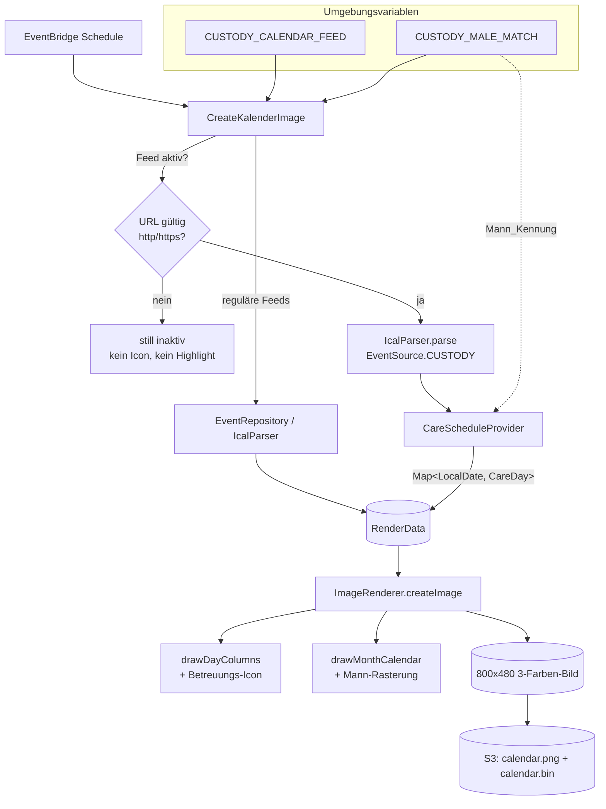
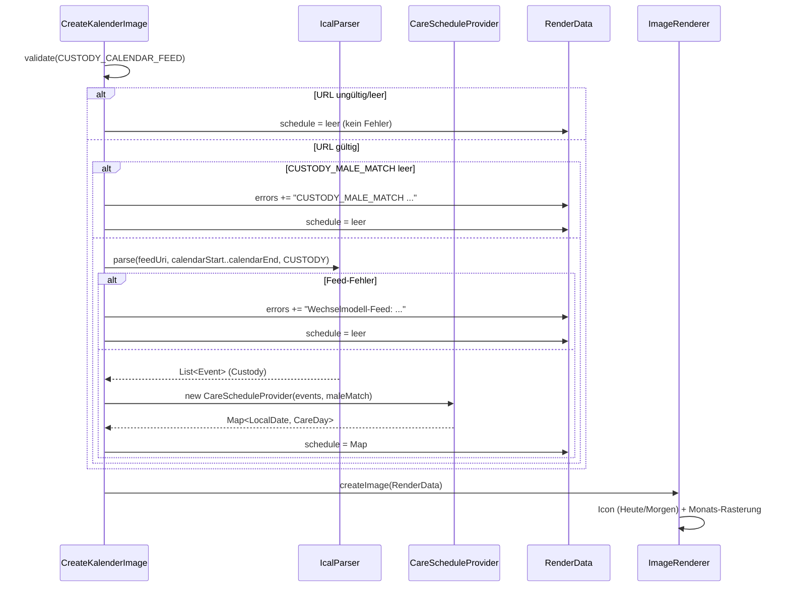

# Design Document: Wechselmodell-Kalender

## Overview

Der Wechselmodell-Kalender ergänzt den bestehenden Familienkalender um eine optionale, datengetriebene Darstellung der Kinderbetreuung im Wechselmodell. Aus einem separaten, ganztägige Events enthaltenden iCal-Feed (`CUSTODY_CALENDAR_FEED`) wird für jeden Tag im gerenderten Datumsbereich bestimmt, **welche Partei** (`MANN` oder `FRAU`) das Kind betreut – inklusive der Erkennung von **Wechseltagen**, an denen zwei Tageshälften unterschiedlichen Parteien gehören.

Das Ergebnis wird an zwei Stellen im 800×480-3-Farben-Bild sichtbar:

1. Ein **Betreuungs-Icon** („Mann"/„Frau") links neben der „Heute"-/„Morgen"-Überschrift.
2. Eine **leichte rote Rasterung** (Dithering) der Mann-Tage im 5-Wochen-Monatskalender, mit Halbzellen-Rasterung an Wechseltagen.

Das Feature folgt dem bestehenden Architekturmuster: Parsing über `IcalParser`/`EventRepository` (ical4j), Bündelung aller Renderdaten in `RenderData`, Zeichnen im `ImageRenderer`. Es ist **still optional**: Ohne gültige Feed-URL verhält sich der Kalender exakt wie bisher.

### Zuordnung Design ↔ Requirements

| Design-Abschnitt | Requirements |
|---|---|
| Aktivierung & Konfiguration | R1, R2, R8 |
| CareScheduleProvider (Datenmodell + Algorithmus) | R3, R4 |
| RenderData-Erweiterung | R3.2, R5, R6, R7.3 |
| CreateKalenderImage-Integration | R1, R2, R3, R8 |
| ImageRenderer: Tagesansicht-Icon | R5 |
| ImageRenderer: Monatskalender-Hervorhebung | R6 |
| Demo-Test | R7 |
| Error Handling | R1.3, R2.2, R3.6 |
| Correctness Properties | R1, R3, R4, R5, R6 |

### Research-Erkenntnisse (Grundlage im bestehenden Code)

- **Ganztägige iCal-Events** werden im `IcalParser` bereits als `startTime = DTSTART.atStartOfDay()` und `endTime = DTEND.atStartOfDay()` abgebildet (halboffen `[DTSTART, DTEND)`). Damit ist die in R3.3/R3.4 geforderte Semantik ohne Anpassung am Parser verfügbar.
- Die in R3.5 geforderte Overlap-Determinismus-Regel wird über einen deterministischen Tie-Key aus `(DTSTART, DTEND, SUMMARY)` erfüllt – **ohne** Änderung am `Event`-Record (siehe „Overlap-Determinismus (R3.5)").
- Der `ImageRenderer` zeichnet bereits **vektoriell** mit `Graphics2D` (z. B. `drawSchoolBadge`, Smiley) ausschließlich in Schwarz/Rot/transparent und verfügt über `fillDithered` (50 %-Schachbrett) und `fillDitheredLight` (~25 %). Für die geforderten 20–40 % wird ein neuer Helper ergänzt.
- Die Monatskalenderzelle ist `cellWidth × cellHeight (38)`; die **Heute-Hervorhebung** nutzt `fillDithered(COLOR_RED)` über die ganze Zelle, Teilnehmer-Indikatorbalken liegen oben (je 2 px), der Unassigned-Balken unten (2 px). Diese reservierten Zonen müssen von der Mann-Rasterung ausgespart werden (R6.7, R6.8).
- Es existiert **keine Property-Testing-Bibliothek** (nur JUnit Jupiter + AssertJ). Für die Correctness Properties wird **jqwik** vorgeschlagen.

## Architecture



### Datenfluss (Custody-Pfad)



### Designentscheidungen

- **Separater Parse-Aufruf statt Durchmischung mit `EventRepository`** (empfohlen): Der Custody-Feed wird direkt über `IcalParser.parse(feedUri, from, to, EventSource.CUSTODY)` eingelesen, **nicht** über `EventRepository`. Begründung:
  - R3.2 verlangt strikte Trennung – Custody-Events dürfen **nie** in `todayEvents`/`tomorrowEvents`/`calendarEvents` landen. Würde man sie ins `EventRepository` mischen, müsste an vielen Stellen (`getEventsForDay`, `getEventsForRange`, `getAllParticipants`, Indikatorbalken im Renderer) ausgefiltert werden – fehleranfällig.
  - Der `CareScheduleProvider` braucht die **rohen ganztägigen Spannen** (`[DTSTART, DTEND)`), während `EventRepository.getEventsForDay` mehrtägige Events in Tagesscheiben zerlegt. Ein separater Parse-Aufruf liefert die Events unverändert.
  - `IcalParser` ist bereits öffentlich und stateless – Wiederverwendung ohne Umbau.
- **Neuer `EventSource.CUSTODY`**: markiert die Herkunft, verhindert versehentliches Rendern als regulärer Termin und erlaubt dem Renderer/Repository, Custody-Events zu ignorieren, falls sie je doch durchgereicht würden.
- **Datum statt Uhrzeit als Schlüssel**: Betreuung ist tagesbasiert; `CareDay` wird über `LocalDate` indexiert.

## Components and Interfaces

### Neu: `EventSource.CUSTODY`

```java
public enum EventSource {
    CALENDAR, HOLIDAY, SCHOOL, VACATION,
    /** Event aus dem Wechselmodell-Feed (Betreuungs-Event) */
    CUSTODY
}
```

### Overlap-Determinismus (R3.5)

Der Overlap-Determinismus stützt sich ausschließlich auf einen deterministischen Tie-Key, der direkt aus den vorhandenen Event-Feldern abgeleitet wird:

```
tieKey = DTSTART + "|" + DTEND + "|" + SUMMARY
```

Überlappen sich an einem Tag mehrere Betreuungs-Events, gewinnt das Event mit dem **lexikografisch größten** `tieKey`. Da der Schlüssel rein aus `(DTSTART, DTEND, SUMMARY)` gebildet wird, ist das Ergebnis unabhängig von der Einlesereihenfolge. Eine Änderung am `Event`-Record ist **nicht** nötig.

> **Hinweis:** Der reale Wechselmodell-Feed ist lückenlos und überschneidungsfrei (ein Block grenzt direkt an den nächsten). Diese Tie-Key-Regel ist daher nur ein Determinismus-Sicherheitsnetz für degenerierte bzw. überlappende Feeds und greift im Normalbetrieb nicht.

### Neu: `CareScheduleProvider`

Reine Logik-Klasse (keine I/O), damit sie property-testbar ist.

```java
package de.goForFun.familienkalender;

public class CareScheduleProvider {

    /**
     * @param custodyEvents ganztägige Betreuungs-Events (EventSource.CUSTODY),
     *                      startTime/endTime als [DTSTART, DTEND) (00:00/00:00)
     * @param maleMatch     Mann_Kennung (nicht leer – Aufrufer stellt das sicher)
     */
    public CareScheduleProvider(List<Event> custodyEvents, String maleMatch) { ... }

    /** Liefert die deterministische Tag-zu-CareDay-Zuordnung für alle abgedeckten Tage. */
    public Map<LocalDate, CareDay> buildSchedule() { ... }
}
```

### Interface-Vertrag `CareScheduleProvider.buildSchedule()`

- Eingabe: Liste von Custody-Events + `maleMatch`.
- Ausgabe: `Map<LocalDate, CareDay>`, nur Einträge für abgedeckte Tage (R4.6: nicht abgedeckte Tage fehlen).
- Deterministisch und reihenfolgeunabhängig (R3.5, R3.7).

## Data Models

### `CareParty`

```java
package de.goForFun.familienkalender.model;

public enum CareParty { MANN, FRAU }
```

### `CareDay` (empfohlene Form: Record)

Gewählt wird ein **Record** statt einer `sealed interface`. Begründung:

- Der Renderer braucht für jede Zelle genau dieselben Zugriffe (`fullDay`, `firstHalf`, `secondHalf`, `switchDay`); ein Record erlaubt einen einheitlichen, verzweigungsarmen Zugriff ohne Pattern-Matching-Switch an jeder Zeichenstelle.
- Als `Map`-Wert trivial zu handhaben; einfache Konstruktion in Demo-Tests und Property-Generatoren.
- Eine `sealed interface FullDay | SwitchDay` wäre „typreiner", erzwingt aber an jeder Nutzung ein `switch` und erschwert die Icon-/Highlight-Auswahl. Der geringe Mehrwert rechtfertigt die Mehrkomplexität hier nicht.

```java
package de.goForFun.familienkalender.model;

/**
 * Betreuungsinformation für genau einen Kalendertag.
 *
 * Normaler Tag: switchDay == false, fullDay != null, firstHalf == secondHalf == fullDay, switchTime == null.
 * Wechseltag:   switchDay == true,  fullDay == null,
 *               firstHalf  = abgebende Partei (vor der Übergabe),
 *               secondHalf = übernehmende Partei (nach der Übergabe),
 *               switchTime = Uhrzeit der Übergabe aus dem getimten Wechsel-Event.
 */
public record CareDay(
        LocalDate date,
        CareParty fullDay,     // null an Wechseltagen
        CareParty firstHalf,   // erste Tageshälfte (vor der Übergabe)
        CareParty secondHalf,  // zweite Tageshälfte (nach der Übergabe)
        boolean switchDay,
        LocalTime switchTime   // Übergabezeit am Wechseltag; null an normalen Tagen
) {
    public static CareDay fullDay(LocalDate date, CareParty party) {
        return new CareDay(date, party, party, party, false, null);
    }
    public static CareDay switchDay(LocalDate date, CareParty first, CareParty second, LocalTime switchTime) {
        return new CareDay(date, null, first, second, true, switchTime);
    }

    /** Für das Betreuungs-Icon maßgebliche Partei (R5.3/R5.4): bei Wechseltag die zweite Hälfte. */
    public CareParty iconParty() {
        return switchDay ? secondHalf : fullDay;
    }
}
```

### Interne Zwischenstruktur: `CareBlock`

Nur innerhalb des `CareScheduleProvider`:

```java
record CareBlock(LocalDate startInclusive, LocalDate endExclusive, CareParty party, String tieKey) {
    LocalDate lastDay() { return endExclusive.minusDays(1); }
    boolean covers(LocalDate d) { return !d.isBefore(startInclusive) && d.isBefore(endExclusive); }
}
```

### `RenderData` (erweitert)

Neues Feld `custodySchedule` **am Ende** anfügen; bestehende Konstruktoren bleiben als abwärtskompatible Overloads erhalten (`custodySchedule = Map.of()`).

```java
public record RenderData(
        LocalDateTime now,
        List<Event> todayEvents,
        List<Event> tomorrowEvents,
        List<WeatherDay> weatherDays,
        List<Event> calendarEvents,
        List<String> participants,
        List<String> errors,
        Map<LocalDate, CareDay> custodySchedule   // NEU; leer = Feature inaktiv/übersprungen
) {
    // bisheriger Konstruktor mit errors, ohne custodySchedule
    public RenderData(LocalDateTime now, List<Event> todayEvents, List<Event> tomorrowEvents,
                      List<WeatherDay> weatherDays, List<Event> calendarEvents,
                      List<String> participants, List<String> errors) {
        this(now, todayEvents, tomorrowEvents, weatherDays, calendarEvents, participants, errors, Map.of());
    }

    // ältester Konstruktor ohne errors und ohne custodySchedule
    public RenderData(LocalDateTime now, List<Event> todayEvents, List<Event> tomorrowEvents,
                      List<WeatherDay> weatherDays, List<Event> calendarEvents, List<String> participants) {
        this(now, todayEvents, tomorrowEvents, weatherDays, calendarEvents, participants, List.of(), Map.of());
    }
}
```

> Warum `Map<LocalDate, CareDay>` statt `List<CareDay>`: Der Renderer greift pro Zelle genau per Datum zu (`schedule.get(day)`). Eine `Map` macht R4.6 (fehlendes Datum = keine Partei) natürlich und Lookups O(1).

## Key Algorithm: Block-Erkennung und Wechseltag-Ableitung

Der `CareScheduleProvider` verarbeitet die Events des Wechselmodell-Feeds in zwei Kategorien: **ganztägige Betreuungsblöcke** („Lukas bei …“, `VALUE=DATE`) und **getimte Wechsel-Events** („Wechsel zu …“, mit Uhrzeit). Die Blöcke liefern die Ganztagspartei je Tag; die getimten Wechsel-Events markieren explizit den Wechseltag samt Uhrzeit und übernehmender Partei.

```
buildSchedule(custodyEvents, maleMatch):
    blocks = []            # ganztägige Betreuungsblöcke
    switchEvents = []      # getimte Wechsel-Events
    for e in custodyEvents:
        if e.startTime == null or e.endTime == null: continue
        if isAllDay(e):    # Start und Ende jeweils 00:00
            startDate = e.startTime.toLocalDate()
            endExcl   = e.endTime.toLocalDate()
            if !endExcl.isAfter(startDate): endExcl = startDate.plusDays(1)
            party  = summaryContainsIgnoreCase(e.summary, maleMatch) ? MANN : FRAU   # R4.1/R4.2
            tieKey = startDate + '|' + endExcl + '|' + e.summary                     # R3.5
            blocks.add(CareBlock(startDate, endExcl, party, tieKey))
        else:
            switchEvents.add(e)    # getimtes Wechsel-Event (R3.4)

    # Pro Tag maßgeblichen Block bestimmen (Overlap-Determinismus, groesster tieKey, R3.5)
    dayToBlock = {}
    for b in blocks:
        for d in [b.startInclusive .. b.endExclusive):     # R3.3
            if dayToBlock[d] == null or b.tieKey > dayToBlock[d].tieKey: dayToBlock[d] = b

    # Basis: jeder abgedeckte Tag = Ganztag mit Blockpartei (R4.5)
    schedule = {}
    for d, b in dayToBlock: schedule[d] = CareDay.fullDay(d, b.party)

    # Getimte Wechsel-Events anwenden (R3.4/R4.3). Bei mehreren am selben Tag gewinnt das spaeteste.
    switchByDay = latestByDay(switchEvents)
    for d, e in switchByDay:
        second = summaryContainsIgnoreCase(e.summary, maleMatch) ? MANN : FRAU   # uebernehmende Partei
        block  = dayToBlock.get(d)
        first  = block != null ? block.party : otherParty(second)               # abgebende Partei (Vormittag)
        schedule[d] = CareDay.switchDay(d, first, second, e.startTime.toLocalTime())
    return schedule        # Tage ohne Eintrag => keine Partei (R4.6)
```

Hinweise:
- Die Block-Zuordnung je Tag ist **reihenfolgeunabhängig** (größter `tieKey`, R3.5); zweimaliges Ausführen liefert identische Maps inkl. Wechsel_Uhrzeit (R3.7).
- Ein **Wechseltag** entsteht ausschließlich durch ein getimtes Wechsel-Event an diesem Tag (nicht mehr aus aneinandergrenzenden Blöcken abgeleitet). `secondHalf` = die im Wechsel-Event (`Wechsel zu …`) benannte übernehmende Partei; `firstHalf` = die Ganztagspartei dieses Tages aus den Blöcken (abgebende Seite am Vormittag). Fehlt für den Tag ein Block, wird `firstHalf` auf die Gegenpartei der übernehmenden gesetzt.
- `switchTime` = Uhrzeit aus `DTSTART` des Wechsel-Events (z. B. 16:00; am DST-Sonderfall auch 01:00).
- `isAllDay(e)` prüft Start und Ende auf Mitternacht (00:00); getimte Wechsel-Events (z. B. 16:00–16:15) sind damit klar von den Blöcken unterschieden.
- `summaryContainsIgnoreCase` nutzt `summary.toLowerCase(ROOT).contains(maleMatch.toLowerCase(ROOT))`; leeres `summary` ⇒ `FRAU`.

## Components and Interfaces: Rendering-Integration

### CreateKalenderImage

Neue statische ENV-Reads und ein Custody-Block vor dem Bauen der `RenderData`:

```java
private static final String CUSTODY_CALENDAR_FEED = System.getenv("CUSTODY_CALENDAR_FEED");
private static final String CUSTODY_MALE_MATCH = System.getenv("CUSTODY_MALE_MATCH");
```

Ablauf (nach `calendarStart`/`calendarEnd`-Berechnung, vor `new RenderData(...)`):

```java
Map<LocalDate, CareDay> custodySchedule = Map.of();
List<String> errors = new ArrayList<>(eventRepository.getErrors());

URI custodyUri = parseHttpUri(CUSTODY_CALENDAR_FEED);   // null wenn fehlt/leer/ungültig/kein http(s)
if (custodyUri != null) {                                // R1.2 aktiv
    if (CUSTODY_MALE_MATCH == null || CUSTODY_MALE_MATCH.isBlank()) {
        errors.add("Wechselmodell: Umgebungsvariable CUSTODY_MALE_MATCH fehlt oder ist leer"); // R2.2
    } else {
        try {
            List<Event> custodyEvents =
                new IcalParser().parse(custodyUri, calendarStart, calendarEnd, EventSource.CUSTODY); // R3.1
            custodySchedule = new CareScheduleProvider(custodyEvents, CUSTODY_MALE_MATCH).buildSchedule();
        } catch (IOException | ParserException e) {
            errors.add("Wechselmodell-Feed: " + e.getMessage());   // R3.6
        }
    }
}
// R1.3: custodyUri == null -> schedule leer, KEIN Fehler

RenderData renderData = new RenderData(now, todayEvents, tomorrowEvents, weatherDays,
        calendarEvents, participants, errors, custodySchedule);
```

`parseHttpUri` validiert syntaktisch (R1.2/R1.3):

```java
private static URI parseHttpUri(String s) {
    if (s == null || s.isBlank()) return null;
    try {
        URI u = URI.create(s.trim());
        String scheme = u.getScheme();
        if (scheme == null) return null;
        scheme = scheme.toLowerCase(Locale.ROOT);
        if ((scheme.equals("http") || scheme.equals("https")) && u.getHost() != null && !u.getHost().isBlank()) {
            return u;
        }
        return null;
    } catch (IllegalArgumentException e) {
        return null;
    }
}
```

**Wichtig (R3.2):** Der Custody-Feed wird nicht in `EventRepository` eingespeist; `todayEvents`/`tomorrowEvents`/`calendarEvents` bleiben unverändert aus den regulären Feeds.

### ImageRenderer: Tagesansicht-Icon (R5)

`createImage` reicht den Schedule an `drawDayColumns` weiter, dieses an `drawDayColumn`. Pro Spalte wird vor dem Zeichnen der Überschrift die maßgebliche Partei bestimmt:

```java
// in drawDayColumn, für den jeweiligen Tag 'day'
CareDay cd = schedule.get(day);          // kann null sein (R5.9)
CareParty iconParty = (cd != null) ? cd.iconParty() : null;  // R5.3/R5.4 via CareDay.iconParty()
```

Die Überschrift wird über `FontHelper.drawString(..., Aligment.RIGHT, ...)` rechtsbündig in `[x, x+width]` gezeichnet. Das Icon steht **auf derselben Zeile wie der Wochentag, am Ende der Zeile** (rechter Spaltenrand), sodass es weder Text noch Events überlappt (R5.1/R5.2/R5.8):

- Icon-Box: quadratisch, Kantenlänge `ICON = 16 px`, am rechten Spaltenrand ausgerichtet: linke obere Ecke bei `(x + width - ICON, headerBaselineTop)`, wobei `headerBaselineTop` so gewählt ist, dass das Icon vertikal mittig zur Überschriftzeile liegt (`DAY_EVENTS_Y_START + 5 - ICON + 3` ≈ Oberkante der Textzeile).
- Die Überschrift wird rechtsbündig in den um die Iconbreite verkürzten Bereich `[x, x + width - (ICON + 4)]` gezeichnet, d. h. der Text endet unmittelbar links vom Icon; Icon und Text liegen auf einer Linie und kollidieren nicht. Bei `iconParty == null` bleibt die Überschrift wie bisher über die volle Breite (R5.9 – „übrige Darstellung unverändert").
- Events beginnen unverändert erst bei `spanningEndY`/`eventY` (vertikal unterhalb) → keine Überlappung mit Events (R5.8).
- Wechsel-Label (R5.10): An einem Wechseltag, an dem der Mann beteiligt ist, wird **über** der Icon-Box eine kleine Zeile (Schriftgröße ~9 px) rechtsbündig am Spaltenrand gezeichnet: „(bis HH:mm)“, wenn `firstHalf == MANN` (Mann gibt ab), bzw. „(ab HH:mm)“, wenn `secondHalf == MANN` (Mann übernimmt); `HH:mm` ist die `switchTime`. An normalen Tagen oder wenn der Mann an keiner Hälfte beteiligt ist, entfällt das Label. Die Zeile liegt oberhalb von `iconTop` und überlappt weder die Wochentag-Überschrift noch das Icon.

Icon-Zeichnung – **WC-Schild-Piktogramme** (eindeutige Toiletten-Symbolik) statt Gender-Symbolen, ausschließlich Schwarz/`COLOR_RED`/transparent, vektoriell, **kein Antialiasing-Grau** (R5.7). Mann = rot (passt zur roten Monatsrasterung), Frau = schwarz. Beide teilen sich denselben runden Kopf; der Körper unterscheidet die Parteien wie auf WC-Schildern eindeutig:

- **Mann**: gefüllter Rumpf (Rechteck/Trapez) + zwei getrennte Beine (zwei schmale gefüllte Rechtecke mit einer schmalen transparenten Lücke in der Mitte).
- **Frau**: gefülltes, nach unten breiter werdendes Dreieckskleid (Saum deutlich breiter als die Schulter), darunter typischerweise ohne getrennte Beine.

```
drawCareIcon(g, party, bx, by, size):     # size = 16
    cx = bx + size/2
    color = (party == MANN) ? COLOR_RED : COLOR_BLACK
    g.setColor(color)
    # Gemeinsamer Kopf: gefüllter Kreis, oben zentriert
    headR = round(size * 0.20)
    headTop = by + 1
    g.fillOval(cx-headR, headTop, 2*headR, 2*headR)
    neckY = headTop + 2*headR + 1
    bottom = by + size - 1
    if party == MANN:
        # Rumpf mit geraden Schultern
        shoulderHalf = round(size*0.28)
        torsoBottom = neckY + round((bottom-neckY)*0.55)
        g.fillRect(cx-shoulderHalf, neckY, 2*shoulderHalf, torsoBottom-neckY)
        # Zwei Beine mit schmaler transparenter Mittel-Lücke
        legW = shoulderHalf - 1
        gap  = max(1, round(size*0.08))
        g.fillRect(cx-legW, torsoBottom, legW-gap/2 ... , bottom-torsoBottom)   # linkes Bein
        g.fillRect(cx+gap/2 ..., torsoBottom, ... , bottom-torsoBottom)          # rechtes Bein
    else: # FRAU
        # Kleid: schmale Schulter oben, breiter Saum unten (gefülltes Trapez/Dreieck)
        topHalf = round(size*0.16)   # schmale Schulter
        botHalf = round(size*0.36)   # breiter Saum
        g.fillPolygon([cx-topHalf, cx+topHalf, cx+botHalf, cx-botHalf],
                      [neckY,      neckY,      bottom,     bottom])
```

Beide Piktogramme bestehen aus gefüllten Grundformen (Kreis für den Kopf, gefüllte Rechtecke bzw. ein gefülltes Trapez für den Körper) – jedes Pixel ist entweder gesetzt (schwarz bzw. rot) oder unberührt (transparent). Antialiasing bleibt über `fillOval`/`fillRect`/`fillPolygon` in Volltonfarbe aus (R5.7). Die Mann-Figur ist durch die **zwei getrennten Beine** eindeutig als Hosen-Figur, die Frau-Figur durch das **nach unten breiter werdende Kleid** eindeutig als Kleid-Figur erkennbar – dieselbe Unterscheidung wie auf WC-Schildern.

### ImageRenderer: Monatskalender-Hervorhebung (R6)

`drawMonthCalendar` erhält den Schedule. Pro Zelle (Datum `day`, `cellX`, `cellY`, `cellWidth`, `cellHeight`) wird die Mann-Rasterung **vor** Tageszahl und Rahmen gezeichnet (damit Zahl/Rahmen obenauf liegen und lesbar bleiben), aber unter Berücksichtigung reservierter Zonen.

Zeichenreihenfolge und Bedeckung (R6.1/R6.8):
- Die Mann-Rasterung füllt den **gesamten Zellhintergrund** `(cellX+1, cellY+1)` bis `(cellX+cellWidth, cellY+cellHeight)` und wird **vor** Tageszahl, Rahmen und Indikatorbalken gezeichnet.
- Die Vollton-Indikatorbalken (Teilnehmerbalken oben, Unassigned-Balken unten) werden wie bisher **danach** gezeichnet und überdecken die darunterliegende Schraffur vollständig; sie bleiben damit als durchgehende Volltonflächen erkennbar (R6.8). Es ist keine Zonen-Aussparung mehr nötig.
- Heute-Zelle: Heute-Rasterung/-Rahmen bleiben unverändert; die Mann-Rasterung wird für die Heute-Zelle **nicht** zusätzlich gezeichnet (die Heute-Hervorhebung dominiert, Tageszahl bleibt lesbar). Das erfüllt R6.7.
- Wochenend-Überlagerung (R6.10): An Wochenendtagen wird zuerst das leichte graue Wochenend-Raster (`fillDitheredLight`, ~25 % Schwarz) und anschließend – für Mann-Tage – die rote Mann-Schraffur (~11 %) in dieselbe Zelle gezeichnet. Beide Raster liegen übereinander; an den wenigen Pixeln, die beide setzen würden (gemeinsame Vielfache der Perioden), erscheint durch die spätere Zeichnung COLOR_RED. Dank `IndexColorModel` entsteht nie eine Mischfarbe oder Graustufe (e-ink-konform).

Wechseltage werden **diagonal** geteilt (R6.4): die Diagonale verläuft von **unten-links nach oben-rechts**. Das obere-linke Dreieck gehört zur Erste_Tageshälfte, das untere-rechte Dreieck zur Zweite_Tageshälfte. Ein (relativ zur inneren Zelle normierter) Punkt `(u, v)` mit `u = (px-innerX)/innerW`, `v = (py-innerY)/innerH` liegt im **oberen-linken** Dreieck, wenn `u + v < 1`, sonst im unteren-rechten.

```
drawCustodyHighlight(g, day, cellX, cellY, cellWidth, cellHeight, schedule, today, participants):
    if day == today: return                          # R6.7: Heute dominiert
    cd = schedule.get(day)
    if cd == null: return                             # R6.9
    innerX = cellX + 1
    innerY = cellY + 1
    innerW = cellWidth - 1
    innerH = cellHeight - 1
    if innerW <= 0 or innerH <= 0: return
    if cd.switchDay:                                  # R6.4 (diagonale Teilung)
        if cd.firstHalf == MANN:                      # R6.5: oberes-linkes Dreieck
            fillCustodyDitherTriangle(g, innerX, innerY, innerW, innerH, UPPER_LEFT)
        if cd.secondHalf == MANN:                     # R6.6: unteres-rechtes Dreieck
            fillCustodyDitherTriangle(g, innerX, innerY, innerW, innerH, LOWER_RIGHT)
    else:                                             # R6.1 / R6.3
        if cd.fullDay == MANN:
            fillCustodyDither(g, innerX, innerY, innerW, innerH)   # ganze Zelle
        # FRAU: nichts (0% der Zelle)
```

Da die Schraffur den ganzen Zellhintergrund füllt und die Vollton-Balken erst **danach** darübergezeichnet werden, überdecken die Balken die Schraffur in ihrer Zone vollständig (R6.8). Die Tageszahl wird – wie bisher – danach zentriert gezeichnet und bleibt sichtbar (das leichte 8–20 %-Raster lässt ≥ 80 % weiß, die schwarze Zahl bleibt gut lesbar; R6.7).

Leichter Dithering-Helper mit **8–20 % Dichte** (R6.2). Für eine dezente Schraffur wird **1 von 8 Pixeln** (~12,5 %) in einem gleichmäßigen Gittermuster gesetzt:

```java
/** Leichte Rasterfüllung ~12,5% (innerhalb 8–20%) in COLOR_RED für die Mann-Tag-Hervorhebung (R6.2). */
private void fillCustodyDither(Graphics2D g, int x, int y, int width, int height) {
    g.setColor(COLOR_RED);
    for (int py = y; py < y + height; py++) {
        for (int px = x; px < x + width; px++) {
            // Gleichmäßiges Punktgitter: gleicher Abstand (3) horizontal wie vertikal
            // -> jedes 9. Pixel (~11%). Absolute Koordinaten, damit das Muster über
            // Zellgrenzen hinweg nahtlos bleibt.
            if ((px % 3 == 0) && (py % 3 == 0)) {
                g.fillRect(px, py, 1, 1);
            }
        }
    }
}

/** Wie fillCustodyDither, aber nur im oberen-linken bzw. unteren-rechten Dreieck (diagonale Teilung, R6.4). */
private void fillCustodyDitherTriangle(Graphics2D g, int x, int y, int w, int h, Triangle tri) {
    g.setColor(COLOR_RED);
    for (int py = y; py < y + h; py++) {
        for (int px = x; px < x + w; px++) {
            if (!((px % 3 == 0) && (py % 3 == 0))) continue;
            // normierte Lage in der Zelle; Diagonale unten-links -> oben-rechts: u + v = 1
            double u = (px - x + 0.5) / w;
            double v = (py - y + 0.5) / h;
            boolean upperLeft = (u + v) < 1.0;
            if ((tri == UPPER_LEFT) == upperLeft) {
                g.fillRect(px, py, 1, 1);
            }
        }
    }
}
```

`(px % 3 == 0) && (py % 3 == 0)` setzt genau jedes neunte Pixel in einem gleichmäßigen Gitter mit identischem horizontalem und vertikalem Abstand (3); der Füllanteil (~11 %) liegt für zellrealistische Flächen sicher im Zielband [8 %, 20 %] (R6.2). Die Dreiecks-Variante wendet dasselbe Gitter an, filtert aber über die normierte Diagonale `u + v < 1` (oberes-linkes Dreieck) bzw. `u + v ≥ 1` (unteres-rechtes Dreieck) – die beiden Dreiecke sind disjunkt und ergeben zusammen die ganze (gerasterte) Zelle.

## Error Handling

| Situation | Verhalten | Req |
|---|---|---|
| `CUSTODY_CALENDAR_FEED` fehlt/leer/kein gültiges http(s) | Feature still inaktiv, Schedule leer, **kein** Eintrag in `errors` | R1.3 |
| Feature aktiv, `CUSTODY_MALE_MATCH` fehlt/leer | `errors += "...CUSTODY_MALE_MATCH..."`, Schedule leer, restliches Bild rendert normal | R2.2 |
| Custody-Feed nicht erreichbar / ungültige iCal-Daten | `errors += "Wechselmodell-Feed: <msg>"`, Schedule leer, restliches Bild rendert normal | R3.6 |
| Leerer Schedule im Renderer | Keine Icons, keine Mann-Rasterung; Tagesspalten/Monatskalender wie bisher | R1.4, R5.9, R6.9 |

Die `errors` werden wie bisher über `drawErrors` rot im Bild angezeigt und im Lambda geloggt. Fehler im Custody-Pfad brechen das übrige Rendern **nie** ab (try/catch kapselt nur den Custody-Block). Die URL-Validierung (`parseHttpUri`) wirft nicht, sondern liefert `null` → damit erzeugt eine ungültige URL **keinen** Fehler (R1.3), während eine gültige URL mit Netzwerk-/Parse-Problem über den `catch` einen Fehler erzeugt (R3.6).

## Correctness Properties

*Eine Property ist eine Eigenschaft bzw. ein Verhalten, das über alle gültigen Ausführungen eines Systems hinweg gelten soll – im Kern eine formale Aussage darüber, was das System tun soll. Properties bilden die Brücke zwischen menschenlesbarer Spezifikation und maschinell prüfbaren Korrektheitsgarantien.*

Die testbare Logik (`CareScheduleProvider`, URL-Validierung, Icon-Auswahl, Highlight-Region, Dither-Dichte) ist rein und eignet sich für Property-Based Testing. UI-Platzierungs- und Demo-/Deployment-Kriterien (R5.1/5.2/5.5/5.6/5.9, R2.2, R3.6, R6.7, R7, R8) werden über Beispiel-/Smoke-Tests abgedeckt (siehe Testing Strategy).

### Property 1: URL-Validierung steuert Aktivierung ohne Fehler

*Für alle* Strings `s` gilt: `parseHttpUri(s)` liefert genau dann eine URI (Feature aktiv), wenn `s` nicht-leer und eine syntaktisch gültige http/https-URL mit Host ist; andernfalls `null` (inaktiv), und in diesem Fall wird **kein** Custody-Konfigurationsfehler in `RenderData.errors` aufgenommen.

**Validates: Requirements 1.2, 1.3**

### Property 2: Halboffene Bereichsabdeckung

*Für jedes* Betreuungs_Event mit Spanne `[DTSTART, DTEND)` (Länge ≥ 1 Tag) ist im resultierenden Schedule jeder Tag `d` mit `DTSTART ≤ d < DTEND` abgedeckt und `DTEND` selbst nicht; für Länge 1 ist genau `DTSTART` abgedeckt.

**Validates: Requirements 3.3, 3.4**

### Property 3: Overlap-Determinismus über den Tie-Key

*Für jede* Menge sich überlappender Betreuungs_Events und *für jede* Permutation ihrer Einlesereihenfolge ist die resultierende `Map<LocalDate, CareDay>` identisch, und jeder überlappte Tag ist dem Event mit dem lexikografisch größten `tieKey` (zusammengesetzt aus `DTSTART + "|" + DTEND + "|" + SUMMARY`) zugeordnet.

**Validates: Requirements 3.5**

### Property 4: Wiederholdeterminismus

*Für jede* Eingabe aus Custody-Events und Mann_Kennung liefert zweimaliges Ausführen von `buildSchedule` für jeden abgedeckten Tag dasselbe Ergebnis (Ganztägige_Partei bzw. Wechseltag-Paar).

**Validates: Requirements 3.7**

### Property 5: Parteiklassifikation per Teilstring (case-insensitive)

*Für jedes* `summary` und *jede* nicht-leere Mann_Kennung gilt: Die Partei des Blocks ist `MANN` genau dann, wenn `summary` die Kennung – unabhängig von Groß-/Kleinschreibung – als Teilstring enthält, sonst `FRAU`.

**Validates: Requirements 4.1, 4.2**

### Property 6: Block- und Wechseltag-Invariante

*Für jede* Menge aus ganztägigen Betreuungsblöcken und getimten Wechsel-Events gilt für jeden abgedeckten Tag `d`: Liegt für `d` **kein** Wechsel-Event vor, so ist `d` ein Ganztag mit der Partei des maßgeblichen Blocks (`switchDay == false`, `fullDay == Blockpartei`). Liegt für `d` **ein** Wechsel-Event vor, so ist `d` ein Wechseltag (`switchDay == true`) mit `secondHalf == übernehmende Partei des Wechsel-Events`, `firstHalf == Ganztagspartei des Tages aus den Blöcken` (bzw. Gegenpartei der übernehmenden, falls kein Block den Tag abdeckt) und `switchTime == Uhrzeit des Wechsel-Events`.

**Validates: Requirements 4.3, 4.4, 4.5**

### Property 7: Keine Partei an nicht abgedeckten Tagen

*Für jeden* Tag, den kein Betreuungs_Event abdeckt, existiert kein Eintrag im Schedule (keine Betreuende_Partei).

**Validates: Requirements 4.6**

### Property 8: Icon-Partei-Auswahl

*Für jeden* `CareDay` gilt: `iconParty()` ist `secondHalf`, wenn der Tag ein Wechseltag ist, sonst `fullDay`.

**Validates: Requirements 5.3, 5.4**

### Property 9: Icon-Farbpalette

*Für jede* gerenderte Betreuungs_Piktogramm-Fläche enthält der Pixelpuffer ausschließlich die drei erlaubten Indizes (transparent, schwarz, `COLOR_RED`) – keine Graustufen oder Halbtöne.

**Validates: Requirements 5.7**

### Property 10: Icon-Layout ist disjunkt

*Für jede* aktive Spalte mit Betreuungs_Piktogramm liegt die Icon-Bounding-Box auf der Höhe der Überschriftzeile am rechten Spaltenrand und ist disjunkt zur Bounding-Box des (um die Iconbreite verkürzten) Überschrifttextes sowie zum darunterliegenden Event-Bereich derselben Spalte: Die linke Icon-Kante (`x + width - ICON`) liegt rechts von der rechten Textkante, und die Icon-Unterkante liegt oberhalb des Event-Bereichs.

**Validates: Requirements 5.8**

### Property 11: Highlight-Region-Korrektheit

*Für jeden* `CareDay` und *jede* Zellgeometrie gilt für die mit dem Mann-Pattern eingefärbte Region innerhalb der Zelle: Bei Ganztag `MANN` ist es der gesamte nutzbare Zellhintergrund; bei Ganztag `FRAU` oder fehlendem `CareDay` ist die Region leer; bei Wechseltag liegt ein gesetztes Pixel im oberen-linken Dreieck (normierte Lage `u + v < 1`) genau dann im Pattern, wenn `firstHalf == MANN`, und ein Pixel im unteren-rechten Dreieck (`u + v ≥ 1`) genau dann, wenn `secondHalf == MANN`, wobei oberes-linkes und unteres-rechtes Dreieck disjunkt sind.

**Validates: Requirements 6.1, 6.3, 6.4, 6.5, 6.6, 6.9**

### Property 12: Dithering-Dichte in [8 %, 20 %]

*Für jedes* Rechteck `(x, y, w, h)` mit zellrealistischer Mindestgröße (`w ≥ 8` und `h ≥ 4`, entsprechend den realen Monatskalender-Zellen) liegt der Anteil der von `fillCustodyDither` gesetzten Pixel an der Gesamtfläche im geschlossenen Intervall [0,08, 0,20]. Das Gitter setzt jedes neunte Pixel in einem gleichmäßigen Raster mit identischem Abstand horizontal und vertikal (`px % 3 == 0 && py % 3 == 0`), Soll-Dichte ~11 %. Hinweis: Für degenerierte Flächen unterhalb einer Gitterperiode sind nur Dichten 0 % oder 100 % erreichbar; solche Größen treten bei der realen Zellgeometrie nicht auf und sind von der Garantie ausgenommen.

**Validates: Requirements 6.2**

### Property 13: Vollton-Indikatorbalken überdecken die Mann-Rasterung

*Für jede* Zelle, die zugleich eine Mann-Rasterung im Hintergrund und einen Vollton-Indikatorbalken trägt, gilt nach der vollständigen Zeichenreihenfolge (Rasterung zuerst, Balken danach): In der Balkenzone sind alle Pixel die Vollton-Balkenfarbe – es sind dort keine roten Dither-Pixel sichtbar, weil der zuletzt gezeichnete Vollton-Balken die darunterliegende Schraffur vollständig überdeckt.

**Validates: Requirements 6.8**

### Property 14: Wochenend- und Mann-Raster erzeugen nur erlaubte Volltonfarben

*Für jede* Mann-Wochenend-Zelle gilt nach der Zeichenreihenfolge (graues Wochenend-Raster zuerst, rote Mann-Schraffur danach): Jeder Pixel der Zelle hat ausschließlich einen der drei erlaubten Paletten-Indizes (transparent, schwarz, `COLOR_RED`) – es entsteht keine Mischfarbe und keine Graustufe. An jedem Pixel, das sowohl das graue als auch das rote Raster setzen würde, ist der resultierende Index `COLOR_RED` (rot gewinnt, da zuletzt gezeichnet).

**Validates: Requirements 6.10**

### Property 15: Wechsel-Label aus Mann-Sicht

*Für jeden* `CareDay` gilt für das über dem Icon angezeigte Wechsel-Label: Ist der Tag kein Wechseltag oder ist der Mann an keiner Tageshälfte beteiligt oder fehlt die `switchTime`, so ist das Label leer (kein Text). Ist der Tag ein Wechseltag mit `firstHalf == MANN` und `secondHalf != MANN`, so lautet das Label `(bis HH:mm)`; ist `secondHalf == MANN` und `firstHalf != MANN`, so lautet es `(ab HH:mm)` – jeweils mit der `switchTime` im 24-Stunden-Format `HH:mm`.

**Validates: Requirements 5.10**

## Testing Strategy

### Property-Based Testing

Es wird **jqwik** als Property-Testing-Bibliothek ergänzt (test-scope in `pom.xml`, Junit-5-Plattform; keine Eigenimplementierung). Begründung der Eignung: `CareScheduleProvider`, `parseHttpUri`, `CareDay.iconParty`, die Highlight-Region-Berechnung und `fillCustodyDither` sind reine, eingabevariierende Funktionen mit großem Eingaberaum (Datumsbereiche, Blocksequenzen, Strings, Rechteckgeometrien) – ideal für universelle Properties.

- Jede der Properties 1–13 wird mit **genau einem** Property-Test (jqwik `@Property`) implementiert.
- Mindestens **100 Iterationen** je Property (`@Property(tries = 100)` oder höher).
- Jeder Property-Test wird kommentiert mit: **Feature: wechselmodell-kalender, Property {Nummer}: {Property-Text}**.
- Generatoren:
  - Blocksequenzen: Startdatum + Liste aufeinanderfolgender/lückenbehafteter Spannen (Länge ≥ 1), Parteien zufällig; deckt Länge-1-Randfall und „keine Lücke/Lücke" ab.
  - Strings für URL- und Kennungs-Properties: gültige http/https-URLs, leere/null, `ftp:`/`mailto:`, relative Pfade, Zufallstext; Kennung als Teilstring in gemischtem Casing in/neben dem Summary.
  - Rechtecke für Dither-/Region-Properties: `w,h ∈ [1, 120]`, Offsets variabel.
  - Für Property 9 (Icon-Farbpalette) wird in einen `TYPE_BYTE_BINARY`-Puffer mit demselben 3-Farben-`IndexColorModel` wie `ImageRenderer` gezeichnet und der Raster auf erlaubte Indizes geprüft.

### Unit-/Beispiel- und Smoke-Tests

Für Kriterien, die nicht eingabevariierend sind:

- **R1.4 / R5.9 / R6.9** (inaktiv/leerer Schedule): Beispieltest, dass Rendering mit leerem `custodySchedule` keine Icons/Highlights zeichnet und dem bisherigen Verhalten entspricht (Charakterisierung).
- **R2.2**: Beispieltests (null, leer, nur Whitespace) → `errors` enthält `CUSTODY_MALE_MATCH`, Schedule leer, Bild rendert.
- **R3.6**: Beispieltests mit unerreichbarer URL bzw. Garbage-iCal → `errors` enthält `Wechselmodell-Feed`, Schedule leer.
- **R5.1/5.2/5.5/5.6**: Beispieltests des Party→Icon-Mappings und der Links-Platzierung an „Heute"/„Morgen".
- **R6.7**: Beispieltest Heute-Zelle + MANN → Heute-Hervorhebung vorhanden, Tageszahl gezeichnet, keine zusätzliche Mann-Rasterung.
- **R7**: siehe Demo-Test unten (Smoke-Rendering).
- **R8**: Konfig-Review/Smoke, dass `serverless.yml` beide ENV-Variablen unter `FamilyWall-Kalender` führt.

Balance: Property-Tests übernehmen die Breitenabdeckung (Block-/Wechseltag-Logik, Klassifikation, Geometrie, Dichte); Unit-Tests decken konkrete Fehlerfälle, Mappings und Integrationspunkte ab.

## Demo-Test-Erweiterung (R7)

`TestImageCreation.buildRenderData` erhält einen zusätzlichen Parameter `Map<LocalDate, CareDay> custodySchedule` (bzw. eine Überladung) und reicht ihn an den neuen `RenderData`-Konstruktor durch. Der bestehende `testImageCreation`-Test baut repräsentative Demodaten relativ zu `now.toLocalDate()`:

```java
LocalDate base = now.toLocalDate().with(DayOfWeek.MONDAY); // sichtbar im 5-Wochen-Raster
Map<LocalDate, CareDay> demo = new HashMap<>();
demo.put(base,               CareDay.fullDay(base, CareParty.MANN));                 // R7.1: MANN-Ganztag
demo.put(base.plusDays(1),   CareDay.fullDay(base.plusDays(1), CareParty.MANN));
demo.put(base.plusDays(2),   CareDay.switchDay(base.plusDays(2), CareParty.MANN, CareParty.FRAU)); // R7.1: Wechseltag MANN->FRAU
demo.put(base.plusDays(3),   CareDay.fullDay(base.plusDays(3), CareParty.FRAU));     // R7.1: FRAU-Ganztag
demo.put(base.plusDays(4),   CareDay.fullDay(base.plusDays(4), CareParty.FRAU));
// Heute + Folgetag mit Partei belegen, damit das Icon in beiden Spalten erscheint:
LocalDate today = now.toLocalDate();
demo.putIfAbsent(today,             CareDay.switchDay(today, CareParty.FRAU, CareParty.MANN)); // Icon = MANN (secondHalf)
demo.putIfAbsent(today.plusDays(1), CareDay.fullDay(today.plusDays(1), CareParty.FRAU));
```

Damit prüft das Demo-PNG sichtbar: Betreuungs-Icon inkl. Wechseltag-Regel (Icon folgt `secondHalf`) sowie Monatskalender-Rasterung inkl. Halbzellen-Hervorhebung am Wechseltag (R7.2). Der Schedule wird über die erweiterte `buildRenderData` in die `RenderData` aufgenommen (R7.3). Der bestehende Rendering-Durchlauf bleibt ein Smoke-Test (erzeugt `test.png` ohne Exception).

## Deployment-Konfiguration (R8)

In `serverless.yml` unter `functions.FamilyWall-Kalender.environment` werden zwei Variablen ergänzt:

```yaml
      CUSTODY_CALENDAR_FEED: ${param:custodyCalendarFeed, ''}
      CUSTODY_MALE_MATCH: ${param:custodyMaleMatch, ''}
```

Default `''` ⇒ bei nicht gesetztem Parameter bleibt das Feature still inaktiv (R1.3), konsistent mit dem bestehenden Muster (`SCHOOL_CALENDAR_FEED: ${param:..., ''}`).
