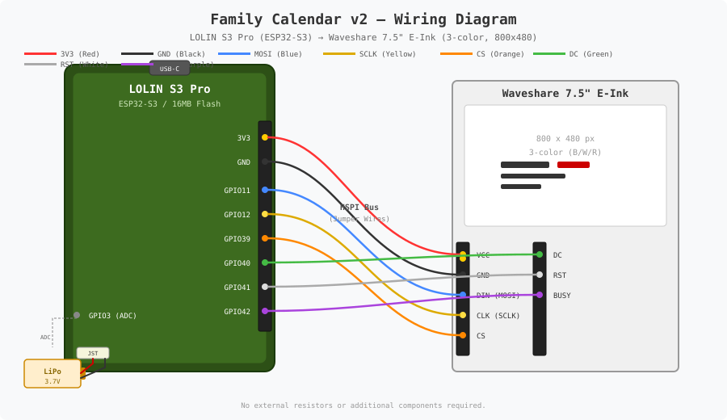

# Family Calendar v2

A serverless family calendar system that renders events, weather, and a monthly overview onto a 3-color e-ink display (800x480, black/white/red). The system consists of a Java backend running on AWS Lambda and an ESP32-S3 firmware that drives the physical display.

In addition, the backend publishes an **anonymized iCal feed** for [FamilyWall](https://www.familywall.com): a third Lambda function (`ServeAnonymizedFeed`) re-serves an [Outlook.com](https://outlook.com) calendar with private appointments reduced to a placeholder ("Privat"), while the e-ink display keeps showing the original titles. See [Anonymized iCal Feed](#anonymized-ical-feed) and [External Services](#external-services).

> This is the successor to [family_calendar v1](https://github.com/Froschi1860/family_calendar). The v2 rewrite replaces the original architecture with a serverless backend, a dedicated ESP32 firmware with OTA updates, and a cleaner separation between image generation and display rendering.

## Architecture

```
 External sources
 ┌──────────────┐ ┌─────────────┐ ┌──────────────┐ ┌──────────────┐ ┌───────────────┐
 │ Family iCal  │ │ School /    │ │ Wechselmodell│ │ Outlook iCal │ │ OpenWeatherMap│
 │ CALENDAR_FEED│ │ Vacation    │ │ CUSTODY_     │ │ ANON_SOURCE_ │ │ OneCall 3.0   │
 │              │ │ iCal feeds  │ │ CALENDAR_FEED│ │ FEED         │ │               │
 └──────┬───────┘ └──────┬──────┘ └──────┬───────┘ └──┬────────┬──┘ └───────┬───────┘
        │                │               │            │        │            │
        └────────────────┴───────┬───────┴────────────┘        │            │
                                 │   ┌─────────────────────────┼────────────┘
┌────────────────────────────────┼───┼─────────────────────────┼──────────────────────┐
│ AWS Cloud                      ▼   ▼                         ▼                      │
│                                                                                     │
│  EventBridge ──▶ ┌─────────────────────────┐        ┌──────────────────────────┐    │
│  (every 6h)      │ CreateKalenderImage     │        │ ServeAnonymizedFeed      │    │
│                  │  - aggregates all feeds │        │ (Function URL, ?token=)  │    │
│                  │  - Outlook events →     │        │  - private events →      │    │
│                  │    ANON_PARTICIPANT     │        │    ANON_PLACEHOLDER      │    │
│                  │  - holidays (jollyday)  │        │  - drops past/free events│    │
│                  │  - renders 800x480 BWR  │        │  - X-WR-CALNAME =        │    │
│                  └────────────┬────────────┘        │    ANON_PARTICIPANT      │    │
│                               │ putObject           │  - no S3 access          │    │
│                               ▼                     └────────────┬─────────────┘    │
│                  ┌─────────────────────────┐                     │                  │
│                  │ S3 Bucket               │                     │                  │
│                  │  - calendar.png         │                     │                  │
│                  │  - calendar.bin         │                     │                  │
│                  └────────────┬────────────┘                     │                  │
│                               │ getObject                        │                  │
│                               ▼                                  │                  │
│                  ┌─────────────────────────┐                     │                  │
│                  │ ServeCalendarImage      │                     │                  │
│                  │ (Function URL, Bearer)  │                     │                  │
│                  │  + X-Next-Update-Seconds│                     │                  │
│                  └────────────┬────────────┘                     │                  │
└───────────────────────────────┼──────────────────────────────────┼──────────────────┘
                                │ HTTPS (Bearer token)             │ ICS subscription
                                ▼                                  ▼ (text/calendar)
               ┌─────────────────────────────────┐        ┌──────────────────────────┐
               │ ESP32-S3 (LOLIN S3 Pro)         │        │ FamilyWall               │
               │  - fetch calendar.bin           │        │  external calendar,      │
               │  - battery indicator            │        │  shared with the member  │
               │  - OTA updates (GitHub)         │        │  ANON_PARTICIPANT        │
               │  - deep sleep                   │        └──────────────────────────┘
               │             │                   │
               │  ┌──────────▼────────────────┐  │
               │  │ 7.5" e-ink, 800x480, BWR  │  │
               │  └───────────────────────────┘  │
               └─────────────────────────────────┘
```

Two views of the Outlook calendar come out of the same source: the **e-ink display shows the original titles** (assigned to `ANON_PARTICIPANT`), **FamilyWall receives the anonymized feed**.

### Backend (Java / AWS Lambda)

The backend is a Java 21 application packaged as an uber-JAR and deployed to AWS Lambda via the Serverless Framework.

**Three Lambda functions:**

1. **CreateKalenderImage** — Triggered every 6 hours by EventBridge. Fetches calendar events from multiple iCal feeds, loads weather data from OpenWeatherMap, and renders an 800x480 3-color bitmap. Uploads both a PNG (for browser preview) and a raw bitplane binary (`calendar.bin`) to S3.

2. **ServeCalendarImage** — Exposed via a Lambda Function URL. Authenticates the ESP32 via Bearer token, reads `calendar.bin` from S3, and returns it with an `X-Next-Update-Seconds` header that tells the device how long to sleep.

3. **ServeAnonymizedFeed** — Exposed via a Lambda Function URL. Re-serves an Outlook iCal feed for FamilyWall with private event details replaced by a placeholder (see [Anonymized iCal Feed](#anonymized-ical-feed)). Does not touch S3 or the device path.

**Key components:**

| Class | Responsibility |
|-------|---------------|
| `EventRepository` | Aggregates events from family iCal, school calendar, vacation feed, public holidays and (optionally) the original Outlook feed assigned to `ANON_PARTICIPANT` |
| `IcalParser` | Parses iCal feeds using ical4j |
| `IcalMapping` | MapStruct mapper from ical4j `VEvent` to internal `Event` model |
| `HolidayProvider` | Public holidays via jollyday (configurable country/state) |
| `WeatherService` | 3-day forecast from OpenWeatherMap OneCall API 3.0 |
| `ImageRenderer` | Renders the 800x480 3-color image (header, day columns, weather, month calendar, footer) |
| `BitplaneExporter` | Converts the rendered image into raw bitplane format for the e-ink display |
| `anonfeed.ServeAnonymizedFeed` | Lambda handler for the anonymized FamilyWall feed (auth via `?token=`, error→status mapping, 10 s fetch timeout) |
| `anonfeed.FeedAnonymizer` | Pure ical4j transformation: anonymizes private events, filters past/free events, sets `X-WR-CALNAME` |
| `anonfeed.AnonConfig` | Reads and validates the `ANON_*` environment variables |

### Firmware (ESP32-S3 / PlatformIO)

The firmware runs on a **WeMos LOLIN S3 Pro** board connected to a Waveshare 7.5" 3-color e-ink display (800x480).

**Lifecycle:**

1. Boot from deep sleep
2. Load WiFi/API config from NVS flash (first boot triggers serial setup wizard)
3. Connect to WiFi
4. Check for OTA firmware updates via GitHub Releases
5. Fetch `calendar.bin` from the Lambda Function URL
6. Draw battery indicator and firmware version into the image buffer
7. Refresh the e-ink display
8. Enter deep sleep for the duration specified by the backend

**Libraries:** GxEPD2 (e-paper driver), Adafruit GFX

## External Services

The backend integrates the following third-party services. None of them is required except the primary family iCal feed and OpenWeatherMap; each optional integration is switched off when its variable is empty.

| Service | Used for | Configuration | Notes |
|---------|----------|---------------|-------|
| [Outlook.com](https://outlook.com) | Source of the personal calendar: rendered on the device (original titles) and re-served anonymized to FamilyWall | `ANON_SOURCE_FEED`, `ANON_PARTICIPANT` | Publish the calendar as an ICS link via *Settings → Calendar → Shared calendars → Publish a calendar* ([Microsoft: publishing Internet Calendars](https://support.microsoft.com/en-gb/office/introduction-to-publishing-internet-calendars-a25e68d6-695a-41c6-a701-103d44ba151d)). Choose the detail level that includes titles ("Can view all details"); otherwise the device only sees busy blocks. Private appointments are marked with `CLASS:PRIVATE`. |
| [FamilyWall](https://www.familywall.com) | Family organizer app that subscribes to the anonymized feed | Function URL of `ServeAnonymizedFeed` (+ `?token=<ANON_API_SECRET>`) | Subscribing to an external ICS URL is a Premium feature ([FamilyWall: import from an external calendar](https://support.familywall.com/en/support/solutions/articles/47001250207-import-events-file-or-url-from-an-external-calendar)). Share the subscribed calendar with the member named in `ANON_PARTICIPANT`. |
| [wechselplan.de](https://wechselplan.de) | Shared-custody (Wechselmodell) plan: care pictogram and shading of the father's days | `CUSTODY_CALENDAR_FEED`, `CUSTODY_MALE_MATCH` | Use the calendar subscription (ICS) link of your plan. See [Shared-Custody Calendar](#shared-custody-calendar-wechselmodell). |
| [OpenWeatherMap](https://openweathermap.org/api/one-call-3) | 3-day weather forecast | `OPENWEATHER_API_KEY`, `OPENWEATHER_LAT`, `OPENWEATHER_LON` | Requires a One Call API 3.0 subscription. |
| [feiertage-deutschland.de](https://www.feiertage-deutschland.de) | School vacation feed (default) | `VACATION_CALENDAR_FEED` | Any other vacation ICS feed works as well. |

Public holidays are computed locally with [jollyday](https://github.com/focus-shift/jollyday) and need no external call.

## Prerequisites

### Backend

- **Java 21** with `JAVA_HOME` set
- Maven Wrapper is included (automatically downloads Maven 3.9.9)
- AWS account with Serverless Framework configured
- OpenWeatherMap API key (OneCall 3.0)

### Firmware

- [PlatformIO](https://platformio.org/) (CLI or VS Code extension)
- USB connection to LOLIN S3 Pro for initial flash

## Building

### Backend

The project uses the Maven Wrapper. No separate Maven installation required.

```bash
# Compile (includes annotation processing: Lombok + MapStruct)
.\mvnw.cmd clean compile

# Run tests
.\mvnw.cmd clean test

# Build uber-JAR (for Lambda deployment)
.\mvnw.cmd clean package

# Build without tests
.\mvnw.cmd clean package -DskipTests
```

### Firmware

```bash
# Build firmware
pio run -d firmware

# Upload to connected board
pio run -d firmware -t upload

# Monitor serial output
pio device monitor -d firmware
```

## Deployment

Deployment is automated via GitHub Actions on release:

1. **build-jar** — Builds the Java uber-JAR with Maven
2. **build-firmware** — Builds the firmware binary with PlatformIO
3. **deploy** — Deploys the Lambda functions via Serverless Framework
4. **upload-assets** — Attaches both JAR and `firmware.bin` to the GitHub Release (for OTA)

Manual deployment:

```bash
# Requires SERVERLESS_ACCESS_KEY in environment
serverless deploy --stage prod
```

## Environment Variables

### Backend (Lambda / serverless.yml params)

| Variable | Description | Example |
|----------|-------------|---------|
| `CALENDAR_FEED` | Primary family iCal feed URL | `https://example.com/cal.ics` |
| `SCHOOL_CALENDAR_FEED` | School calendar iCal feed (optional) | |
| `CUSTODY_CALENDAR_FEED` | Shared-custody (Wechselmodell) iCal feed from [wechselplan.de](https://wechselplan.de) (optional) | |
| `CUSTODY_MALE_MATCH` | Name substring identifying the father in the custody feed titles (e.g. `Max Mustermann`) | |
| `VACATION_CALENDAR_FEED` | School vacation feed (optional) | `https://www.feiertage-deutschland.de/kalender-download/ics/schulferien-bayern.ics` |
| `HOLIDAY_COUNTRY` | ISO 3166-1 alpha-2 country code for public holidays | `de` |
| `HOLIDAY_STATE` | State/region code for public holidays | `by` |
| `OPENWEATHER_API_KEY` | OpenWeatherMap OneCall API 3.0 key | |
| `OPENWEATHER_LAT` | Latitude for weather forecast | `48.1351` |
| `OPENWEATHER_LON` | Longitude for weather forecast | `11.5820` |
| `API_SECRET` | Shared secret for ESP32 authentication (Bearer token) | |
| `UPDATE_INTERVAL_MINUTES` | Minutes between scheduled image regenerations | `360` |
| `ANON_SOURCE_FEED` | Outlook iCal feed URL. Served anonymized to FamilyWall **and** rendered un-anonymized on the device (optional for the device; required for `ServeAnonymizedFeed`) | `https://outlook.office365.com/owa/calendar/…/calendar.ics` |
| `ANON_PARTICIPANT` | Person the Outlook events belong to: participant badge on the device and `X-WR-CALNAME` of the FamilyWall feed (optional) | `Max` |
| `ANON_PLACEHOLDER` | Title that replaces private events in the FamilyWall feed (optional) | `Privat` |
| `ANON_API_SECRET` | Optional `?token=` guard for the anonymized feed; empty = open access | |

See `.env.example` for a local reference.

### Firmware (NVS Flash — configured via serial wizard)

| Setting | Description |
|---------|-------------|
| `wifiSsid` | WiFi network name |
| `wifiPassword` | WiFi password |
| `calendarUrl` | Lambda Function URL endpoint |
| `apiSecret` | Bearer token (must match backend `API_SECRET`) |
| `githubOwner` | GitHub repository owner (for OTA) |
| `githubRepo` | GitHub repository name (for OTA) |
| `githubToken` | GitHub token (optional, for private repos) |

On first boot, the firmware starts a serial setup wizard to configure these values. They are persisted in NVS flash and survive reboots.

## Project Structure

```
family_calendar_v2/
├── src/main/java/de/goForFun/familienkalender/
│   ├── CreateKalenderImage.java    # Lambda handler: orchestration
│   ├── ServeCalendarImage.java     # Lambda handler: serve binary to ESP32
│   ├── EventRepository.java        # Multi-source event aggregation
│   ├── IcalParser.java             # iCal feed parsing
│   ├── ImageRenderer.java          # 800x480 e-ink image rendering
│   ├── BitplaneExporter.java       # Image → raw bitplane conversion
│   ├── WeatherService.java         # OpenWeatherMap integration
│   ├── HolidayProvider.java        # Public holiday provider (jollyday)
│   ├── anonfeed/                   # Anonymized FamilyWall feed (separate from device path)
│   │   ├── ServeAnonymizedFeed.java  # Lambda handler: anonymized iCal feed
│   │   ├── FeedAnonymizer.java       # ical4j transformation
│   │   └── AnonConfig.java           # ANON_* configuration
│   └── model/
│       ├── Event.java              # Event record
│       ├── EventSource.java        # CALENDAR | HOLIDAY | SCHOOL | VACATION
│       ├── RenderData.java         # Data transfer object for rendering
│       └── WeatherDay.java         # Weather forecast day
├── firmware/
│   ├── src/main.cpp                # ESP32 firmware entry point
│   ├── include/
│   │   ├── config.h                # Pin definitions, display config
│   │   ├── nvs_config.h            # NVS flash configuration
│   │   └── ota_update.h            # OTA update via GitHub Releases
│   └── platformio.ini              # PlatformIO build configuration
├── serverless.yml                  # AWS deployment configuration
├── pom.xml                         # Maven build configuration
├── .github/workflows/              # CI/CD pipelines
│   ├── build-jar.yml               # Build Java artifact
│   ├── build-firmware.yml          # Build firmware artifact
│   ├── deploy.yml                  # CI on push to master
│   └── release.yml                 # Full release pipeline
└── .env.example                    # Environment variable reference
```

## Hardware

### Components

| Component | Model | Notes |
|-----------|-------|-------|
| Microcontroller | WeMos LOLIN S3 Pro (ESP32-S3) | 16 MB Flash, OPI PSRAM, USB-C, onboard LiPo charger |
| E-Ink Display | Waveshare 7.5" 3-color (B/W/R) | 800x480 pixels, SPI interface |
| Battery | LiPo single cell (3.7V) | Connected to LOLIN S3 Pro battery port |
| Power | USB-C or LiPo | Board handles charging when USB connected |

### Pin Connections

The display connects to the LOLIN S3 Pro via jumper wires on the SPI bus (HSPI):

| Display Pin | GPIO | Function |
|-------------|------|----------|
| DIN (MOSI)  | 11   | SPI data out |
| CLK (SCLK)  | 12   | SPI clock |
| CS           | 39   | Chip select |
| DC           | 40   | Data/Command |
| RST          | 41   | Reset |
| BUSY         | 42   | Busy signal (display is refreshing) |

Battery voltage is read via the onboard voltage divider:

| Function | GPIO | Notes |
|----------|------|-------|
| BAT_ADC  | 3    | ADC input through board voltage divider |

### Wiring Diagram

```
    LOLIN S3 Pro (ESP32-S3)                     Waveshare 7.5" E-Ink
   ┌───────────────────────────┐               ┌──────────────────┐
   │          [USB-C]          │               │   800x480, 3-C   │
   │                           │               │                  │
   │  GPIO11 (MOSI)  ──────────┼── (Blue) ─────┼── DIN            │
   │  GPIO12 (SCLK)  ──────────┼── (Yellow) ───┼── CLK            │
   │  GPIO39 (CS)    ──────────┼── (Orange) ───┼── CS             │
   │  GPIO40 (DC)    ──────────┼── (Green) ────┼── DC             │
   │  GPIO41 (RST)   ──────────┼── (White) ────┼── RST            │
   │  GPIO42 (BUSY)  ──────────┼── (Purple) ───┼── BUSY           │
   │  3V3            ──────────┼── (Red) ──────┼── VCC            │
   │  GND            ──────────┼── (Black) ────┼── GND            │
   │                           │               │                  │
   │  GPIO3 ◄── [Voltage Div]  │               └──────────────────┘
   │                           │
   │  [JST] ◄── LiPo 3.7V      │
   └───────────────────────────┘
```

### Simplified Schematic

```
                        +3.3V
                          │
   ┌──────────────────────┼──────────────────────────────────────┐
   │                      │                                      │
   │   LOLIN S3 Pro ──────┘                                      │
   │   ┌────────────────────────────┐       ┌────────────────┐   │
   │   │                            │       │                │   │
   │   │  USB-C (Power + Data) ◄────┼───────┼── PC/Charger   │   │
   │   │                            │       └────────────────┘   │
   │   │                            │                            │
   │   │  HSPI Bus:                 │       Jumper Wires         │
   │   │    GPIO11 ─── MOSI ────────┼──────────────►┐            │
   │   │    GPIO12 ─── SCLK ────────┼──────────────►│            │
   │   │    GPIO39 ─── CS ──────────┼──────────────►│            │
   │   │    GPIO40 ─── DC ──────────┼──────────────►│  E-Ink     │
   │   │    GPIO41 ─── RST ─────────┼──────────────►│  Display   │
   │   │    GPIO42 ◄── BUSY ────────┼──────────────►│  (SPI)     │
   │   │    3V3 ────────────────────┼──────────────►│  VCC       │
   │   │    GND ────────────────────┼──────────────►│  GND       │
   │   │                            │               └───────┘    │
   │   │                            │                            │
   │   │  GPIO3 ◄── ADC             │                            │
   │   │              │             │                            │
   │   │         [Voltage Divider]  │                            │
   │   │              │             │                            │
   │   │  BAT+  ──────┘             │       ┌────────────────┐   │
   │   │  BAT-  ─── GND             │       │  LiPo 3.7V     │   │
   │   │  [JST Connector]  ◄────────┼───────┼── Battery      │   │
   │   │                            │       └────────────────┘   │
   │   └────────────────────────────┘                            │
   │                                                             │
   └─────────────────────────────────────────────────────────────┘
```

### Notes on Assembly

- The display is connected via **jumper wires** from the LOLIN S3 Pro GPIO header to the Waveshare e-ink HAT connector (8 wires total: MOSI, SCLK, CS, DC, RST, BUSY, VCC, GND).
- The battery connects to the JST-PH 2-pin connector on the board. Charging is handled automatically when USB-C is plugged in.
- The board's built-in voltage divider on GPIO3 reads battery voltage without additional external components.
- No external pull-up/pull-down resistors are needed.

### Wiring Diagram (SVG)

A visual wiring diagram is provided as an SVG file for use in documentation or printing:



The SVG shows the physical jumper wire connections between the LOLIN S3 Pro pin header and the Waveshare e-ink display connector.

### Fritzing Wiring Table

| From (LOLIN S3 Pro Header) | Wire Color (suggested) | To (Waveshare E-Ink HAT) |
|----------------------------|------------------------|--------------------------|
| 3V3 | Red | VCC |
| GND | Black | GND |
| GPIO11 | Blue | DIN (MOSI) |
| GPIO12 | Yellow | CLK (SCLK) |
| GPIO39 | Orange | CS |
| GPIO40 | Green | DC |
| GPIO41 | White | RST |
| GPIO42 | Purple | BUSY |

## Display Layout

The rendered image is divided into these areas:

- **Header** — Current date (right-aligned), separator line
- **Day columns** (left half) — "Heute" (today) and "Morgen" (tomorrow) with events
  - All-day events: red background with white text
  - Timed events: time + participant badge + title
  - QR codes for events with URLs
- **Weather forecast** (top right) — 3-day forecast with icons and temperature
- **Month calendar** (bottom right) — 5-week grid with event indicators per participant
- **Footer** — Last update timestamp, version info

## Shared-Custody Calendar (Wechselmodell)

The optional shared-custody overlay is driven by an iCal feed generated by [wechselplan.de](https://wechselplan.de). When `CUSTODY_CALENDAR_FEED` points to such a feed and `CUSTODY_MALE_MATCH` names the father, the renderer adds a care pictogram (man/woman, WC-sign style) next to the "Heute"/"Morgen" headers and lightly shades the father's days in the month calendar. On handover days a small label above the pictogram shows the time from the father's perspective, e.g. `(ab 16:00)` (takes over) or `(bis 16:00)` (hands over).

The feed mixes several event types, distinguished by their `UID` prefix:

| UID prefix | Meaning | Effect |
|------------|---------|--------|
| `wp-care-` | All-day care block ("Kind bei …") | Assigns the day to the named party |
| `wp-vacation-` | All-day vacation block ("Kind: Urlaub – …") | Counts as normal care for the named party |
| `wp-handover-` | Timed handover ("Wechsel zu …") | Marks a switch day with the handover time |
| `wp-schoolvac-` | School holidays ("Schulferien: …") | Ignored for care determination |

The party per day is derived from the `SUMMARY` via the `CUSTODY_MALE_MATCH` substring; a handover's first half is the previous day's (handing-over) party, the second half the party named in the handover event. If you need to double-check feed specifics, the source is [wechselplan.de](https://wechselplan.de).

## Anonymized iCal Feed

The `ServeAnonymizedFeed` Lambda (Function URL) re-serves an [Outlook.com](https://outlook.com) iCal feed with private event details stripped, so it can be subscribed in [FamilyWall](https://www.familywall.com) without leaking what a private appointment is about. Events whose `CLASS` is `PRIVATE`/`CONFIDENTIAL` keep their time, duration, UID and timezone but get their `SUMMARY` replaced by a placeholder and their content fields (`DESCRIPTION`, `LOCATION`, `URL`, `ATTENDEE`, `ORGANIZER`, `ATTACH`) removed. Public events pass through unchanged. Anonymization only affects this outbound feed; the code lives in the separate package `de.goForFun.familienkalender.anonfeed` and never touches S3 or the device path.

Two filters keep the feed lean (see spec Requirement 9):

- **Past events are dropped.** An event is omitted once its end (`DTEND`; else `DTSTART`, all-day `DTSTART` + 1 day) is at or before "now". Ongoing and future events are kept. Recurring events (`RRULE`) are never dropped just because their `DTSTART` is in the past.
- **Free events are dropped.** An event counts as free when `TRANSP:TRANSPARENT` or `X-MICROSOFT-CDO-BUSYSTATUS:FREE` (case-insensitive); such events block no time and are omitted (private or public alike).

Configuration via `ANON_SOURCE_FEED` (required), `ANON_PARTICIPANT` (sets `X-WR-CALNAME`), `ANON_PLACEHOLDER` (default `Privat`) and `ANON_API_SECRET` (optional `?token=` guard; empty = open access). See `.env.example` and `serverless.yml`.

To subscribe in FamilyWall ([how-to](https://support.familywall.com/en/support/solutions/articles/47001250207-import-events-file-or-url-from-an-external-calendar)), use the Function URL of `ServeAnonymizedFeed` (plus `?token=<ANON_API_SECRET>` if a secret is set) as external calendar URL and share the subscribed calendar with the member named in `ANON_PARTICIPANT`.

### Outlook feed on the device

The same source feeds two views:

| View | Titles | Assignment |
|------|--------|------------|
| e-ink device (`CreateKalenderImage`) | **original**, including private events | every event gets exactly `ANON_PARTICIPANT` as participant badge |
| FamilyWall (`ServeAnonymizedFeed`) | private events replaced by `ANON_PLACEHOLDER` | calendar named `ANON_PARTICIPANT` (`X-WR-CALNAME`) |

On the device the Outlook feed is loaded **in addition** to `CALENDAR_FEED` over the same date range. Details (see spec Requirement 10):

- Unassigned events of the family feed are still assigned to all family members — they are **not** attributed to `ANON_PARTICIPANT` because of the Outlook feed.
- If `ANON_PARTICIPANT` is empty, the Outlook events keep their parsed attendees.
- If `ANON_SOURCE_FEED` is empty or not a valid http(s) URL, the device renders as before, without an error.
- If the Outlook feed cannot be loaded, an `Outlook-Feed: …` error is reported like other feed errors; the remaining feeds render normally.
- Only events with a `TZID` (as Outlook publishes them) or all-day dates are expanded by `IcalParser`; floating or UTC-only times are currently skipped.

## Technology Stack

| Component | Technology |
|-----------|-----------|
| Backend language | Java 21 |
| Build tool | Maven 3.9.9 (via wrapper) |
| Cloud provider | AWS (Lambda, S3, EventBridge) |
| Deployment | Serverless Framework |
| iCal parsing | ical4j 4.2.3 |
| Object mapping | MapStruct 1.6.3 |
| Holidays | jollyday 2.12.0 |
| Weather | OpenWeatherMap OneCall API 3.0 |
| QR codes | ZXing 3.5.3 |
| Firmware platform | ESP32-S3 (LOLIN S3 Pro) |
| Firmware framework | Arduino (PlatformIO) |
| Display driver | GxEPD2 |
| Display | Waveshare 7.5" 3-color e-ink (800x480) |

## License

Private project.
